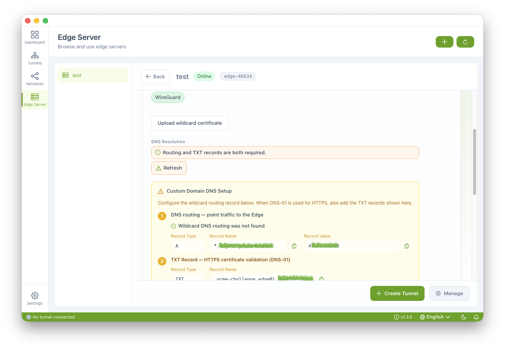

# 🌐 DNS Troubleshooting Guide

> Ensure that your DNS settings are correct so domain names can resolve normally. If you encounter DNS resolution issues, check your network connection and DNS configuration.

## 🔍 Common DNS Issue Diagnosis

### DNS Resolution Failure
- **Symptom**: The domain cannot be accessed, and the browser displays "DNS_PROBE_FINISHED_NXDOMAIN" or a similar error.
- **Possible causes**:
  - The DNS record is not configured correctly.
  - DNS propagation has not completed (usually takes 1–48 hours).
  - The local DNS cache is stale.
  - The DNS server is unavailable.

### DNS Verification Failure
- **Symptom**: The YAT console displays "DNS Verification Failed".
- **Possible causes**:
  - The CNAME record points to the wrong Edge address.
  - The DNS record TTL is too long, causing delayed updates.
  - The DNS provider blocks the request, or a firewall intercepts it.

## 🛠️ Troubleshooting Steps

### Step 1: Get the CNAME Record Value

#### Get the record value in the Edge console
1. Sign in to the YAT console → [Edge Management](./edge/management.md)
2. Locate your Edge server in the Edge list.
3. Click the **Manage** button or the Edge card to open the details page.
4. Find the CNAME record value in the **Domain Health** or **DNS Configuration** section.
5. Copy the displayed CNAME record value (usually in the format `xxx.edge.tunnel6.com`).

>  Edge console DNS configuration prompt
> Description: Shows the DNS configuration area in the Edge console, including the CNAME record type, name, value, and copy button.

#### Get the record value in the yat-fe client
1. Open the yat-fe client application.
2. Select **Tunnel Management** in the left navigation bar.
3. Locate the corresponding tunnel and open its details page.
4. Find the CNAME record value in the **Remote Addresses** or **Domain Configuration** section.
5. Click the copy button to copy the record value.

> 📸  yat-fe Client Tunnel Details
> Description: Shows the tunnel details page in the yat-fe client, including remote addresses, the CNAME record, and the copy button.

### Step 2: Check the DNS Record Configuration
1. Sign in to your DNS provider's console.
2. Confirm that the CNAME record has been added correctly.
3. Verify that the record value points to the correct Edge node address.

### Step 2: Verify DNS Propagation Status
Use the following commands to check whether DNS has taken effect:
```bash
# Check DNS resolution
nslookup your-domain.com

# Or use dig
dig your-domain.com CNAME +short
```

### Step 3: Configure the Tunnel Alias Domain

#### Configure the alias domain in the yat-fe client
1. Open the yat-fe client application.
2. Select **Tunnel Management** in the left navigation bar.
3. Click **+ Create Tunnel** in the upper-right corner.
4. Select the application type in the tunnel creation wizard (for example, HTTP).
5. Enter your custom domain in the **Domain Configuration** section (for example, `myapp.example.com`).
6. Save the configuration and start the tunnel.

> 📸  yat-fe Tunnel Creation Domain Configuration
> Description: Shows the tunnel creation wizard in the yat-fe client, including the domain input field and save button.

### Step 4: Clear the Local DNS Cache
```bash
# macOS
sudo dscacheutil -flushcache; sudo killall -HUP mDNSResponder

# Windows
ipconfig /flushdns

# Linux
sudo systemd-resolve --flush-caches
```

## 📚 Related Resources
- [DNS Record Configuration Guide](./custom-domains.md#dns-record-setup)
- [Custom Domain Configuration](./custom-domains.md)
- [Edge Management](./edge/management.md)

## ❓ FAQ

### Q: How long does DNS propagation take?
A: It usually takes 1–48 hours, depending on the TTL setting of the DNS record.

### Q: How can I speed up DNS propagation?
A: Set a short TTL (for example, 300 seconds) before configuring DNS. After the configuration is complete, you can restore a longer TTL.

### Q: Which DNS providers does YAT support?
A: YAT supports all major DNS providers, including Cloudflare, Alibaba Cloud DNS, Tencent Cloud DNS, GoDaddy, and Namecheap.

---
*Document last updated: 2026-05-04*
