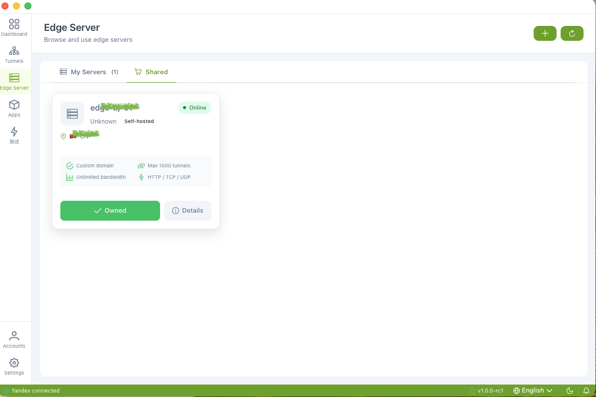

# Edge Marketplace and Sharing

> Subscribe to shared Edge nodes, or share one of your own with other devices.

---

## Subscribe to a shared Edge

1. Open **Edges** and select **Marketplace**.
2. Review the available nodes, owner, region, and status.
3. Choose an Edge that is close to your users.
4. Click **Subscribe** and confirm.

After subscribing, the Edge appears in **My Edges** and can be selected when you create a tunnel.

> 📸  Edge marketplace

## Unsubscribe

1. Open **My Edges**.
2. Find the shared Edge.
3. Click **Unsubscribe**.
4. Confirm the action.

Tunnels using that Edge stop immediately. Edit them with another Edge or recreate them to restore access.

## Share an Edge

Edge sharing is being developed. The planned workflow is:

- Choose which devices or users may subscribe.
- Set traffic or connection limits.
- Review usage statistics.
- Revoke access without redeploying the server.

Until sharing is available, use your own Edge on multiple devices in the same account.

## Choosing a shared Edge

| Factor | Recommendation |
|--------|----------------|
| Region | Pick a node close to your users or services |
| Bandwidth | Confirm the limit is sufficient for your workload |
| Availability | Prefer nodes with stable online history |
| Trust | Use an operator you know or an official node |

---

*YAT Team - Making intranet penetration simpler*
