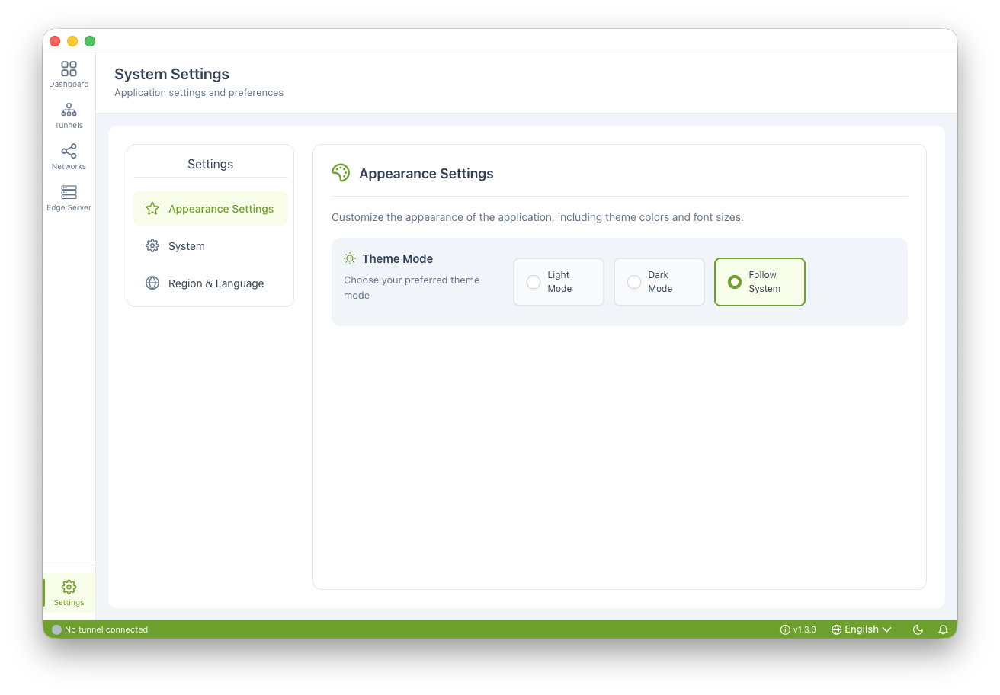

# Cuenta y ajustes

> Gestiona sesión, idioma, tema, datos locales y seguridad desde la página de ajustes del cliente.

## Cuenta

La cuenta se identifica con tu inicio de sesión de GitHub o Google. Para cerrar sesión:

1. Abre **Settings**.
2. Selecciona la sección de cuenta.
3. Pulsa **Sign out**.
4. Confirma la acción.

Al cerrar sesión se detienen los túneles locales; puedes volver a iniciarlos cuando vuelvas a entrar.

## Idioma y tema

| Ajuste | Opciones | Nota |
|--------|-----------|------|
| Idioma | Idiomas disponibles del cliente | Se aplica sin reiniciar |
| Tema | Claro, oscuro o automático | El modo automático sigue al sistema |
| Escala | Tamaños de interfaz | Útil en pantallas de alta densidad |

> 📸  Ajustes de tema e idioma

## Datos locales

YAT guarda configuración, estados y caché en el directorio de datos del usuario. Puedes:

- **Exportar configuración**: genera una copia de ajustes no secretos.
- **Borrar caché**: limpia datos temporales.
- **Restablecer cliente**: elimina configuración local y cierra la sesión.

El restablecimiento no elimina los recursos de la cuenta en el servidor.

## Seguridad

- Cierra sesión en dispositivos que ya no uses.
- Revisa la lista de dispositivos y roles en [Multidispositivo y roles](./multi-device-roles.md).
- No compartas archivos de configuración que contengan secretos.
- Si un Edge es compartido, confirma que confías en su operador.

## Problemas típicos

### La sesión no se guarda
Comprueba que el sistema permite almacenamiento local al cliente y que no hay restricciones de directiva o limpieza automática.

### El tema no cambia
Reinicia la aplicación y comprueba si el modo automático depende del ajuste del sistema operativo.

### El cliente no recuerda los ajustes
Evita borrar el directorio de datos al salir. Si el problema continúa, exporta la configuración y restablece el cliente.

## Recursos relacionados

- [Guía de inicio rápido](./quick-start.md)
- [Multidispositivo y roles](./multi-device-roles.md)
- [Preguntas frecuentes](./faq.md)

---
*Última actualización del documento: 2026-05-04*
