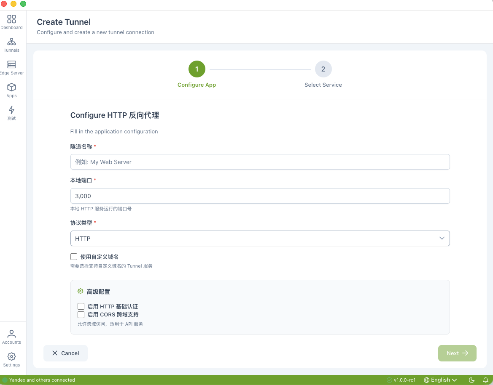
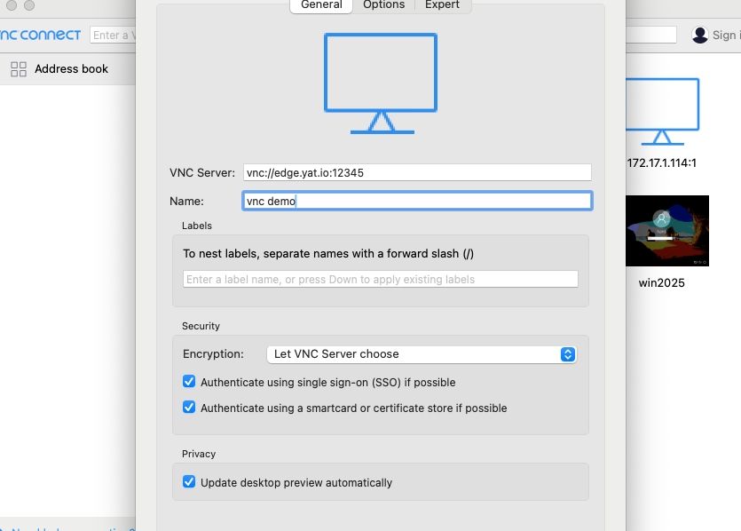

# Aplicaciones y extensiones

> Las aplicaciones integradas cubren HTTP, TCP y UDP. Las extensiones añaden flujos específicos, como el escritorio remoto ARD de macOS.

## Aplicaciones integradas

### HTTP Proxy
Publica servicios web con dominio y HTTPS. Configura el servicio local y, si hace falta, el dominio personalizado. Es la opción recomendada para sitios y APIs.

### TCP Forward
Reenvía un puerto remoto de Edge hacia un puerto local. Sirve para bases de datos, SSH, RDP y otros protocolos basados en conexión.

### UDP Forward
Reenvía datagramas UDP. Útil para juegos, DNS propio y sistemas multimedia.

## Extensiones

Las extensiones se ejecutan en el cliente y pueden:

- Registrar tipos de aplicación propios
- Añadir formularios de configuración
- Integrar herramientas externas
- Simplificar la gestión de roles y permisos

No pueden ejecutarse fuera del cliente ni cambiar la configuración global del sistema sin permiso explícito.

## Instalar

### Instalación local
1. Descarga o compila la extensión.
2. Copia el directorio `dist` en el directorio de extensiones de YAT.
3. Reinicia el cliente.
4. Abre **Extensions** y activa la extensión.

```bash
cp -R extension-dist ~/.local/share/yat/extensions/ard
```

### Verificar
Comprueba que la extensión aparece en la lista, que el estado es activo y que la aplicación que registra aparece al crear un túnel.

### Desinstalar
Detén los túneles que usan la extensión, elimina su directorio y reinicia el cliente.

## ARD Remote Desktop

ARD expone la función Screen Sharing de macOS a través de un túnel TCP.

### Requisitos

- macOS con Screen Sharing activado
- Extensión ARD instalada en el publicador
- Cliente VNC compatible en el equipo que se conecta
- Puerto TCP disponible

### Publicador
1. Instala y activa la extensión ARD.
2. Crea un túnel de tipo ARD.
3. Selecciona el servicio local de Screen Sharing.
4. Guarda e inicia el túnel.

### Consumidor
1. Copia la dirección remota del túnel.
2. Abre un cliente VNC o Screen Sharing.
3. Introduce la dirección remota.
4. Autentica con las credenciales del macOS remoto.

> 📸  Extensión HTTP
> 📸  Conexión ARD

### Si no conecta

```bash
# Comprobar el puerto local
lsof -i :5900

# Comprobar el puerto remoto
nc -zv your-edge-domain.com 5900
```

Confirma también que macOS permite Screen Sharing para el usuario.

## Desarrollo de extensiones

Flujo general:

1. Crea el proyecto con su manifiesto.
2. Implementa los formularios y la lógica local.
3. Compila a `dist`.
4. Copia el resultado al directorio de extensiones.
5. Reinicia YAT y prueba con un túnel nuevo.

Consulta `EXTENSION_DEVELOPER_GUIDE.md` para el formato del manifiesto y la API disponible.

## Preguntas frecuentes

### La extensión no aparece
Reinicia el cliente y comprueba que el directorio contiene el manifiesto y `dist`.

### ARD falla
Verifica Screen Sharing, puerto 5900, firewall y credenciales de macOS.

### ¿Las extensiones acceden a mis datos?
Solo pueden acceder a lo que declaren en el manifiesto y a lo que el usuario autorice en la configuración.

## Recursos relacionados

- [Gestión de túneles](./tunnel-management.md)
- [Modos de transporte](./transport-modes.md)
- [Multidispositivo y roles](./multi-device-roles.md)

---
*Última actualización del documento: 2026-05-04*
