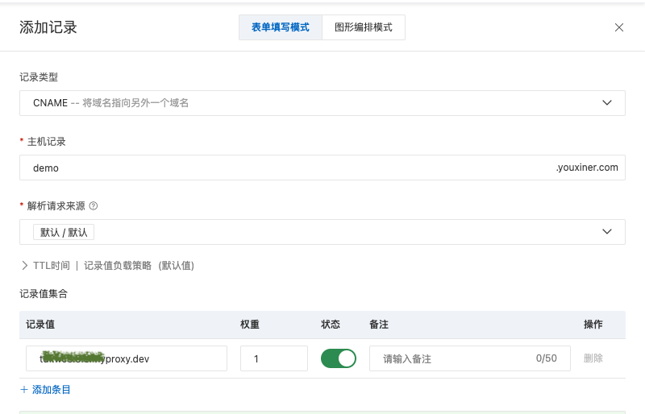
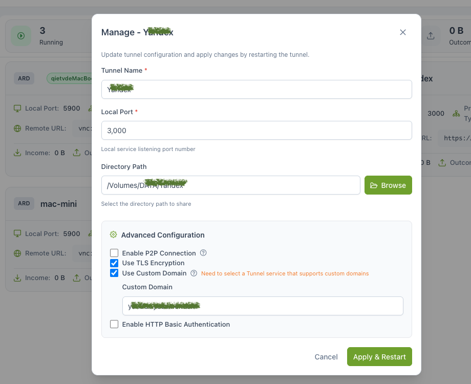

# Dominios personalizados

> Un dominio propio permite acceder a un túnel con tu nombre en lugar del dominio asignado por el sistema. YAT gestiona la verificación CNAME y el certificado HTTPS.

## Dominio asignado

Cada túnel recibe un nombre del tipo `abc123.edge.myroxy.dev`. Este dominio funciona sin configuración adicional y es útil para pruebas.

## Añadir un dominio propio

### 1. Prepara el dominio

Elige un subdominio del dominio que controles, por ejemplo `app.example.com`. Si el dominio lo gestiona otro equipo, solicita permiso para crear un CNAME.

### 2. Crea el CNAME

1. Abre la consola de tu proveedor DNS.
2. Crea un registro CNAME.
3. Usa el subdominio como nombre.
4. Usa el valor CNAME mostrado por YAT, por ejemplo `xxx.edge.tunnel6.com`.
5. Guarda un TTL corto, por ejemplo 300 segundos, durante la primera configuración.

### 3. Configura el dominio en YAT

1. Abre **Tunnel Management** en el cliente.
2. Edita el túnel.
3. En **Domain Configuration**, escribe `app.example.com`.
4. Guarda y reinicia el túnel.

### 4. Verifica el DNS

```bash
dig app.example.com CNAME +short
nslookup app.example.com
curl -I https://app.example.com
```

El CNAME debe devolver el valor de YAT y el certificado debe emitirse después de la propagación.

> 📸  Configuración del dominio
> 📸  Dominio y CNAME

## Certificados

YAT usa Let's Encrypt para emitir y renovar certificados automáticamente. El estado puede ser:

| Estado | Significado |
|--------|--------------|
| `Pending` | Esperando propagación o verificación DNS |
| `Issued` | Certificado activo |
| `Renewing` | Renovación en curso |
| `Failed` | Error de verificación, propagación o configuración |

Si necesitas forzar la renovación:

```bash
./edge certs renew --config config.yaml
```

## Comprobar el CNAME

El flujo normal es:

1. El cliente guarda el dominio del túnel.
2. Captain genera el valor CNAME del Edge.
3. El DNS público apunta el subdominio a Edge.
4. Edge verifica el CNAME y solicita el certificado.

Si la verificación falla:

```bash
# Esperar propagación y volver a probar
dig app.example.com CNAME +short

# Limpiar caché local
sudo dscacheutil -flushcache
sudo killall -HUP mDNSResponder
```

Confirma también que no exista un registro A en el mismo nombre; A y CNAME no pueden coexistir.

## Preguntas frecuentes

### ¿Puedo usar varios dominios en un túnel?
Depende del tipo de aplicación y de la configuración de canales. Para HTTP puedes añadir dominios adicionales si la aplicación local acepta los `Host` correspondientes.

### ¿Se admiten wildcard?
No se recomiendan para túneles normales. Cada dominio debe poder verificarse y emitir su propio certificado.

### ¿El dominio cambia si cambio de Edge?
Sí. El CNAME apunta a un Edge concreto, así que al migrar debes actualizar el registro DNS al nuevo valor.

## Recursos relacionados

- [Diagnóstico de DNS](./dns-troubleshooting.md)
- [Gestión de certificados](./certificate-management.md)
- [Gestión de Edge](./edge/management.md)

---
*Última actualización del documento: 2026-05-04*
