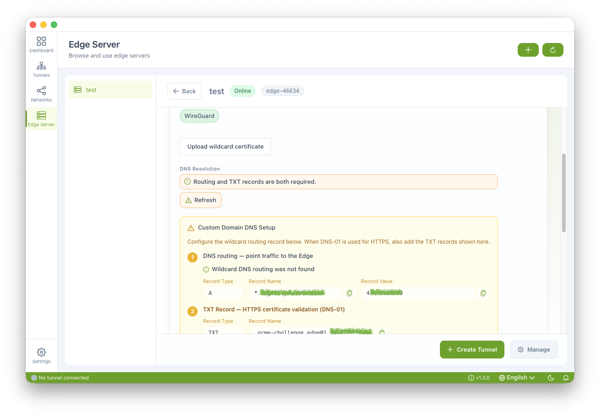

# 🌐 Guía de diagnóstico de DNS

> Comprueba que los registros DNS estén correctamente publicados. Si un dominio no resuelve, revisa primero la red y después la configuración DNS.

## 🔍 Diagnóstico

### Error de resolución DNS
- **Síntoma**: el dominio no se abre y el navegador muestra `DNS_PROBE_FINISHED_NXDOMAIN` o un error similar.
- **Causas posibles**:
  - El registro DNS no está configurado correctamente.
  - La propagación DNS aún no ha terminado (normalmente entre 1 y 48 horas).
  - La caché DNS local está desactualizada.
  - El servidor DNS no está disponible.

### Fallo de verificación DNS
- **Síntoma**: la consola de YAT muestra `DNS Verification Failed`.
- **Causas posibles**:
  - El registro CNAME apunta a una dirección de Edge incorrecta.
  - El TTL del registro es demasiado largo y retrasa la actualización.
  - El proveedor DNS bloquea la solicitud o un firewall la intercepta.

## 🛠️ Pasos

### Paso 1: obtén el valor del CNAME

#### Desde la consola de Edge
1. Inicia sesión en la consola de YAT → [Gestión de Edge](./edge/management.md)
2. Busca tu servidor Edge en la lista.
3. Abre la página de detalles desde el botón **Manage** o desde la tarjeta.
4. Copia el valor del CNAME en **Domain Health** o **DNS Configuration**.
5. El valor suele tener el formato `xxx.edge.tunnel6.com`.

>  Configuración DNS en la consola de Edge
> Descripción: área de configuración DNS con tipo de registro, nombre, valor y botón de copia.

#### Desde el cliente yat-fe
1. Abre la aplicación yat-fe.
2. Selecciona **Tunnel Management** en la navegación izquierda.
3. Abre los detalles del túnel correspondiente.
4. Busca el valor del CNAME en **Remote Addresses** o **Domain Configuration**.
5. Usa el botón de copia.

> 📸  Detalles del túnel en yat-fe
> Descripción: direcciones remotas, registro CNAME y botón de copia.

### Paso 2: revisa el registro
1. Entra en la consola de tu proveedor DNS.
2. Confirma que el CNAME existe y está escrito correctamente.
3. Verifica que apunta al nodo Edge correcto.

### Paso 3: comprueba la propagación
```bash
# Comprobar la resolución
nslookup your-domain.com

# Alternativa con dig
dig your-domain.com CNAME +short
```

### Paso 4: configura un dominio alias

#### En el cliente yat-fe
1. Abre la aplicación yat-fe.
2. Selecciona **Tunnel Management**.
3. Pulsa **+ Create Tunnel**.
4. Elige el tipo de aplicación, por ejemplo HTTP.
5. Escribe tu dominio en **Domain Configuration**, por ejemplo `myapp.example.com`.
6. Guarda e inicia el túnel.

> 📸  Configuración de dominio al crear un túnel
> Descripción: asistente de creación con campo de dominio y botón de guardado.

### Paso 5: limpia la caché DNS local
```bash
# macOS
sudo dscacheutil -flushcache; sudo killall -HUP mDNSResponder

# Windows
ipconfig /flushdns

# Linux
sudo systemd-resolve --flush-caches
```

## 📚 Recursos relacionados
- [Configuración de registros DNS](./custom-domains.md#dns-record-setup)
- [Dominios personalizados](./custom-domains.md)
- [Gestión de Edge](./edge/management.md)

## ❓ Preguntas frecuentes

### ¿Cuánto tarda la propagación DNS?
Normalmente entre 1 y 48 horas, según el TTL del registro.

### ¿Cómo acelerarla?
Configura un TTL corto, por ejemplo 300 segundos, antes de cambiar el DNS. Cuando la configuración sea estable, puedes aumentarlo de nuevo.

### ¿Qué proveedores DNS son compatibles?
YAT funciona con los proveedores habituales, incluidos Cloudflare, Alibaba Cloud DNS, Tencent Cloud DNS, GoDaddy y Namecheap.

---
*Última actualización del documento: 2026-05-04*
