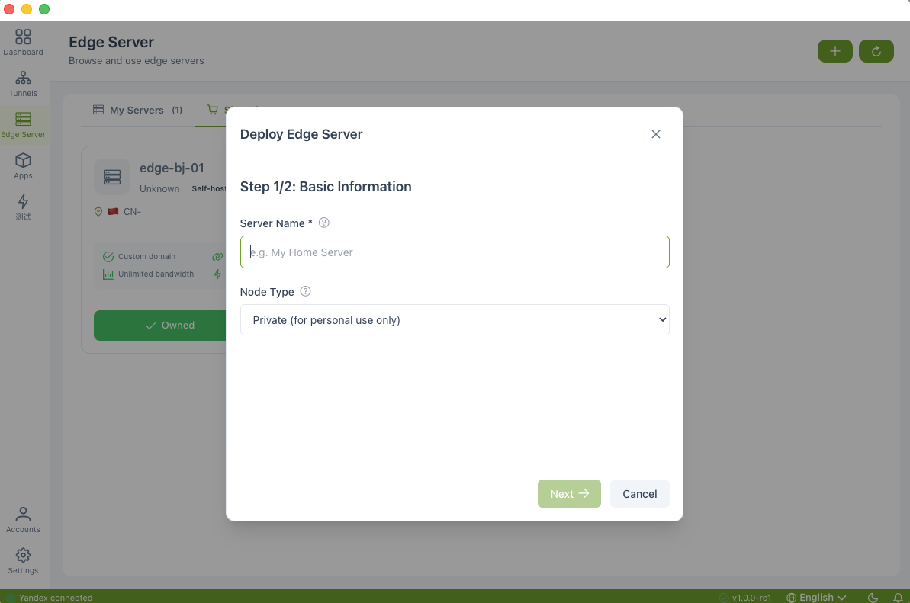
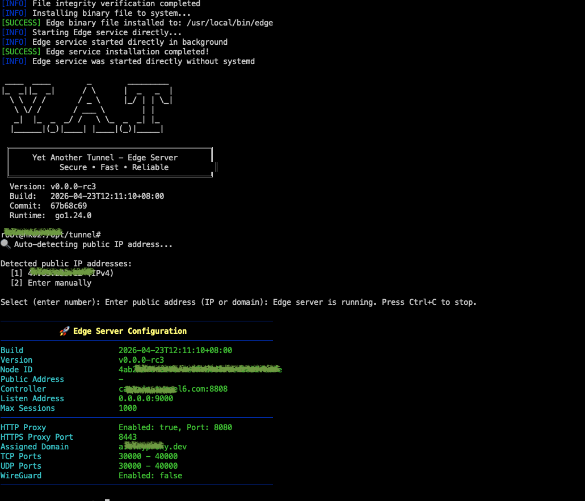

# Desplegar un servidor Edge

> El cliente puede generar un script de despliegue con el secreto de registro incluido. También puedes instalar Edge manualmente en un servidor con IP pública.

## Requisitos

- Linux x86_64 o ARM64
- IP pública y puerto accesible
- 2 vCPU y 2 GB de RAM recomendados
- Docker u otro runtime si prefieres contenedor
- Nombre de dominio para HTTPS y WireGuard

## Despliegue con script

1. Abre **Edges** en el cliente.
2. Pulsa **Add Edge** o **Deploy Edge**.
3. Rellena la dirección pública y la región.
4. Genera el script.
5. Copia el comando al servidor.
6. Ejecútalo y espera a que el nodo aparezca como Online.

El script descarga el binario, crea el directorio de datos, registra el nodo y crea un servicio systemd.

> 📸  Generación del script
> 📸  Ejecución del despliegue

## Despliegue manual

```bash
# Crear usuario y directorios
sudo useradd --system --home /var/lib/yat-edge --shell /usr/sbin/nologin yat-edge
sudo mkdir -p /var/lib/yat-edge /etc/yat-edge
sudo chown -R yat-edge:yat-edge /var/lib/yat-edge

# Descargar e instalar
curl -fL https://example.com/edge-linux-amd64 -o ./edge
chmod +x ./edge
sudo mv ./edge /usr/local/bin/edge
```

Crea `/etc/yat-edge/config.yaml` con la dirección pública, dominio y puertos. Después registra el nodo con el secreto generado por la consola.

## Servicio systemd

```ini
[Unit]
Description=YAT Edge
After=network-online.target

[Service]
User=yat-edge
ExecStart=/usr/local/bin/edge server start --config /etc/yat-edge/config.yaml
Restart=always
RestartSec=5
LimitNOFILE=65535

[Install]
WantedBy=multi-user.target
```

```bash
sudo systemctl daemon-reload
sudo systemctl enable --now yat-edge
```

## Verificación

```bash
systemctl status yat-edge
journalctl -u yat-edge -f
./edge server status
curl -I https://your-edge-domain.com
```

En la consola, comprueba que el estado es Online y que el dominio está verificado.

## Firewall

Abre los puertos configurados, por ejemplo:

```bash
sudo ufw allow 443/tcp
sudo ufw allow 80/tcp
sudo ufw allow 51820/udp
```

## Recursos relacionados

- [Gestión de Edge](./management.md)
- [Configuración de WireGuard](./wireguard.md)
- [Referencia de configuración](./config-reference.md)

---
*YAT Team*
