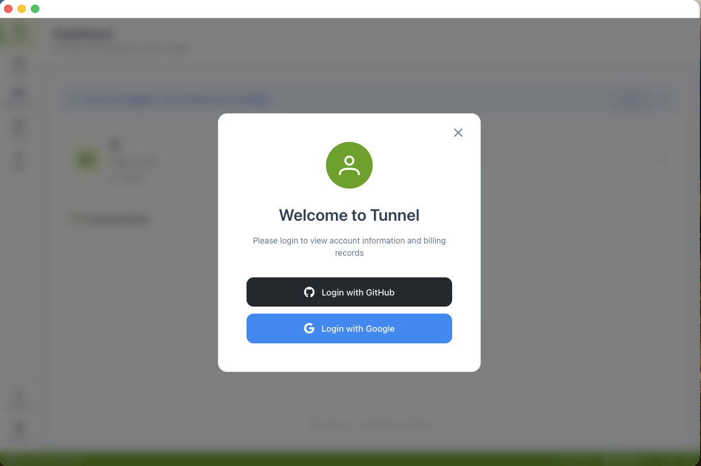
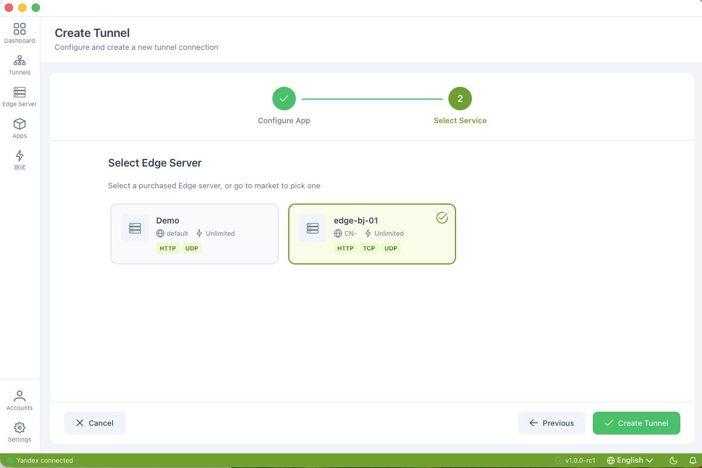
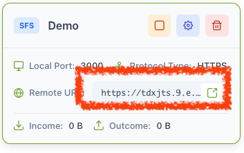

# Guía de inicio rápido

> En cinco minutos puedes instalar YAT, iniciar sesión, suscribirte a un Edge y publicar tu primer servicio local.

## Requisitos

- macOS 10.15 o posterior, Windows 10 o posterior, o Linux.
- Conexión a internet.
- Cuenta de YAT, con inicio de sesión por GitHub o Google.
- Un servicio local que quieras exponer, por ejemplo un servidor HTTP.

## Paso 1: instala el cliente

### macOS
1. Descarga el paquete `.dmg`.
2. Abre el paquete y arrastra YAT a **Applications**.
3. Inicia YAT desde Launchpad o la carpeta Aplicaciones.

> ⚠️ Si macOS avisa de que no puede verificar el desarrollador, abre **Ajustes del sistema → Privacidad y seguridad → Abrir igualmente**.

### Windows
1. Descarga el instalador `.exe`.
2. Ejecuta el asistente de instalación.
3. Inicia YAT cuando termine.

### Linux
```bash
chmod +x yat-*.AppImage
./yat-*.AppImage
```

Si la aplicación se abre y muestra la pantalla de inicio de sesión, la instalación es correcta.

> 📸  Interfaz principal de YAT en el primer inicio

## Paso 2: inicia sesión

1. Abre YAT.
2. Elige **GitHub** o **Google**.
3. Autoriza el acceso en el navegador.
4. Vuelve al cliente; la sesión se guarda para el siguiente inicio.

Si el navegador no se abre automáticamente, copia el enlace que muestra YAT y ábrelo manualmente.

## Paso 3: suscríbete a un Edge

Un Edge es el punto público por el que entra el tráfico. La cuenta puede usar nodos oficiales, nodos compartidos por otros dispositivos o tu propio servidor.

1. Abre la página **Edges**.
2. Busca un Edge oficial cercano o un Edge compartido.
3. Pulsa **Subscribe**.
4. Comprueba que el nodo aparece como disponible.

> 📸  Página de Edge disponibles

## Paso 4: crea el primer túnel

Para la prueba, puedes usar un servidor HTTP local:

```bash
# Python
python3 -m http.server 3000

# Node.js
npx serve -l 3000 .
```

Después crea el túnel:

1. Entra en **Tunnels**.
2. Pulsa **+ Create Tunnel**.
3. Selecciona **HTTP Proxy**.
4. Elige el Edge suscrito.
5. Configura la dirección local como `127.0.0.1:3000`.
6. Guarda el túnel.

> 📸  Selección de aplicación
> 📸  Configuración del proxy HTTP
> 📸  Confirmación de creación

## Paso 5: arranca y prueba el túnel

1. Abre el túnel.
2. Pulsa **Start** y espera a que el estado sea `Running`.
3. Copia la dirección remota, con formato similar a `abc123.edge.myroxy.dev`.
4. Ábrela en un navegador.

Si ves el contenido del servidor local, el túnel funciona.

> 📸  Proceso de arranque
> 📸  Acceso desde el navegador

## Lista de comprobación

| Paso | Resultado esperado |
|------|--------------------|
| Cliente instalado | La aplicación se abre |
| Sesión iniciada | Aparece tu cuenta |
| Edge suscrito | El nodo está disponible |
| Túnel creado | Estado `Created` o `Stopped` |
| Túnel iniciado | Estado `Running` |
| Acceso remoto | El navegador muestra el servicio local |

## Problemas típicos

### No hay Edge disponible
Suscríbete primero a un Edge oficial o compartido. Si usas un servidor propio, confirma que está registrado y en línea.

### El túnel no arranca
Comprueba que el servicio local está activo, que el puerto no está ocupado y que la dirección local es correcta.

### La dirección remota no se abre
Revisa el estado del túnel, espera unos segundos tras el arranque y vuelve a copiar la dirección remota.

## Siguientes pasos

- [Gestión de túneles](./tunnel-management.md)
- [Aplicaciones y extensiones](./apps-and-extensions.md)
- [Dominios personalizados](./custom-domains.md)
- [Modos de transporte](./transport-modes.md)

---
*YAT Team*
