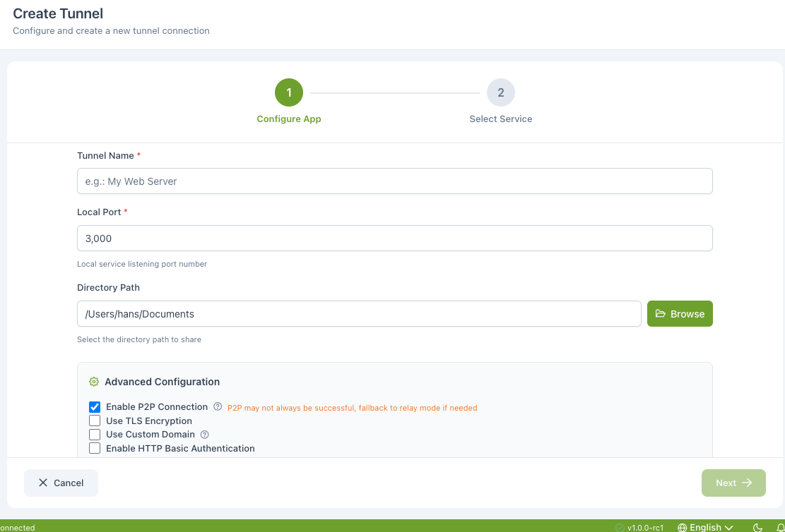
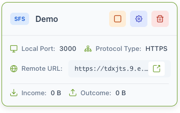
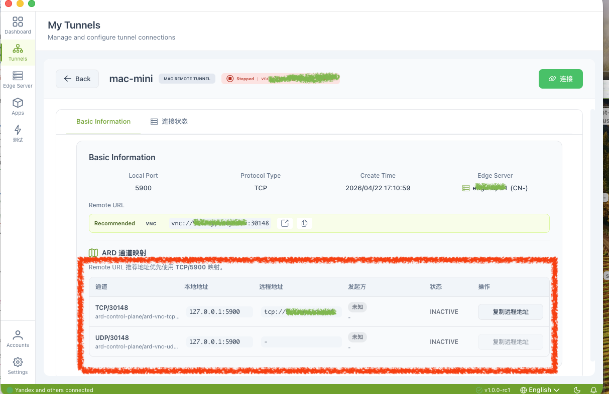

# Gestión de túneles

> Un túnel vincula un servicio local con un dominio o puerto en Edge. Desde la lista de túneles puedes crear, iniciar, detener, compartir y eliminar cada túnel.

## Conceptos

| Estado | Significado |
|--------|-------------|
| `Created` | El túnel existe pero no está en ejecución |
| `Starting` | Estableciendo conexión con Edge |
| `Running` | El túnel acepta tráfico |
| `Stopped` | Detenido manualmente o por error |
| `Error` | Revisa el mensaje de estado y los registros |

Tipos de aplicación:

| Tipo | Uso |
|------|-----|
| HTTP Proxy | Servicios web y APIs |
| TCP Forward | Bases de datos, SSH, RDP y protocolos binarios |
| UDP Forward | Juegos, DNS propio y multimedia |
| ARD | Escritorio remoto de macOS mediante extensión |

## Crear un túnel

1. Abre **Tunnels**.
2. Pulsa **+ Create Tunnel**.
3. Elige el tipo de aplicación.
4. Selecciona el Edge.
5. Configura dominio o puerto remoto y dirección local.
6. Guarda la configuración.

También puedes crear un túnel desde la página **Edges**, seleccionando el Edge y pulsando **Create Tunnel**.

> 📸  Selección de aplicación
> 📸  Configuración HTTP

## Iniciar y detener

- **Start**: conecta el cliente con Edge y habilita la entrada pública.
- **Stop**: cierra la conexión activa y desactiva la entrada.
- **Restart**: útil después de cambiar dominio, puerto o modo de transporte.

> 📸  Arranque del túnel

## Detalles

La página de detalles muestra:

- Estado y Edge asignado
- Direcciones remotas y dominio
- Canales y modos de transporte
- Estadísticas de tráfico
- Registros recientes
- Permisos de colaboración

> 📸  Información básica
> 📸  Direcciones remotas
> 📸  Canales

## Compartir

| Modo | Efecto |
|------|--------|
| Private | Solo el propietario puede gestionar y usar el túnel |
| Team | Usuarios o dispositivos con permiso pueden gestionarlo |
| Shared | Otros pueden acceder al servicio, sin permisos de administración |

Para cambiar el modo, entra en la pestaña de colaboración del túnel, elige los dispositivos o usuarios y guarda los permisos.

## Eliminar

Antes de eliminar:

1. Detén el túnel.
2. Confirma que nadie lo esté usando.
3. Guarda el dominio o la configuración si planeas recrearlo.
4. Pulsa **Delete** y confirma.

La eliminación libera el dominio asignado y los canales en Edge.

## Estadísticas

La lista muestra tráfico y estado por túnel. En los detalles puedes consultar:

- Bytes enviados y recibidos
- Conexiones activas
- Latencia y pérdida de paquetes
- Uso por canal

> 📸  Tarjetas de estadísticas

## Problemas frecuentes

### Puerto ocupado
```bash
# macOS / Linux
lsof -i :3000

# Windows
netstat -ano | findstr :3000
```
Cambia el puerto local o detén el proceso que lo ocupa.

### El túnel se detiene justo después de arrancar
Comprueba que el servicio local responde, que el puerto remoto no está en uso y que el Edge está en línea.

### Ver registros
Abre los detalles del túnel o consulta los registros del cliente en la página de diagnóstico.

### Migrar entre Edges
Los túneles se pueden recrear en otro Edge, pero la dirección remota cambia. Actualiza el DNS si usas un dominio propio.

## Buenas prácticas

- Usa nombres que describan servicio y entorno.
- Prefiere `127.0.0.1` como dirección local.
- Reinicia el túnel tras cambiar dominios o certificados.
- Revisa permisos antes de compartir.

## Recursos relacionados

- [Guía de inicio rápido](./quick-start.md)
- [Gestión de Edge](./edge/management.md)
- [Aplicaciones y extensiones](./apps-and-extensions.md)
- [Modos de transporte](./transport-modes.md)

---
*Última actualización del documento: 2026-05-04*
