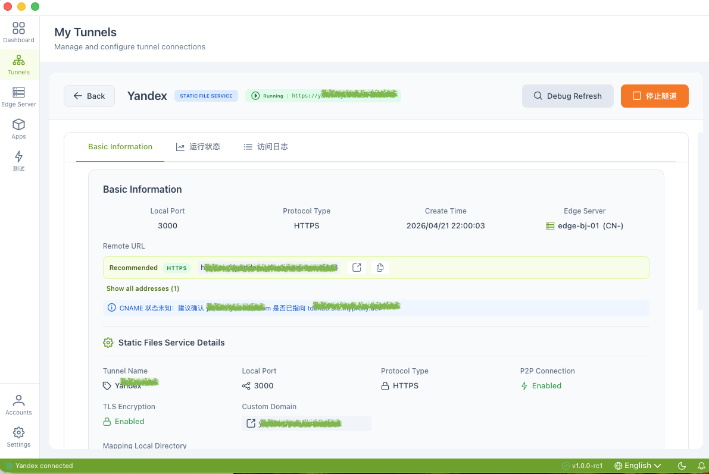
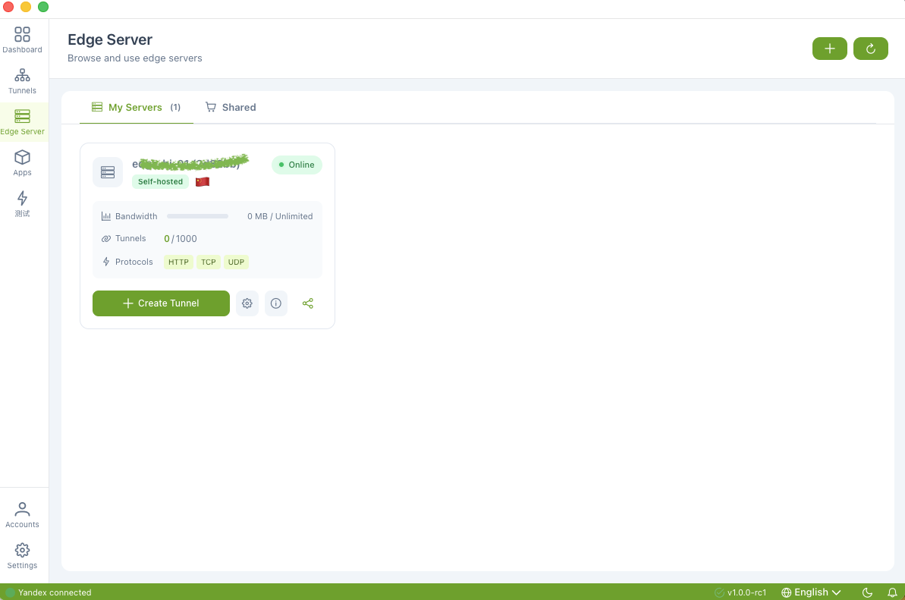

# Qué es YAT

> YAT expone servicios de una red privada a través de un Edge público, sin abrir puertos en el router ni exponer la máquina interna.

## Qué resuelve

El NAS, una base de datos, un entorno de desarrollo o un servicio de escritorio remoto suelen estar dentro de una red privada. Con YAT, el cliente local mantiene una conexión autenticada con un Edge público; el tráfico externo entra por Edge y llega al servicio interno a través de esa conexión.

```
visitante → Edge → conexión autenticada → servicio interno
```

## Funciones principales

| Función | Para qué sirve |
|---------|----------------|
| Túneles HTTP, TCP y UDP | Publicar servicios web, TCP y UDP |
| Red Edge | Elegir entre nodos oficiales, propios o compartidos |
| WireGuard | Construir una LAN virtual entre dispositivos |
| Extensiones | Añadir capacidades como ARD y compartir escritorio |
| Multidispositivo | Gestionar roles y colaboración entre equipos |
| Dominios y certificados | Usar tu dominio con HTTPS administrado |

## Conceptos básicos

### Túnel
Un túnel asocia un servicio local con un dominio o puerto remoto en un Edge. Define la aplicación, la dirección local y el modo de transporte.

### Canal
Un canal es una unidad de reenvío dentro del túnel. Un túnel HTTP, TCP o UDP puede tener varios canales según la configuración.

### Edge
Edge es la entrada pública. Escucha los puertos, enruta el tráfico al túnel correcto, gestiona certificados y notifica su estado a la consola.

### Extensión
Las extensiones añaden aplicaciones y flujos de trabajo al cliente. ARD, por ejemplo, convierte el reenvío de puertos en una experiencia de escritorio remoto.

## Arquitectura

| Componente | Rol |
|------------|-----|
| `yat-fe` | Cliente de escritorio donde se configuran túneles, Edge y extensiones |
| `Edge` | Nodo público que recibe tráfico y lo reenvía al cliente autenticado |
| `Captain` | Control plane: identidades, autorizaciones, nodos y estado |
| Extensiones | Módulos locales que aportan funciones adicionales |

El canal de control y el canal de datos usan identidad y cifrado. La confianza no depende de que una IP sea fija.

## Comparación con herramientas tradicionales

| Herramienta | Enfoque | Diferencia con YAT |
|-------------|---------|---------------------|
| Port forwarding | Configuración del router | YAT no requiere abrir puertos en la red interna |
| VPN tradicional | Red completa | YAT publica servicios concretos y controla dominios por túnel |
| Reverse proxy manual | Servidor y DNS propios | YAT gestiona Edge, certificados y estado |
| Port mapping en la nube | Infraestructura adicional | YAT puede usar nodos oficiales o un Edge propio |

## Casos de uso

### Personal
- Acceder al NAS desde fuera de casa.
- Compartir un proyecto web sin desplegarlo.
- Usar escritorio remoto sin exponer puertos.

### Equipos
- Compartir un entorno de pruebas con varias personas.
- Gestionar dispositivos y roles desde la misma cuenta.
- Publicar servicios internos con dominios propios.

### Desarrollo
- Probar webhooks hacia un servidor local.
- Conectar herramientas locales a servicios remotos.
- Mantener entornos reproducibles sin red pública.

## Seguridad

- **mTLS**: cliente y servidor se autentican mutuamente.
- **Certificados**: Let's Encrypt emite y renueva HTTPS.
- **Control de acceso**: cada túnel, dominio y dispositivo tiene permisos explícitos.
- **Aislamiento**: el servicio interno no necesita escuchar en `0.0.0.0`.

## Capturas

>  Lista de túneles
>  Detalles de un túnel
>  Gestión de Edge

## Siguientes pasos

- [Guía de inicio rápido](./quick-start.md)
- [Gestión de túneles](./tunnel-management.md)
- [Gestión de Edge](./edge/management.md)
- [Preguntas frecuentes](./faq.md)

---
*YAT Team - Hacer más simple el acceso a redes privadas*
