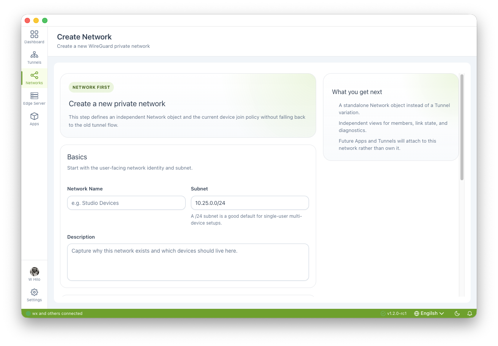
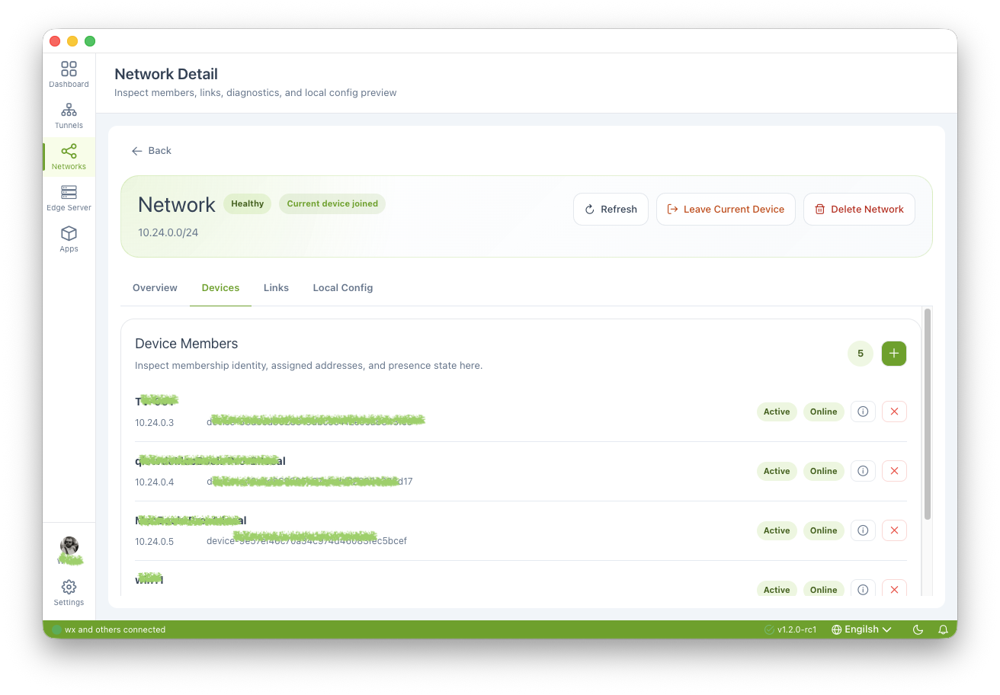
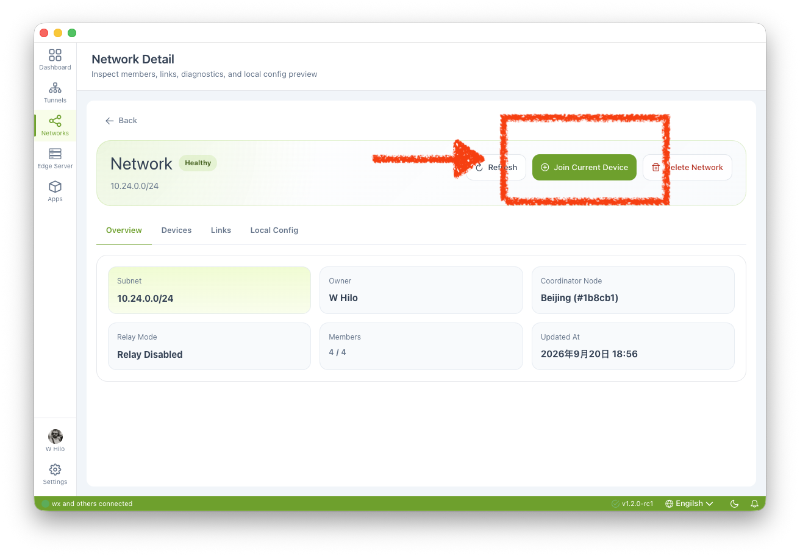
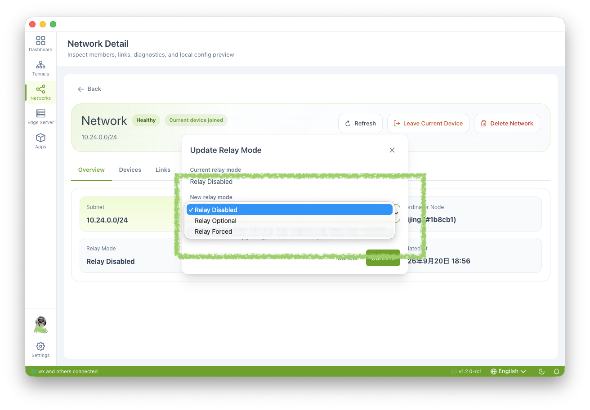

# Redes WireGuard

> WireGuard crea una LAN virtual cifrada. Cada dispositivo obtiene una dirección dentro de la red y puede comunicarse directamente con los demás miembros.

## Cuándo usarlo

| Necesidad | WireGuard | Tuneles HTTP/TCP/UDP |
|-----------|-----------|----------------------|
| Acceder a un único servicio | Normalmente no | Sí |
| Conectar varios servicios privados | Sí | Puede ser incómodo |
| Comunicación bidireccional | Sí | No |
| Misma IP interna en todos los servicios | Sí | No |

## Requisitos

- Edge con WireGuard habilitado
- Kernel con soporte de WireGuard y reenvío IP
- Cliente YAT conectado
- Firewall que permita la interfaz `wg-yat0-*`
- Puerto UDP del Edge accesible

## Crear una red

1. Abre **WireGuard Networks** o la sección correspondiente del cliente.
2. Pulsa **Create Network**.
3. Asigna un nombre y una subred, por ejemplo `100.64.0.0/24`.
4. Elige el Edge.
5. Guarda y espera a que Edge cree la interfaz.

> 📸  Creación de red

## Añadir miembros

1. Abre la red.
2. Añade el dispositivo local.
3. Invita o registra el dispositivo remoto.
4. Comprueba que ambos miembros aparecen en línea y con IP asignada.

> 📸  Lista de miembros
> 📸  Unir un dispositivo local

## Pruebas

```bash
# Ver la interfaz
ip addr show wg-yat0-xxx

# Ping entre miembros
ping 100.64.0.2

# Probar un puerto
nc -zv 100.64.0.2 5432
```

## Modos de retransmisión

| Modo | Comportamiento | Uso |
|------|----------------|-----|
| Relay | Edge reenvía todo el tráfico | Compatible con cualquier NAT |
| Direct | Intenta conectar miembros directamente | Menor latencia cuando la red lo permite |

Si Direct falla, cambia a Relay y verifica la conectividad. Después puedes volver a probar Direct.

> 📸  Modo de retransmisión

## Diagnóstico

### Interfaz sin IP
Comprueba que el cliente está conectado y que el miembro está registrado en la red.

### Un miembro está offline
Revisa el estado de YAT, la conexión con Edge y el puerto UDP.

### Ping no funciona
En Edge:

```bash
sysctl net.ipv4.ip_forward
nft list ruleset | grep wg-yat0
```

El reenvío debe estar activo y las reglas deben aceptar la interfaz.

### Puerto no responde
Si el ping funciona, el problema suele estar en el servicio local o su firewall, no en WireGuard.

## Integración con Edge

Edge administra la interfaz, asigna IPs y aplica reglas de reenvío. Para requisitos y problemas de kernel, Docker o nftables, consulta [Configuración de Edge WireGuard](./edge/wireguard.md).

## Recursos relacionados

- [Configuración de Edge WireGuard](./edge/wireguard.md)
- [Modos de transporte](./transport-modes.md)
- [Diagnóstico de conexiones](./connection-troubleshooting.md)

---
*Última actualización del documento: 2026-05-04*
