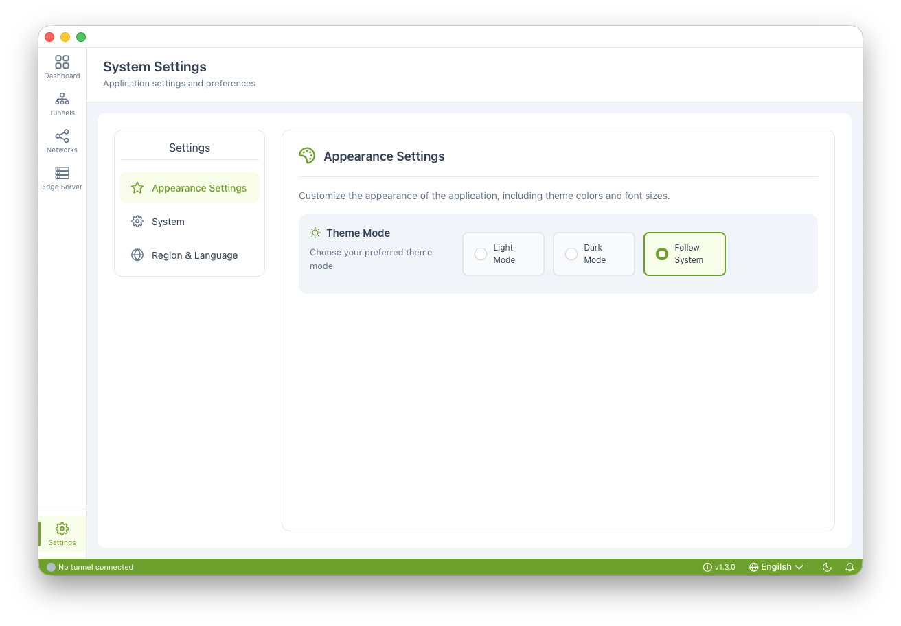

# アカウントと設定

> サインイン状態、言語、テーマ、ローカルデータ、セキュリティはクライアントの設定画面で管理します。

## アカウント

アカウントは GitHub または Google のサインインで識別されます。サインアウトするには：

1. **Settings** を開きます。
2. アカウント項目を選択します。
3. **Sign out** をクリックします。
4. 確認します。

サインアウトするとローカルトンネルも停止します。再サインイン後に再開できます。

## 言語とテーマ

| 設定 | 選択肢 | 備考 |
|------|--------|------|
| 言語 | クライアントが対応する言語 | 再起動不要 |
| テーマ | ライト、ダーク、自動 | 自動は OS 設定に追従 |
| 表示スケール | 複数サイズ | 高解像度画面で有効 |

> 📸  テーマと言語の設定

## ローカルデータ

YAT は設定、状態、キャッシュをユーザーのデータディレクトリに保存します。

- **設定のエクスポート**：秘密情報を含まない設定のコピーを作成
- **キャッシュの削除**：一時データを整理
- **クライアントのリセット**：ローカル設定を削除しサインアウト

リセットしてもサーバー側のアカウントリソースは削除されません。

## セキュリティ

- 使用しなくなったデバイスではサインアウトする
- [マルチデバイスとロール](./multi-device-roles.md) でデバイスと権限を確認する
- 秘密情報を含む設定ファイルを共有しない
- 共有 Edge を使う場合は運用者を確認する

## よくある問題

### サインインが保持されない
クライアントのローカル保存が許可されているか、ポリシーや自動クリーンアップの影響がないか確認してください。

### テーマが変わらない
アプリを再起動してください。自動モードは OS の外観設定に依存します。

### 設定が保存されない
終了時にデータディレクトリが削除されていないか確認してください。改善しない場合は設定をエクスポートしてからリセットします。

## 関連資料

- [クイックスタート](./quick-start.md)
- [マルチデバイスとロール](./multi-device-roles.md)
- [FAQ](./faq.md)

---
*最終更新日：2026-05-04*
