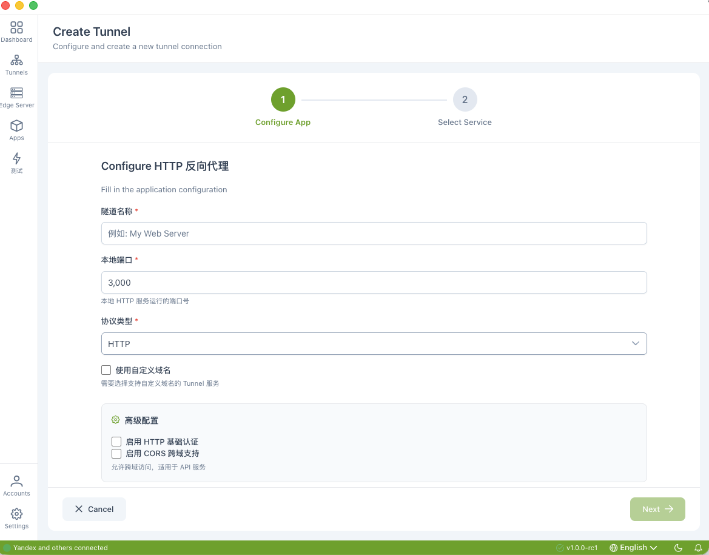
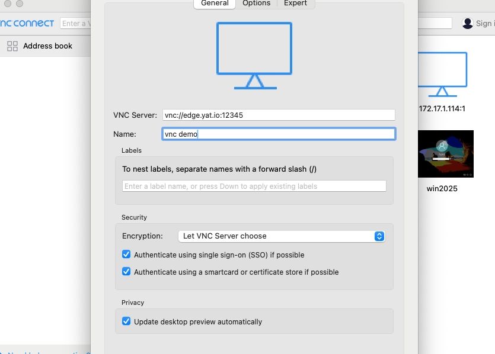

# アプリと拡張機能

> 内蔵アプリは HTTP、TCP、UDP を扱います。拡張機能は macOS の ARD リモートデスクトップなど、特定の操作フローを追加します。

## 内蔵アプリ

### HTTP Proxy
ドメインと HTTPS を使って Web サービスを公開します。サイトや API に推奨されるモードです。

### TCP Forward
Edge の公開ポートをローカルポートへ転送します。データベース、SSH、RDP、接続型プロトコルに適しています。

### UDP Forward
UDP データグラムを転送します。ゲーム、自前 DNS、マルチメディアで利用できます。

## 拡張機能

拡張機能はクライアント内で動作し、次のような機能を追加できます。

- 独自アプリ種別の登録
- 設定フォームの追加
- 外部ツールとの連携
- ロールと権限の操作簡略化

クライアント外での実行や、明示的な権限なしでのシステム全体設定変更はできません。

## インストール

1. 拡張機能をダウンロードまたはビルドします。
2. `dist` ディレクトリを YAT の拡張機能ディレクトリへコピーします。
3. クライアントを再起動します。
4. **Extensions** で有効化します。

```bash
cp -R extension-dist ~/.local/share/yat/extensions/ard
```

一覧に表示され、トンネル作成時にアプリ種別が現れれば成功です。

不要になった場合は、関連トンネルを停止してディレクトリを削除し、クライアントを再起動してください。

## ARD リモートデスクトップ

ARD は macOS の Screen Sharing を TCP トンネル経由で利用しやすくします。

### 前提条件

- Screen Sharing が有効な macOS
- 公開側に ARD 拡張機能
- 接続側に互換 VNC クライアント
- 利用可能な TCP ポート

### 公開側
1. ARD 拡張機能を有効化します。
2. ARD 種別のトンネルを作成します。
3. ローカルの Screen Sharing サービスを指定します。
4. 保存して起動します。

### 接続側
1. リモートアドレスをコピーします。
2. VNC クライアントまたは Screen Sharing を開きます。
3. リモートアドレスを入力します。
4. macOS の認証情報でログインします。

> 📸  HTTP 拡張機能
> 📸  ARD 接続

接続できない場合は次を確認してください。

```bash
lsof -i :5900
nc -zv your-edge-domain.com 5900
```

## 拡張機能開発

基本フロー：

1. マニフェストを含むプロジェクトを作成
2. フォームとローカルロジックを実装
3. `dist` へビルド
4. 拡張機能ディレクトリへコピー
5. YAT を再起動してトンネルを作成しテスト

詳細は `EXTENSION_DEVELOPER_GUIDE.md` を参照してください。

## FAQ

### 拡張機能が表示されない
クライアントを再起動し、ディレクトリにマニフェストと `dist` があるか確認してください。

### ARD が接続できない
Screen Sharing、ポート 5900、ファイアウォール、macOS の認証情報を確認してください。

### 拡張機能はデータにアクセスできますか？
マニフェストで宣言し、ユーザーが許可した範囲のみアクセスできます。

## 関連資料

- [トンネル管理](./tunnel-management.md)
- [トランスポートモード](./transport-modes.md)
- [マルチデバイスとロール](./multi-device-roles.md)

---
*最終更新日：2026-05-04*
