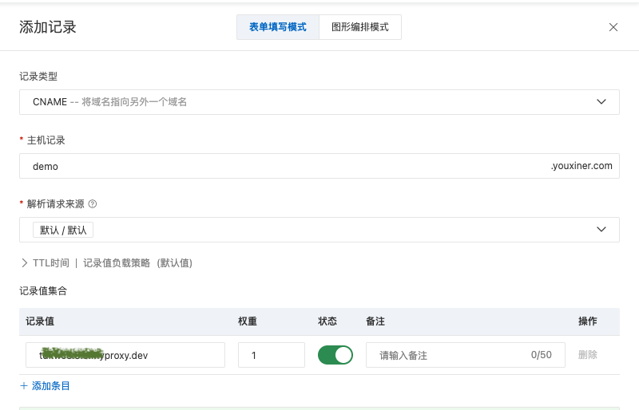
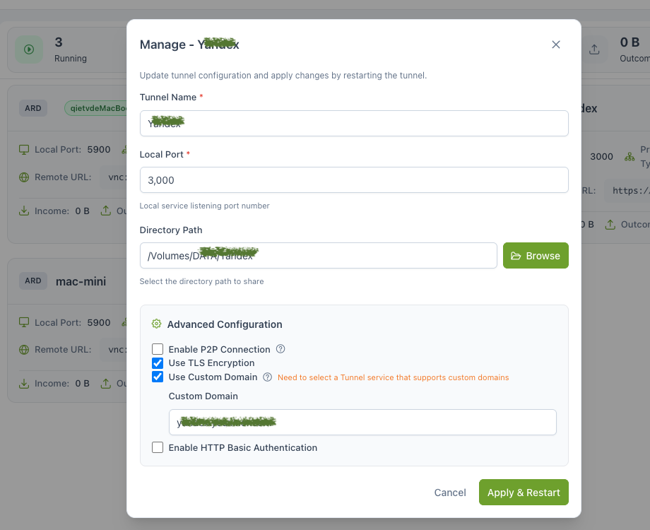

# カスタムドメイン

> 独自ドメインを使うと、システム割り当てのアドレスではなく自分の名前でトンネルにアクセスできます。YAT は CNAME 検証と HTTPS 証明書を管理します。

## システム割り当てドメイン

各トンネルには `abc123.edge.myroxy.dev` のようなドメインが割り当てられます。追加設定なしで利用でき、テストに便利です。

## 独自ドメインの設定

### 1. ドメインを準備

管理しているドメインのサブドメイン（例：`app.example.com`）を選びます。別チームが DNS を管理している場合は、CNAME 追加の権限を確認してください。

### 2. CNAME を作成

1. DNS プロバイダーのコンソールを開きます。
2. CNAME レコードを作成します。
3. 名前にサブドメインを設定します。
4. YAT が表示する値（例：`xxx.edge.tunnel6.com`）を入力します。
5. 初回設定では TTL を 300 秒など短くします。

### 3. YAT で設定

1. クライアントの **Tunnel Management** を開きます。
2. 対象トンネルを編集します。
3. **Domain Configuration** に `app.example.com` を入力します。
4. 保存してトンネルを再起動します。

### 4. DNS を確認

```bash
dig app.example.com CNAME +short
nslookup app.example.com
curl -I https://app.example.com
```

CNAME が YAT の値を返し、伝播後に証明書が発行されれば成功です。

> 📸  ドメイン設定
> 📸  ドメインと CNAME

## 証明書

YAT は Let's Encrypt で証明書を自動発行・更新します。

| 状態 | 意味 |
|------|------|
| `Pending` | DNS 伝播または検証待ち |
| `Issued` | 証明書が有効 |
| `Renewing` | 更新処理中 |
| `Failed` | 検証、伝播、設定のいずれかに失敗 |

手動で更新する場合は次を実行します。

```bash
./edge certs renew --config config.yaml
```

## CNAME 検証

1. クライアントがトンネルのドメインを保存
2. Captain が Edge の CNAME 値を生成
3. 公開 DNS がサブドメインを Edge に向ける
4. Edge が CNAME を検証し、証明書を要求

検証に失敗する場合は、まず伝播を待ってからキャッシュを消去してください。

```bash
dig app.example.com CNAME +short

sudo dscacheutil -flushcache
sudo killall -HUP mDNSResponder
```

同じ名前の A レコードが存在しないことも確認してください。A と CNAME は同名で共存できません。

## FAQ

### 1 つのトンネルに複数ドメインを設定できますか？
アプリ種別とチャネル設定によります。HTTP では、ローカルアプリが該当する `Host` を扱える場合に追加ドメインを設定できます。

### ワイルドカードは使えますか？
通常のトンネルでは推奨しません。各ドメインを検証し、証明書を発行できる必要があります。

### Edge を変えるとドメインはどうなりますか？
CNAME は特定の Edge を指すため、移行時には新しい値へ DNS レコードを更新してください。

## 関連資料

- [DNS トラブルシューティング](./dns-troubleshooting.md)
- [証明書管理](./certificate-management.md)
- [Edge 管理](./edge/management.md)

---
*最終更新日：2026-05-04*
