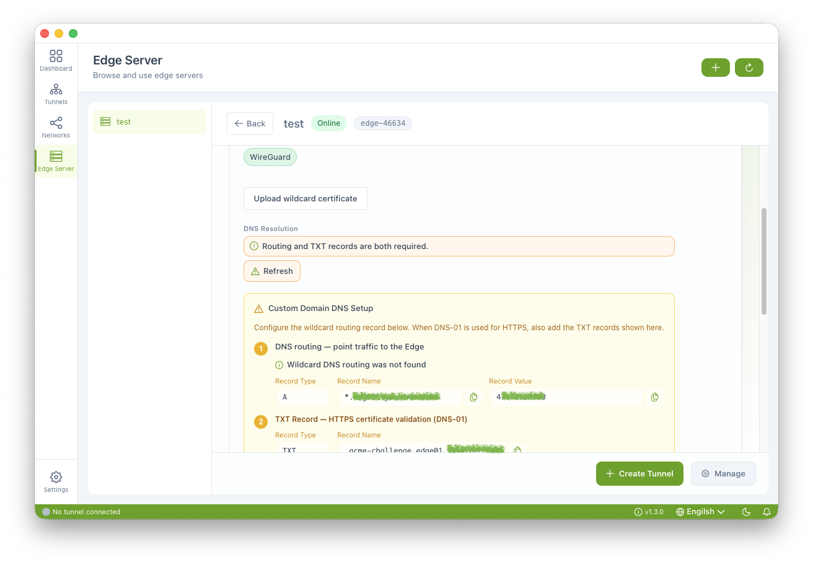

# 🌐 DNS トラブルシューティングガイド

> DNS レコードが正しく公開されているか確認してください。ドメインが解決しない場合は、まずネットワーク、次に DNS 設定を確認します。

## 🔍 診断

### DNS 解決エラー
- **症状**：ドメインを開けず、ブラウザーに `DNS_PROBE_FINISHED_NXDOMAIN` などが表示される
- **考えられる原因**：
  - DNS レコードの設定が正しくない
  - DNS の伝播が完了していない（通常 1〜48 時間）
  - ローカルの DNS キャッシュが古い
  - DNS サーバーが利用できない

### DNS 検証エラー
- **症状**：YAT コンソールに `DNS Verification Failed` と表示される
- **考えられる原因**：
  - CNAME レコードが誤った Edge アドレスを指している
  - レコードの TTL が長すぎて更新が遅れている
  - DNS プロバイダーがリクエストをブロックしている、またはファイアウォールが遮断している

## 🛠️ 手順

### 手順 1：CNAME の値を取得

#### Edge コンソールから取得
1. YAT コンソールにサインイン → [Edge 管理](./edge/management.md)
2. Edge 一覧から対象サーバーを探す
3. **Manage** ボタンまたは Edge カードから詳細ページを開く
4. **Domain Health** または **DNS Configuration** の CNAME 値を確認
5. 表示された値をコピーします（通常 `xxx.edge.tunnel6.com` 形式）

>  Edge コンソールの DNS 設定
> 説明：レコード種別、名前、値、コピーボタンを含む DNS 設定領域。

#### yat-fe クライアントから取得
1. yat-fe アプリを開く
2. 左側ナビゲーションの **Tunnel Management** を選択
3. 対象トンネルの詳細ページを開く
4. **Remote Addresses** または **Domain Configuration** の CNAME 値を確認
5. コピーボタンで値を取得

> 📸  yat-fe のトンネル詳細
> 説明：リモートアドレス、CNAME レコード、コピーボタン。

### 手順 2：DNS レコードを確認
1. DNS プロバイダーのコンソールにサインイン
2. CNAME レコードが正しく追加されているか確認
3. 値が正しい Edge ノードを指しているか確認

### 手順 3：伝播状態を確認
```bash
# DNS 解決を確認
nslookup your-domain.com

# dig を使う場合
dig your-domain.com CNAME +short
```

### 手順 4：トンネルのエイリアスドメインを設定

#### yat-fe で設定
1. yat-fe アプリを開く
2. 左側ナビゲーションの **Tunnel Management** を選択
3. 右上の **+ Create Tunnel** をクリック
4. トンネル作成ウィザードでアプリ種別を選択（例：HTTP）
5. **Domain Configuration** にカスタムドメインを入力（例：`myapp.example.com`）
6. 設定を保存してトンネルを開始

> 📸  トンネル作成時のドメイン設定
> 説明：ドメイン入力欄と保存ボタンを含む作成ウィザード。

### 手順 5：ローカル DNS キャッシュを消去
```bash
# macOS
sudo dscacheutil -flushcache; sudo killall -HUP mDNSResponder

# Windows
ipconfig /flushdns

# Linux
sudo systemd-resolve --flush-caches
```

## 📚 関連資料
- [DNS レコード設定ガイド](./custom-domains.md#dns-record-setup)
- [カスタムドメイン](./custom-domains.md)
- [Edge 管理](./edge/management.md)

## ❓ FAQ

### DNS の伝播にはどれくらいかかりますか？
通常は 1〜48 時間です。DNS レコードの TTL 設定によって変わります。

### 伝播を早くするには？
DNS を変更する前に短い TTL（例：300 秒）を設定します。安定したら、長い TTL に戻せます。

### どの DNS プロバイダーに対応していますか？
Cloudflare、Alibaba Cloud DNS、Tencent Cloud DNS、GoDaddy、Namecheap など主要なプロバイダーに対応しています。

---
*最終更新日：2026-05-04*
