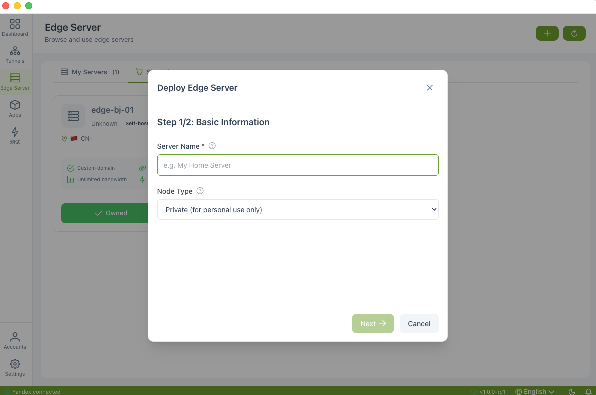
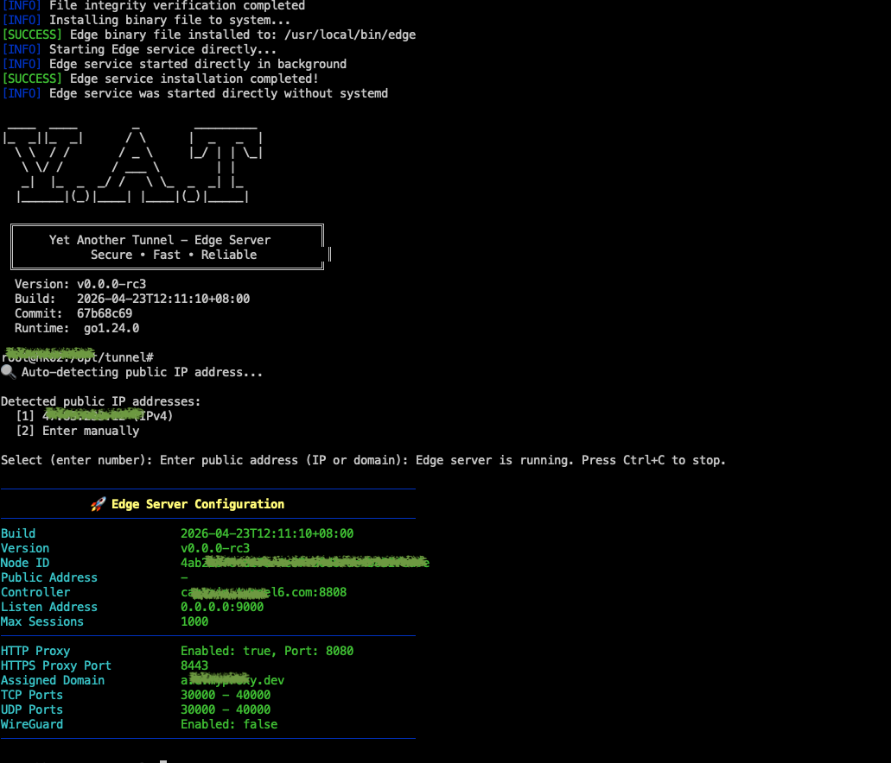

# Edge サーバーをデプロイ

> クライアントは登録シークレットを含むデプロイスクリプトを生成できます。公開 IP を持つサーバーに手動でインストールすることも可能です。

## 前提条件

- Linux x86_64 または ARM64
- 公開 IP と到達可能なポート
- 推奨リソース：2 vCPU、2 GB RAM
- 必要に応じて Docker
- HTTPS と WireGuard 用のドメイン

## スクリプトでデプロイ

1. クライアントの **Edges** を開く
2. **Add Edge** または **Deploy Edge** をクリック
3. 公開アドレスとリージョンを入力
4. スクリプトを生成
5. コマンドをサーバーへコピー
6. 実行して Online になるのを待つ

スクリプトはバイナリの取得、データディレクトリ作成、ノード登録、systemd サービス作成を行います。

> 📸  スクリプト生成
> 📸  デプロイ実行

## 手動デプロイ

```bash
sudo useradd --system --home /var/lib/yat-edge --shell /usr/sbin/nologin yat-edge
sudo mkdir -p /var/lib/yat-edge /etc/yat-edge
sudo chown -R yat-edge:yat-edge /var/lib/yat-edge

curl -fL https://example.com/edge-linux-amd64 -o ./edge
chmod +x ./edge
sudo mv ./edge /usr/local/bin/edge
```

`/etc/yat-edge/config.yaml` に公開アドレス、ドメイン、ポートを設定し、コンソールで生成したシークレットを使ってノードを登録します。

## systemd

```ini
[Unit]
Description=YAT Edge
After=network-online.target

[Service]
User=yat-edge
ExecStart=/usr/local/bin/edge server start --config /etc/yat-edge/config.yaml
Restart=always
RestartSec=5
LimitNOFILE=65535

[Install]
WantedBy=multi-user.target
```

```bash
sudo systemctl daemon-reload
sudo systemctl enable --now yat-edge
```

## 検証

```bash
systemctl status yat-edge
journalctl -u yat-edge -f
./edge server status
curl -I https://your-edge-domain.com
```

コンソールで Online 状態とドメイン検証を確認してください。

## ファイアウォール

設定に合わせてポートを許可します。

```bash
sudo ufw allow 443/tcp
sudo ufw allow 80/tcp
sudo ufw allow 51820/udp
```

## 関連資料

- [Edge 管理](./management.md)
- [WireGuard 設定](./wireguard.md)
- [設定リファレンス](./config-reference.md)

---
*YAT Team*
