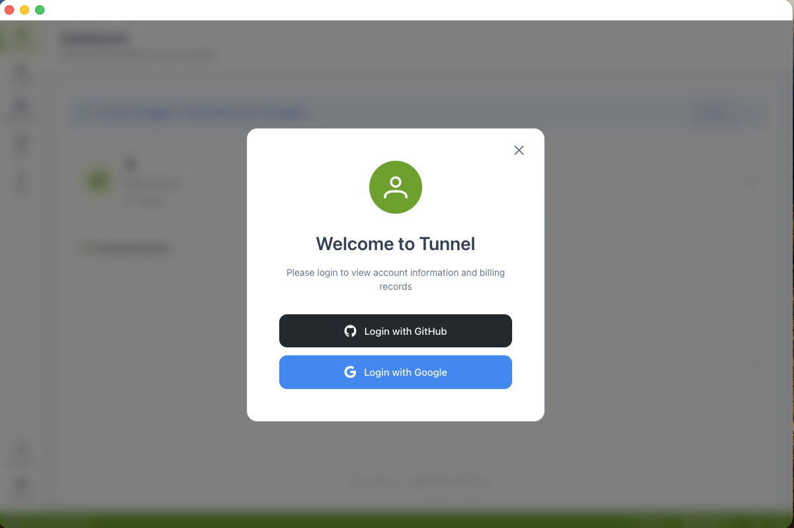
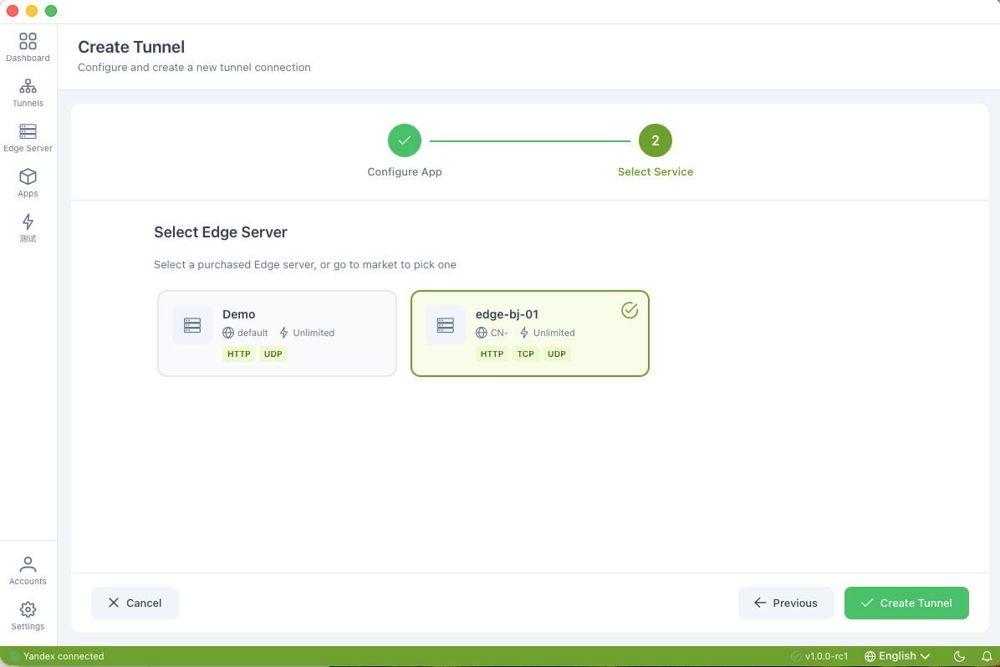
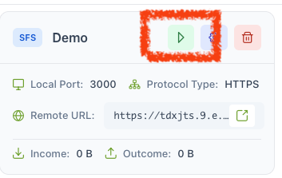
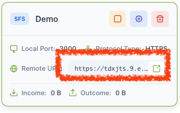

# クイックスタート

> YAT をインストールし、サインインして Edge を購読すれば、5 分程度で最初のローカルサービスを公開できます。

## 前提条件

- macOS 10.15 以降、Windows 10 以降、または Linux
- インターネット接続
- GitHub または Google でサインインできる YAT アカウント
- 公開したいローカルサービス（例：HTTP サーバー）

## 手順 1：クライアントをインストール

### macOS
1. `.dmg` ファイルをダウンロードします。
2. ファイルを開き、YAT を **Applications** に移動します。
3. Launchpad または Applications から起動します。

> ⚠️ macOS が開発元を検証できないと警告した場合は、**システム設定 → プライバシーとセキュリティ → このまま開く** を選択してください。

### Windows
1. `.exe` インストーラーをダウンロードします。
2. ウィザードに従ってインストールします。
3. 完了後、YAT を起動します。

### Linux
```bash
chmod +x yat-*.AppImage
./yat-*.AppImage
```

アプリが起動してサインイン画面が表示されればインストール成功です。

> 📸  初回起動時の YAT 画面

## 手順 2：サインイン

1. YAT を開きます。
2. **GitHub** または **Google** を選択します。
3. ブラウザーで認可します。
4. クライアントに戻ると、サインイン状態が保存されます。

ブラウザーが自動で開かない場合は、表示されたリンクをコピーして手動で開いてください。

## 手順 3：Edge を購読

Edge は外部トラフィックの入口です。公式ノード、他のデバイスが共有するノード、自分で運用するサーバーを選択できます。

1. **Edges** ページを開きます。
2. 近くの公式 Edge または共有 Edge を選びます。
3. **Subscribe** をクリックします。
4. ノードが利用可能になっていることを確認します。

> 📸  Edge 一覧

## 手順 4：最初のトンネルを作成

テストにはローカル HTTP サーバーが便利です。

```bash
# Python
python3 -m http.server 3000

# Node.js
npx serve -l 3000 .
```

トンネルの作成手順：

1. **Tunnels** を開きます。
2. **+ Create Tunnel** をクリックします。
3. **HTTP Proxy** を選択します。
4. 購読済み Edge を指定します。
5. ローカルアドレスに `127.0.0.1:3000` を入力します。
6. 保存します。

> 📸  アプリ選択
> 📸  HTTP プロキシ設定
> 📸  作成確認

## 手順 5：起動して確認

1. トンネルを開きます。
2. **Start** をクリックし、状態が `Running` になるまで待ちます。
3. `abc123.edge.myroxy.dev` のようなリモートアドレスをコピーします。
4. ブラウザーで開きます。

ローカルサービスの内容が表示されれば成功です。

> 📸  起動処理
> 📸  ブラウザーからのアクセス

## 確認リスト

| 項目 | 期待される結果 |
|------|----------------|
| クライアント | アプリが起動する |
| サインイン | アカウントが表示される |
| Edge | ノードが利用可能 |
| トンネル | `Created` または `Stopped` |
| 実行状態 | `Running` |
| リモートアクセス | ローカルサービスが見える |

## よくある問題

### Edge がない
先に公式 Edge または共有 Edge を購読してください。自前サーバーを使う場合は、登録とオンライン状態を確認します。

### トンネルが起動しない
ローカルサービスが動いているか、ポートが空いているか、ローカルアドレスが正しいかを確認してください。

### リモートアドレスが開かない
トンネル状態を確認し、起動後数秒待ってからアドレスをコピーし直してください。

## 次のステップ

- [トンネル管理](./tunnel-management.md)
- [アプリと拡張機能](./apps-and-extensions.md)
- [カスタムドメイン](./custom-domains.md)
- [トランスポートモード](./transport-modes.md)

---
*YAT Team*
