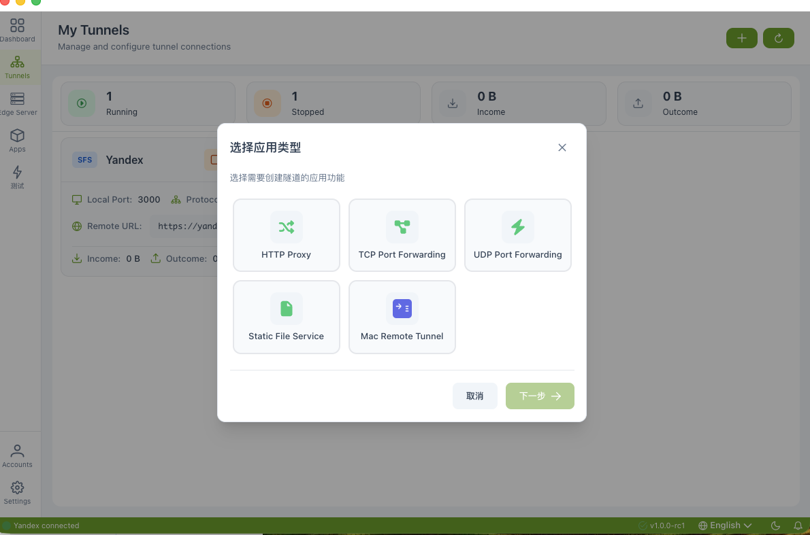
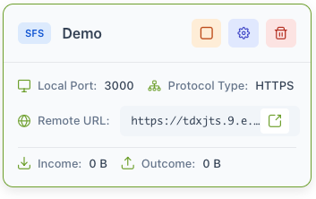
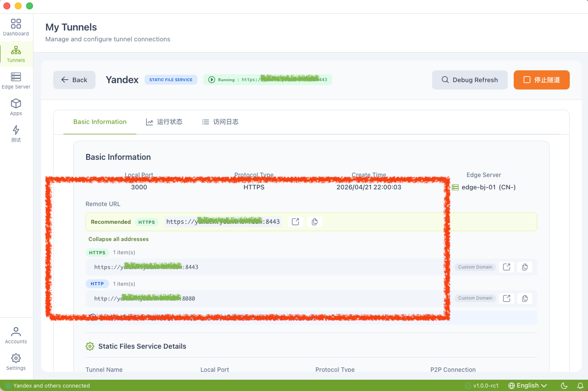
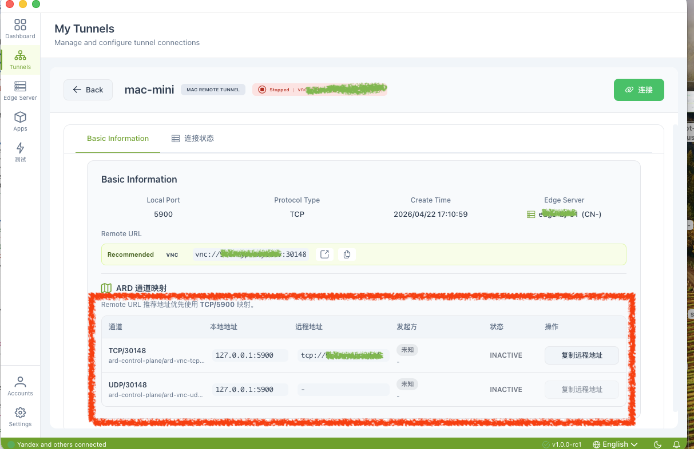

# トンネル管理

> トンネルはローカルサービスと Edge 上のドメインまたはポートを結び付けます。一覧から作成、起動、停止、共有、削除できます。

## 基本状態

| 状態 | 意味 |
|------|------|
| `Created` | 作成済みだが未実行 |
| `Starting` | Edge との接続を確立中 |
| `Running` | トラフィックを受け付けられる |
| `Stopped` | 手動停止または切断済み |
| `Error` | メッセージとログを確認 |

## アプリ種別

| 種別 | 用途 |
|------|------|
| HTTP Proxy | Web サイトや API |
| TCP Forward | DB、SSH、RDP、バイナリプロトコル |
| UDP Forward | ゲーム、自前 DNS、ストリーミング |
| ARD | macOS の拡張機能によるリモートデスクトップ |

## 作成

1. **Tunnels** を開きます。
2. **+ Create Tunnel** をクリックします。
3. アプリ種別を選択します。
4. Edge を指定します。
5. リモートのドメインまたはポートとローカルアドレスを設定します。
6. 保存します。

**Edges** ページから Edge を選び、**Create Tunnel** を使うこともできます。

> 📸  アプリ選択
> 📸  HTTP 設定

## 起動と停止

- **Start**：クライアントと Edge を接続し、公開入口を有効化
- **Stop**：接続を閉じ、公開入口を無効化
- **Restart**：ドメイン、ポート、モード変更後に有効

> 📸  トンネル起動

## 詳細

詳細ページでは次を確認できます。

- 状態と割り当て Edge
- リモートアドレスとドメイン
- チャネルとトランスポートモード
- トラフィック統計
- 最近のログ
- 共有権限

> 📸  基本情報
> 📸  リモートアドレス
> 📸  チャネル一覧

## 共有

| モード | 効果 |
|--------|------|
| Private | 所有者のみが管理・利用可能 |
| Team | 許可されたユーザーやデバイスが管理可能 |
| Shared | サービスにはアクセスできるが管理権限はない |

詳細ページの共有設定から対象を選び、必要最小限のロールを割り当ててください。

## 削除

1. トンネルを停止します。
2. 利用者がいないことを確認します。
3. 必要ならドメインや設定を控えます。
4. **Delete** をクリックして確定します。

削除すると、割り当てドメインと Edge 上のチャネルが解放されます。

## 統計

一覧ではトンネルごとのトラフィックと状態を確認できます。詳細では送受信バイト数、アクティブ接続数、レイテンシ、パケットロス、チャネル別使用量を参照できます。

> 📸  統計カード

## よくある問題

### ポートが使用中

```bash
# macOS / Linux
lsof -i :3000

# Windows
netstat -ano | findstr :3000
```

ローカルポートを変更するか、該当プロセスを停止してください。

### 起動直後に停止する
ローカルサービスの応答、リモートポートの重複、Edge のオンライン状態を確認してください。

### ログの確認
トンネル詳細またはクライアントの診断ページからログを確認できます。

### Edge の移行
別の Edge で再作成できますが、リモートアドレスは変わります。独自ドメインを使う場合は DNS を更新してください。

## 運用のポイント

- サービスと環境が分かる名前を使う
- ローカルアドレスは `127.0.0.1` を優先する
- ドメインや証明書を変更したら再起動する
- 共有前に権限を確認する

## 関連資料

- [クイックスタート](./quick-start.md)
- [Edge 管理](./edge/management.md)
- [アプリと拡張機能](./apps-and-extensions.md)
- [トランスポートモード](./transport-modes.md)

---
*最終更新日：2026-05-04*
