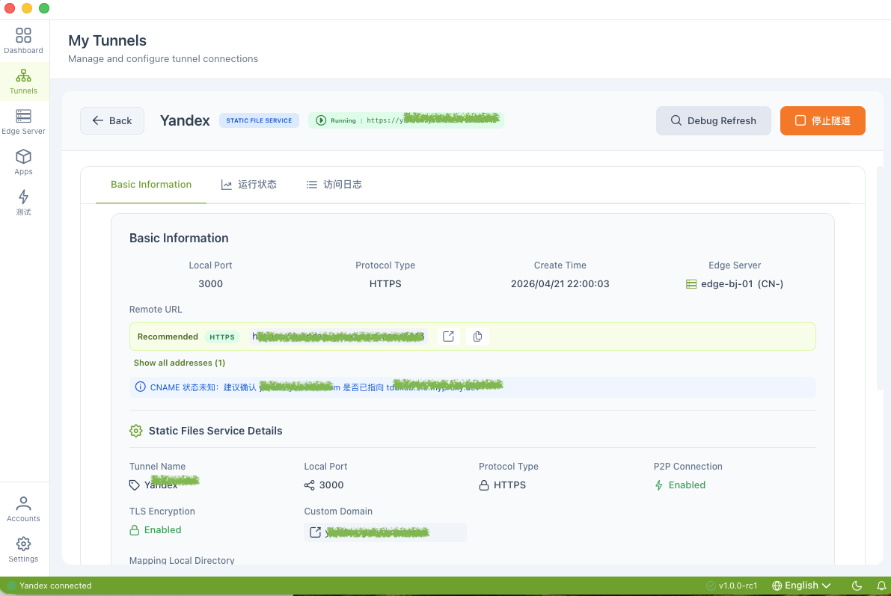
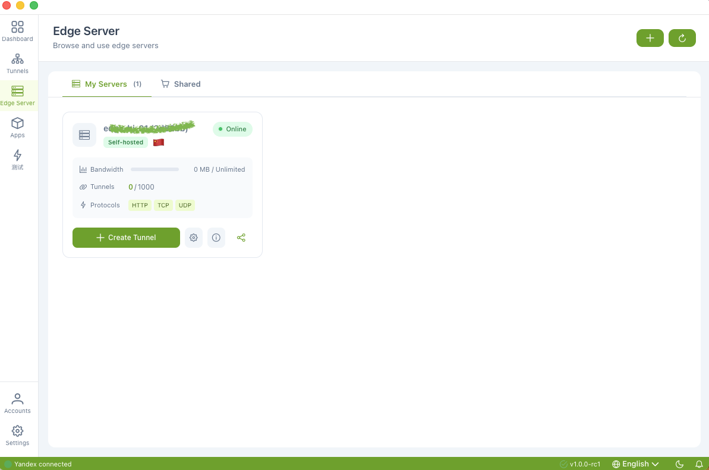

# YAT とは

> YAT は、ルーターのポート開放や内部マシンの公開なしに、プライベートネットワーク内のサービスを公開するための Edge 型トンネルサービスです。

## 解決する問題

NAS、データベース、開発環境、リモートデスクトップサービスは、多くの場合プライベートネットワーク内にあります。YAT では、ローカルクライアントが認証済み接続を公開 Edge と維持し、外部トラフィックは Edge からその接続を通じて内部サービスに届きます。

```
訪問者 → Edge → 認証済み接続 → 内部サービス
```

## 主な機能

| 機能 | 用途 |
|------|------|
| HTTP / TCP / UDP トンネル | Web サービス、TCP サービス、UDP サービスの公開 |
| Edge ネットワーク | 公式、自前、共有ノードの選択 |
| WireGuard | デバイス間の仮想 LAN 構築 |
| 拡張機能 | ARD などの機能追加 |
| マルチデバイス | ロールと共同作業の管理 |
| ドメインと証明書 | 独自ドメインと HTTPS の自動管理 |

## 基本概念

### トンネル
ローカルサービスと Edge 上のドメインまたはポートを関連付ける単位です。アプリ種別、ローカルアドレス、トランスポートモードを指定します。

### チャネル
トンネル内の転送単位です。HTTP、TCP、UDP の設定に応じて複数持つことができます。

### Edge
公開入口です。ポートを待ち受け、正しいトンネルへ振り分け、証明書を扱い、状態をコンソールへ報告します。

### 拡張機能
クライアントにアプリや操作フローを追加します。ARD はポート転送をリモートデスクトップ体験として扱いやすくします。

## 構成

| コンポーネント | 役割 |
|----------------|------|
| `yat-fe` | トンネル、Edge、拡張機能を設定するデスクトップクライアント |
| `Edge` | トラフィックを受け取り、認証済みクライアントへ転送する公開ノード |
| `Captain` | 識別情報、認可、ノード、状態を管理するコントロールプレーン |
| 拡張機能 | ローカルで動作する追加機能モジュール |

制御チャネルもデータチャネルも識別と暗号化を利用します。信頼は固定 IP ではなく識別情報に基づきます。

## 従来手法との比較

| 手法 | 特徴 | YAT との違い |
|------|------|--------------|
| ポート転送 | ルーター設定が必要 | 内部ネットワークのポート開放が不要 |
| 従来型 VPN | ネットワーク全体を接続 | サービス単位で公開し、トンネルごとにドメインを制御 |
| 手動リバースプロキシ | サーバーと DNS を自前管理 | Edge、証明書、状態管理を統合 |
| クラウドポートマッピング | 追加インフラが必要 | 公式ノードまたは自前 Edge を選択可能 |

## 利用例

### 個人
- 外出先から自宅の NAS に接続
- Web プロジェクトを簡単に共有
- ポートを公開せずにリモートデスクトップを利用

### チーム
- 複数人でテスト環境を共有
- 同じアカウントでデバイスとロールを管理
- 社内サービスに独自ドメインを設定

### 開発
- ローカルサーバーで webhook を受信
- ローカルツールと外部サービスを連携
- 公開ネットワークなしで再現しやすい環境を維持

## セキュリティ

- **mTLS**：クライアントとサーバーが相互に認証
- **証明書**：Let's Encrypt による HTTPS 発行と更新
- **アクセス制御**：トンネル、ドメイン、デバイスごとに権限を管理
- **分離**：内部サービスを `0.0.0.0` で待ち受けさせる必要がない

## 画面

>  トンネル一覧
>  トンネル詳細
>  Edge 管理

## 次のステップ

- [クイックスタート](./quick-start.md)
- [トンネル管理](./tunnel-management.md)
- [Edge 管理](./edge/management.md)
- [FAQ](./faq.md)

---
*YAT Team - Making intranet penetration simpler*
