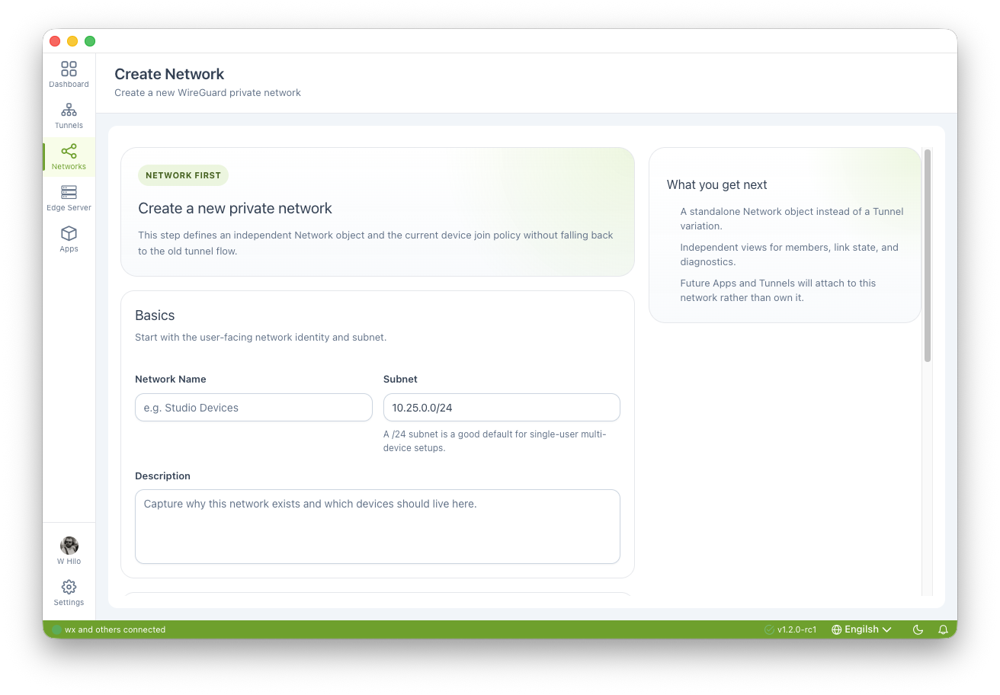
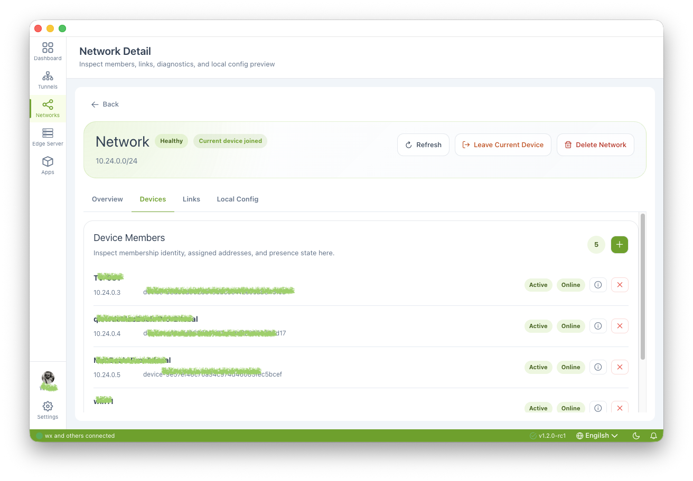
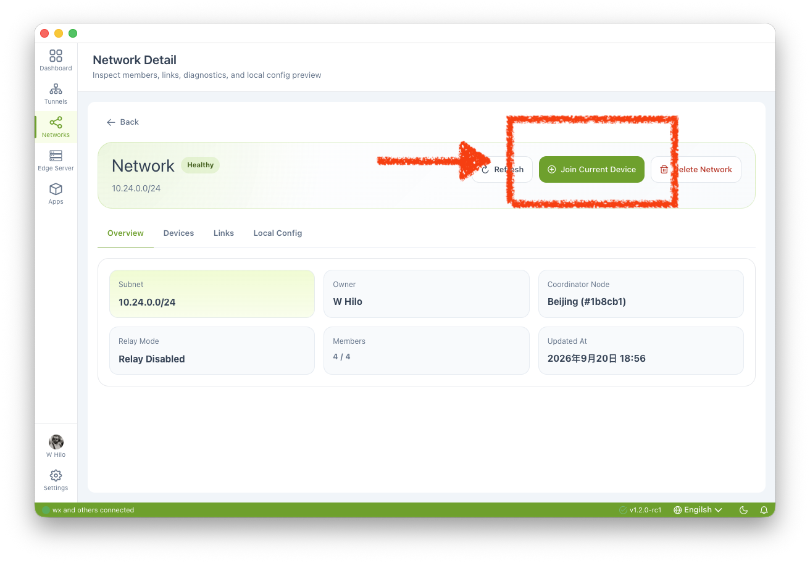
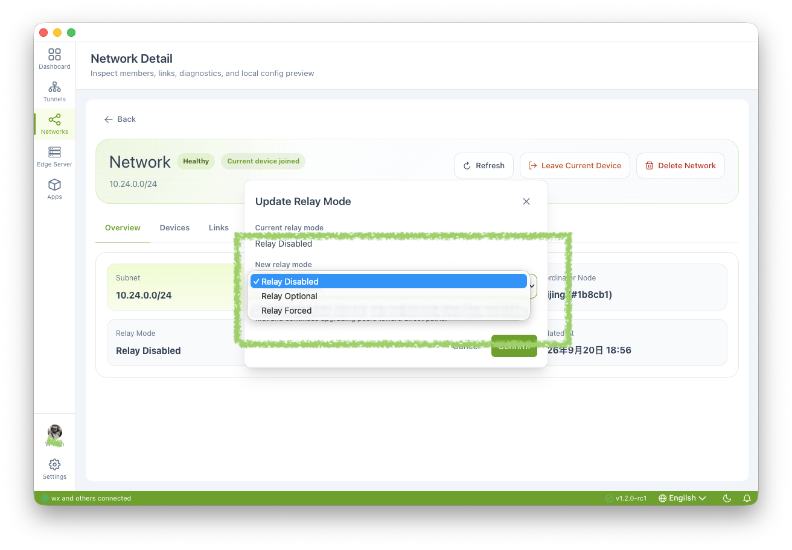

# WireGuard ネットワーク

> WireGuard は暗号化された仮想 LAN を構築します。各デバイスはネットワーク内のアドレスを持ち、メンバー間で直接通信できます。

## 選び方

| 目的 | WireGuard | HTTP/TCP/UDP トンネル |
|------|-----------|------------------------|
| 単一サービスの公開 | 通常は不要 | 適している |
| 複数内部サービスの利用 | 適している | 管理が煩雑になりやすい |
| 双方向通信 | 対応 | 非対応 |
| 同一内部 IP 空間を使う | 対応 | 非対応 |

## 前提条件

- Edge で WireGuard が有効
- WireGuard と IP 転送に対応したカーネル
- 接続済みの YAT クライアント
- `wg-yat0-*` を許可するファイアウォール
- Edge の UDP ポートが到達可能

## ネットワーク作成

1. クライアントの **WireGuard Networks** を開きます。
2. **Create Network** をクリックします。
3. 名前とサブネット（例：`100.64.0.0/24`）を入力します。
4. Edge を選択します。
5. 保存し、Edge がインターフェースを作成するのを待ちます。

> 📸  ネットワーク作成

## メンバー追加

1. ネットワークを開きます。
2. ローカルデバイスを追加します。
3. リモートデバイスを登録または招待します。
4. 両メンバーがオンラインで IP を持つことを確認します。

> 📸  メンバー一覧
> 📸  ローカルデバイス参加

## 動作確認

```bash
ip addr show wg-yat0-xxx
ping 100.64.0.2
nc -zv 100.64.0.2 5432
```

## 中継モード

| モード | 動作 | 用途 |
|--------|------|------|
| Relay | Edge が全通信を中継 | どのような NAT でも動作しやすい |
| Direct | メンバー間の直接接続を試みる | ネットワーク条件が良ければ低遅延 |

Direct が失敗する場合は Relay に切り替えて接続性を確認してください。

> 📸  中継モード設定

## 診断

### IP が割り当てられない
クライアントの接続状態と、ネットワークへのメンバー登録を確認してください。

### メンバーが Offline
YAT の状態、Edge との接続、UDP ポートを確認してください。

### ping が通らない

```bash
sysctl net.ipv4.ip_forward
nft list ruleset | grep wg-yat0
```

転送が有効で、該当インターフェースが許可されている必要があります。

### ポートが応答しない
ping が通る場合、WireGuard ではなく対象サービスやそのファイアウォールの問題であることが多いです。

## 関連資料

- [Edge WireGuard 設定](./edge/wireguard.md)
- [トランスポートモード](./transport-modes.md)
- [接続トラブルシューティング](./connection-troubleshooting.md)

---
*最終更新日：2026-05-04*
