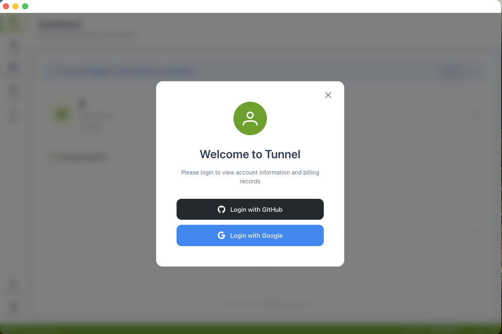
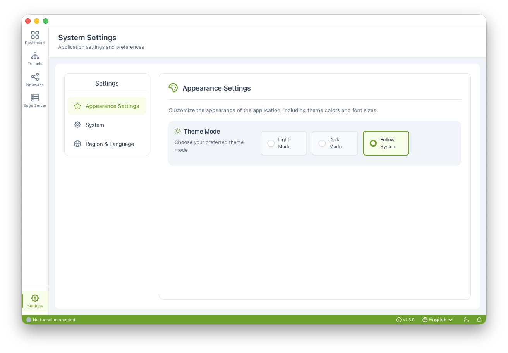

# 賬戶與設定

> 管理您的 YAT 賬戶和客戶端設定

---

## 📋 目錄

- [賬戶管理](#賬戶管理)
- [客戶端設定](#客戶端設定)
- [語言與主題](#語言與主題)
- [資料管理](#資料管理)
- [安全設定](#安全設定)

---

## 賬戶管理

### 登入方式

YAT 支援以下登入方式：

- **GitHub** - 使用 GitHub 賬號登入（推薦）
- **Google** - 使用 Google 賬號登入
- **郵箱** - 使用郵箱註冊（即將支援）

### 登入流程

1. 開啟 YAT 客戶端
2. 點選 **登入** 按鈕
3. 選擇登入方式
4. 授權訪問
5. 完成登入

> 📸  登入頁面
> 
> 說明：顯示 GitHub/Google 登入按鈕

### 賬戶資訊

登入後檢視賬戶資訊：

- **使用者名稱**
- **郵箱**
- **頭像**
- **註冊時間**

### 退出登入

1. 點選 **Settings**
2. 點選 **退出登入**
3. 確認退出

> ⚠️ **注意**：退出登入後：
> - 隧道會停止
> - Edge 連線會斷開
> - 需要重新登入才能使用

---

## 客戶端設定

### 開啟設定

點選左側導航欄的 **Settings** 圖示。

> > 📸  yat-fe 客戶端主題設定
> 
> 說明：顯示設定項列表

### 通用設定

#### 開機自啟

- **啟用**: YAT 隨系統啟動
- **停用**: 手動啟動

**macOS**:
```
系統設定 > 通用 > 登入項
```

**Windows**:
```
工作管理員 > 啟動
```

#### 最小化到托盤

- **啟用**: 關閉視窗時最小化到系統托盤
- **停用**: 關閉視窗時退出程式

#### 啟動時顯示主視窗

- **啟用**: 啟動時自動顯示主視窗
- **停用**: 啟動時在後臺執行

---

## 語言與主題

### 語言設定

YAT 支援多語言：

- ✅ **簡體中文** (zh-CN)
- ✅ **English** (en)
- ⚠️ **日本語** (ja) - 開發中
- ⚠️ **Français** (fr) - 開發中

**切換語言**：
1. Settings > 語言
2. 選擇語言
3. 介面自動切換

### 主題設定

YAT 支援三種主題模式：

#### Light（亮色）

- 白色背景
- 深色文字
- 適合明亮環境

#### Dark（暗色）

- 深色背景
- 淺色文字
- 適合暗光環境
- 減少眼睛疲勞

#### System（跟隨系統）

- 自動跟隨系統主題
- 系統切換時自動變化

>  yat-fe 客戶端主題設定
> 
> 說明：顯示 Light/Dark/System 選項

### 主題適配

擴充套件也會跟隨主題切換：

```typescript
// 擴充套件中接收主題變化
hooks: {
  onThemeChange(isDark, themeMode, context) {
    // 更新擴充套件 UI
  }
}
```

---

## 資料管理

### 資料位置

YAT 資料儲存在以下位置：

**macOS**:
```
~/Library/Application Support/YAT/
├── config.json        # 配置檔案
├── tunnels.db         # 隧道資料
├── edges.db           # Edge 資料
└── extensions/        # 擴充套件目錄
```

**Windows**:
```
%APPDATA%/YAT/
```

**Linux**:
```
~/.config/yat/
```

### 清除快取

如果遇到顯示問題，可以嘗試清除快取：

1. Settings > 資料管理
2. 點選 **清除快取**
3. 重啟 YAT

> ⚠️ **注意**：清除快取不會刪除：
> - 隧道配置
> - Edge 配置
> - 賬戶資訊

### 匯出資料

匯出資料配置（備份）：

1. Settings > 資料管理
2. 點選 **匯出配置**
3. 選擇儲存位置
4. 儲存 `.json` 檔案

### 匯入資料

匯入配置（恢復）：

1. Settings > 資料管理
2. 點選 **匯入配置**
3. 選擇備份檔案
4. 確認匯入

> ⚠️ **警告**：匯入會覆蓋當前配置！

---

## 安全設定

### 賬戶安全

#### 雙因素認證（2FA）

即將支援：
- TOTP（時間一次性密碼）
- SMS 驗證
- 硬體金鑰

#### 登入歷史

檢視最近的登入記錄：
- 時間
- 裝置
- IP 地址
- 位置

### 裝置管理

檢視已登入的裝置：

- 裝置名稱
- 登入時間
- 最後活躍
- 操作（登出）

### 隱私設定

#### 資料收集

YAT 收集以下資料用於改進產品：

- ✅ 使用統計（匿名）
- ✅ 錯誤日誌（匿名）
- ❌ 隧道內容
- ❌ 個人資料

#### 退出資料收集

Settings > 隱私 > 停用遙測

---

## 常見問題

### Q: 忘記密碼怎麼辦？

YAT 使用 OAuth 登入，無需密碼。

如果使用郵箱登入：
1. 點選 **忘記密碼**
2. 輸入郵箱
3. 接收重置連結
4. 設定新密碼

### Q: 如何更換繫結的郵箱？

目前不支援更換郵箱，需要：
1. 登出當前賬號
2. 使用新郵箱註冊
3. 重新配置

### Q: 可以刪除賬號嗎？

可以，但**不可逆**：

1. 聯絡支援團隊
2. 確認刪除
3. 所有資料會被清除

> ⚠️ **警告**：
> - 所有隧道會被刪除
> - 所有 Edge 會被登出
> - 證書會被撤銷

### Q: 多裝置登入有限制嗎？

**沒有限制**。同一賬號可以在多個裝置登入。

### Q: 資料會同步嗎？

**會**。以下資料會跨裝置同步：

- ✅ 隧道列表
- ✅ Edge 列表
- ✅ 賬戶設定
- ❌ 客戶端設定（本地）

### Q: 如何保護賬戶安全？

1. 使用強密碼（如果支援）
2. 啟用 2FA（即將支援）
3. 定期檢查登入歷史
4. 不在公共電腦儲存登入狀態

---

## 💡 最佳實踐

### 1. 定期備份配置

```bash
# 備份配置目錄
tar czf yat-backup-$(date +%Y%m%d).tar.gz \
  ~/Library/Application\ Support/YAT/
```

### 2. 保持客戶端更新

- 啟用自動更新
- 定期檢查新版本
- 閱讀更新日誌

### 3. 清理不用的資料

- 刪除不用的隧道
- 取消不用的 Edge 訂閱
- 解除安裝不用的擴充套件

### 4. 注意安全

- 不在公共網路登入
- 定期檢查登入裝置
- 及時更新密碼

---

## 📚 相關檔案

- [快速開始](quick-start.md) - 註冊和登入
- [常見問題](faq.md) - 賬戶相關問題
- [多裝置管理](multi-device-roles.md) - 裝置角色管理

---

*YAT Team - 讓內網穿透更簡單*
