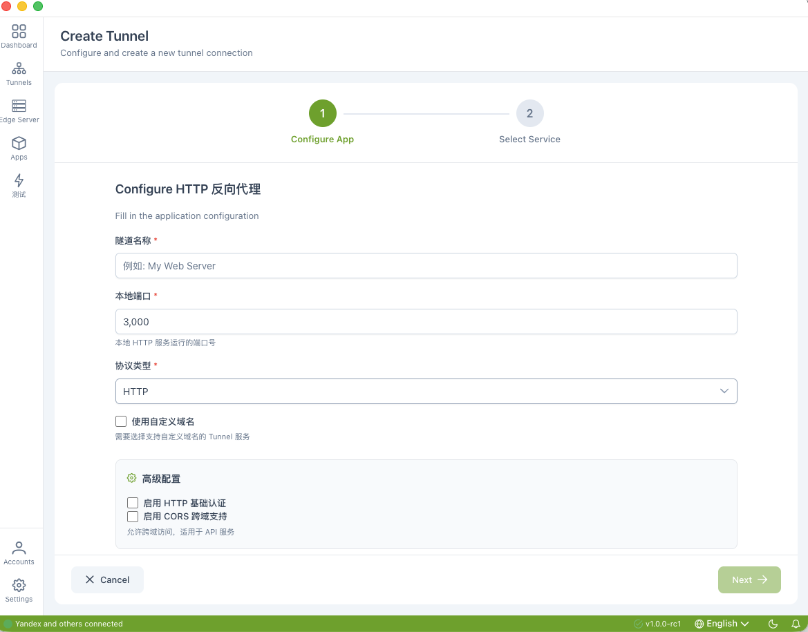
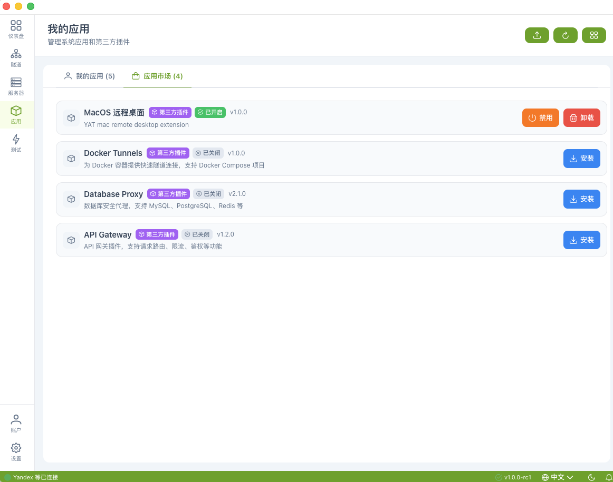
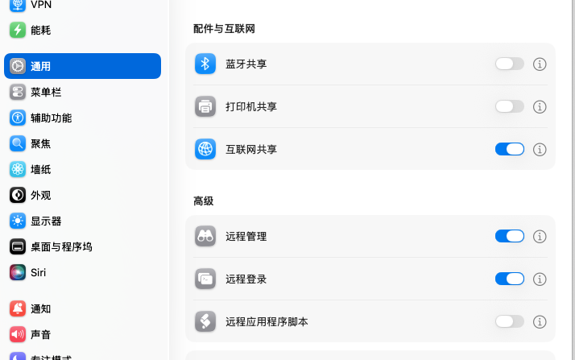
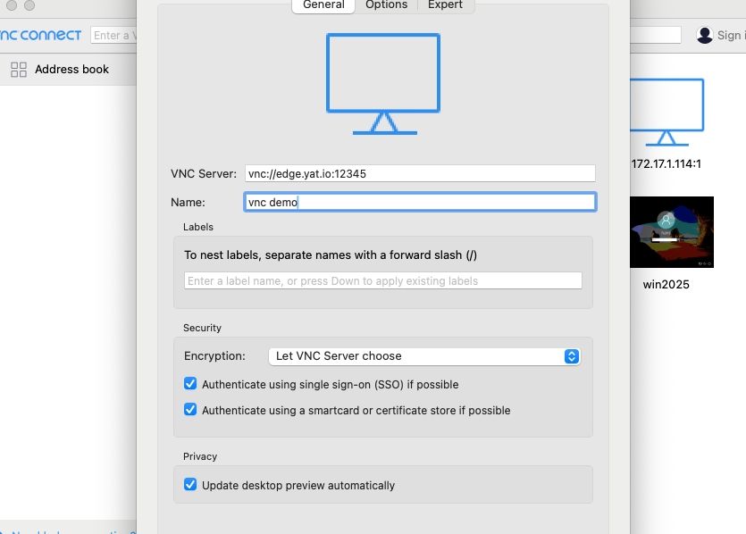

# 應用與擴充套件

> 瞭解 YAT 的應用生態和擴充套件系統

---

## 📋 目錄

- [應用概述](#應用概述)
- [內建應用](#內建應用)
- [擴充套件系統](#擴充套件系統)
- [安裝擴充套件](#安裝擴充套件)
- [使用 ARD 遠端桌面](#使用-ard-遠端桌面)
- [開發擴充套件](#開發擴充套件)
- [常見問題](#常見問題)

---

## 應用概述

### 什麼是應用（App）？

在 YAT 中，**應用（App）** 是一種特定遠端訪問能力的定義，包括：

- 📝 **配置表單** - 建立隧道時的配置介面
- 🎨 **UI 元件** - 隧道詳情中的自定義展示
- 🔘 **操作按鈕** - 啟動、停止等操作的定義
- 🪝 **生命週期鉤子** - 啟動前、啟動後的處理邏輯

### 應用 vs 擴充套件

| 概念 | 說明 | 關係 |
|------|------|------|
| **App** | 遠端訪問能力定義 | 抽象概念 |
| **Extension** | App 的載體 | 包含 App 定義 + 後設資料 |

**示例**：
- ARD 擴充套件 包含 ARD 應用定義
- 一個擴充套件可以包含多個應用（未來支援）

---

## 內建應用

### HTTP 代理

**用途**：將本地 HTTP 服務暴露到公網

**特性**：
- ✅ 自動 HTTPS
- ✅ 自定義域名
- ✅ 路徑重寫

**配置項**：
```
- 隧道名稱
- 本地埠（如 3000、8080）
- 本地主機（預設 127.0.0.1）
- 傳輸模式
- 共享設定
```

> 📸  HTTP 代理配置表單
> 
> 說明：顯示埠輸入、傳輸模式選擇

**使用場景**：
- 本地開發伺服器演示
- Webhook 測試
- API 除錯

### TCP 轉發

**用途**：轉發任意 TCP 協議

**特性**：
- ✅ 透明傳輸
- ✅ 長連線支援
- ✅ 自動重連

**配置項**：
```
- 隧道名稱
- 本地埠
- 遠端埠（可選）
- 本地主機
```

**使用場景**：
- SSH 遠端訪問
- 資料庫連線
- 自定義 TCP 服務

### UDP 轉發

**用途**：轉發 UDP 協議

**特性**：
- ✅ 低延遲
- ✅ 無連線狀態
- ✅ 廣播支援

**使用場景**：
- DNS 服務
- 遊戲伺服器
- 音影片流

---

## 擴充套件系統

### 擴充套件架構

```
┌─────────────────────────────────┐
│         YAT 客戶端               │
│  ┌───────────────────────────┐  │
│  │   Extension Runtime Host  │  │
│  │  - 擴充套件載入器              │  │
│  │  - Host API Bridge        │  │
│  │  - 生命週期管理            │  │
│  └───────────┬───────────────┘  │
│              │                   │
│  ┌───────────▼───────────────┐  │
│  │    Extension (擴充套件)        │  │
│  │  - App Definition         │  │
│  │  - Vue/React Components   │  │
│  │  - Lifecycle Hooks        │  │
│  └───────────────────────────┘  │
└─────────────────────────────────┘
```

### 擴充套件能力

擴充套件可以：

- ✅ 自定義配置表單
- ✅ 自定義詳情頁面
- ✅ 定義操作按鈕
- ✅ 實現生命週期鉤子
- ✅ 呼叫 Host API（啟動/停止通道）
- ✅ 自定義遠端地址解析

### 擴充套件限制

出於安全考慮，擴充套件**不能**：

- ❌ 直接訪問檔案系統
- ❌ 執行系統命令
- ❌ 訪問未授權的 API
- ❌ 修改其他擴充套件資料

---

## 安裝擴充套件

### 方式一：應用市場安裝（開發中）

1. 點選 **Apps** > **市場**
2. 瀏覽可用擴充套件
3. 點選 **安裝**
4. 等待安裝完成

### 方式二：本地安裝

1. 下載擴充套件包（`.yat` 或目錄）
2. 放置到擴充套件目錄：

**macOS**:
```
~/Library/Application Support/yat/extensions/
```

**Windows**:
```
%APPDATA%/yat/extensions/
```

**Linux**:
```
~/.config/yat/extensions/
```

3. 重啟 YAT 客戶端
4. 擴充套件自動載入

### 驗證安裝

1. 點選 **Apps**
2. 檢視已安裝的擴充套件列表
3. 確認擴充套件狀態為 **已啟用**

> 📸   擴充套件管理頁面
> 
> 說明：顯示已安裝擴充套件、啟用/停用開關、解除安裝按鈕

### 解除安裝擴充套件

1. 找到已安裝的擴充套件
2. 點選 **解除安裝**
3. 確認解除安裝

> ⚠️ **注意**：解除安裝擴充套件會刪除該擴充套件建立的所有隧道

---

## 使用 ARD 遠端桌面

ARD (Apple Remote Desktop) 擴充套件是 YAT 的第一個官方擴充套件，用於 macOS 遠端桌面訪問。

### 功能特性

- 🖥️ **VNC 遠端桌面** - 標準 VNC 協議
- 🔐 **安全傳輸** - mTLS 加密
- 🌐 **多傳輸模式** - Relay / P2P / WireGuard
- 👥 **角色分離** - Publisher / Consumer
- 📸 **桌面快照** - 即時預覽

### 前置要求

**Publisher（伺服器端）**：
- ✅ macOS 系統
- ✅ 已開啟螢幕共享或遠端管理
- ✅ YAT 客戶端 + ARD 擴充套件

**Consumer（客戶端）**：
- ✅ 任意系統（macOS/Windows/Linux）
- ✅ YAT 客戶端 + ARD 擴充套件
- ✅ VNC 客戶端（如 RealVNC、TightVNC）

### 配置 Publisher

#### 步驟 1：開啟 macOS 螢幕共享

1. 開啟 **系統設定** > **通用** > **共享**
2. 啟用 **螢幕共享** 或 **遠端管理**
3. 設定訪問許可權

> 📸 macOS 螢幕共享設定
> 
> 說明：顯示共享開關、許可權設定

#### 步驟 2：建立 ARD 隧道

1. 點選 **Tunnels** > **建立隧道**
2. 選擇 **Mac Remote Desktop**
3. 填寫配置：
   - **隧道名稱**: 我的 Mac
   - **目標主機**: 127.0.0.1 或區域網 IP
   - **角色**: 伺服器（Publisher）
4. 點選 **建立**


> 說明：顯示主機名輸入、角色選擇、傳輸模式

#### 步驟 3：啟動隧道

1. 找到建立的隧道
2. 點選 **連線** 按鈕
3. 等待狀態變為 **執行中**

**啟動前檢查**：
- ✅ 本地 5900 埠可達
- ✅ Edge 線上
- ✅ 角色為 Publisher

### 配置 Consumer

#### 步驟 1：檢視共享隧道

在 Consumer 裝置上：
1. 開啟 **Tunnels** 頁面
2. 看到 Publisher 建立的共享隧道
3. 角色自動識別為 **Consumer**

#### 步驟 2：連線遠端桌面

**方式一：通過 YAT 客戶端**

1. 點選 **連線遠端桌面** 按鈕
2. 自動調起 VNC 客戶端
3. 輸入密碼（如果需要）

**方式二：手動連線**

1. 複製遠端地址（如 `vnc://edge.myroxy.dev:12345`）
2. 開啟 VNC 客戶端
3. 貼上地址並連線

> 📸  VNC 客戶端連線介面
> 
> 說明：顯示 VNC 客戶端、地址輸入、連線按鈕

### 角色說明

#### Publisher（伺服器）

- 🔧 **許可權**: 啟動/停止/控制隧道
- 📡 **職責**: 提供 VNC 服務
- 💻 **裝置**: 被控 Mac

#### Consumer（客戶端）

- 👁️ **許可權**: 檢視狀態、連線遠端桌面
- 🖱️ **職責**: 使用遠端桌面
- 💻 **裝置**: 控制端裝置

### 高階配置

#### 傳輸模式選擇

| 模式 | 延遲 | 頻寬 | 適用場景 |
|------|------|------|---------|
| **Relay** | 中 | 中 | 通用場景 |
| **P2P** | 低 | 高 | 同網路/低延遲 |
| **WireGuard** | 低 | 高 | 大檔案傳輸 |

#### 自定義埠

預設使用 5900 埠，如需修改：

1. 在 macOS 中修改 VNC 監聽埠
2. 建立隧道時填寫自定義埠

---

## 開發擴充套件

### 快速開始

詳細的擴充套件開發指南請參考：[EXTENSION_DEVELOPER_GUIDE.md](https://github.com/tunnel6/yat/blob/main/docs/extension/EXTENSION_DEVELOPER_GUIDE.md)

### 開發步驟概覽

#### 1. 初始化專案

```bash
mkdir my-extension
cd my-extension
npm init -y
npm install @hilow/extension-types vue typescript vite
```

#### 2. 建立入口檔案

```typescript
// src/index.ts
import type { AppExtensionPackage } from '@hilow/extension-types'

export const extension: AppExtensionPackage = {
  metadata: {
    id: 'app-my-extension',
    name: 'My Extension',
    version: '1.0.0',
    description: 'My custom extension',
    author: 'Developer'
  },
  appDefinition: {
    id: 'app-my-extension',
    i18n: { /* ... */ },
    actions: [ /* ... */ ],
    hooks: { /* ... */ }
  }
}
```

#### 3. 開發元件

建立 Vue/React 元件用於配置表單和詳情頁面。

#### 4. 測試擴充套件

```bash
npm run build
# 將 dist 目錄複製到擴充套件目錄
# 重啟 YAT 客戶端
```

#### 5. 釋出擴充套件

打包擴充套件併發布到應用市場（即將支援）。

### 示例專案

- **ARD 擴充套件**: `extensions/ard/`
- **React 示例**: `extensions/react-example/`
- **基礎示例**: `extensions/example/`

---

## 常見問題

### Q: 擴充套件安裝後沒有顯示？

**檢查清單**：
1. 擴充套件目錄結構是否正確
2. 是否包含 `index.js` 入口檔案
3. 是否重啟了 YAT 客戶端
4. 檢視開發者工具控制台是否有錯誤

### Q: ARD 擴充套件連線失敗？

**可能原因**：
1. macOS 未開啟螢幕共享
2. 5900 埠被佔用
3. 防火牆阻止連線
4. Edge 離線

**解決步驟**：
```bash
# 檢查埠
lsof -i :5900

# 檢查螢幕共享狀態
defaults read /var/db/launchd.db/com.apple.launchd/overrides.plist com.apple.screensharing
```

### Q: 如何開發自定義擴充套件？

閱讀 [擴充套件開發指南](https://github.com/tunnel6/yat/blob/main/docs/extension/EXTENSION_DEVELOPER_GUIDE.md)，包含：
- 型別系統說明
- Host API 檔案
- 完整示例程式碼
- 打包釋出流程

### Q: 擴充套件可以訪問我的資料嗎？

擴充套件只能訪問：
- ✅ 自己建立的隧道資料
- ✅ Host API 暴露的介面
- ✅ 使用者主動提供的配置

擴充套件**不能**訪問：
- ❌ 其他擴充套件的資料
- ❌ 系統檔案
- ❌ 未授權的網路資源

### Q: 擴充套件會自動更新嗎？

目前不支援自動更新，需要：
1. 下載新版本
2. 替換舊版本
3. 重啟 YAT

自動更新功能開發中。

---

## 💡 最佳實踐

### 1. 選擇合適的傳輸模式

- **Web 服務**: HTTP/HTTPS + Relay
- **遠端桌面**: TCP/UDP + P2P
- **資料庫**: TCP + WireGuard

### 2. 安全建議

- 僅在需要時啟動隧道
- 使用獨佔模式（個人使用）
- 定期檢查隧道列表
- 及時更新擴充套件

### 3. 效能最佳化

- 優先使用 P2P 模式
- 大檔案傳輸使用 WireGuard
- 避免同時執行過多隧道

---

## 📚 相關檔案

- [擴充套件開發指南](https://github.com/tunnel6/yat/blob/main/docs/extension/EXTENSION_DEVELOPER_GUIDE.md) - 完整的擴充套件開發檔案
- [隧道管理](tunnel-management.md) - 建立和管理隧道
- [傳輸模式](transport-modes.md) - 瞭解傳輸模式差異
- [多裝置協作](multi-device-roles.md) - Publisher/Consumer 角色

---

*YAT Team - 讓內網穿透更簡單*
