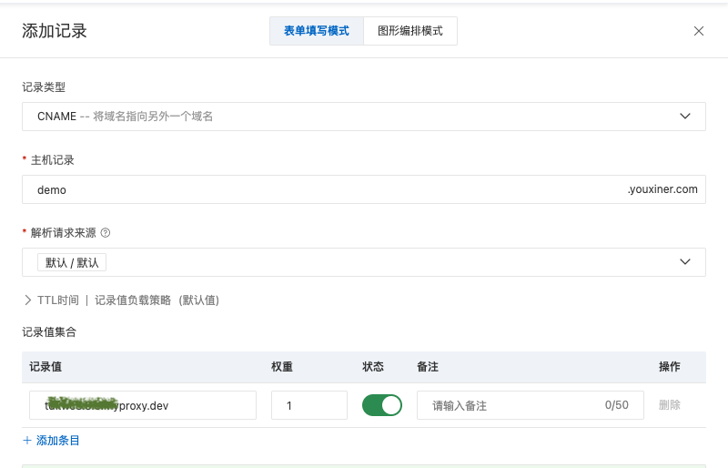
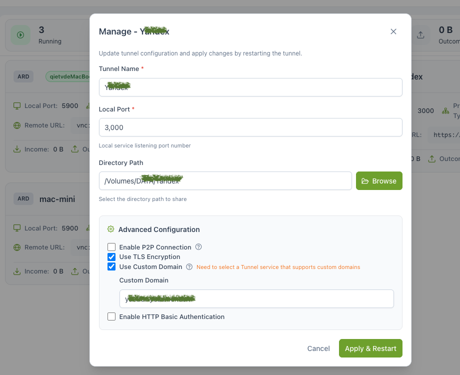

# 自定義域名

> 為隧道配置自定義域名，提升專業形象

---

## 📋 目錄

- [概述](#概述)
- [系統分配域名](#系統分配域名)
- [配置自定義域名](#配置自定義域名)
- [DNS 記錄設定](#dns-記錄設定)
- [證書管理](#證書管理)
- [CNAME 驗證](#cname-驗證)
- [常見問題](#常見問題)

---

## 概述

### 為什麼需要自定義域名？

**系統分配域名**：
```
https://abc123-def456.edge.myroxy.dev
```

**自定義域名**：
```
https://api.yourcompany.com
```

**優勢**：
- ✅ 更專業的外觀
- ✅ 易於記憶
- ✅ 品牌統一
- ✅ SEO 友好

---

## 系統分配域名

### 域名格式

每個隧道會自動分配域名：

```
格式: {subdomain}.{base-domain}
示例: abc123.edge.myroxy.dev
```

### Subdomain 生成規則

- 使用 base36 編碼
- 基於 Edge 自增 ID
- 生命週期保持不變

---

## 配置自定義域名

### 步驟 1：準備域名

確保您擁有一個域名，例如 `yourcompany.com`

### 步驟 2：新增 DNS 記錄

#### HTTP/HTTPS 隧道

新增 **CNAME** 記錄：

```
型別: CNAME
名稱: api（或 @）
值: abc123-def456.edge.myroxy.dev
TTL: 300
```

> 📸  DNS 配置示例
> 
> 說明：顯示 DNS 提供商後臺、CNAME 記錄配置

#### TCP/UDP 隧道

TCP/UDP 隧道**不支援**自定義域名，只能使用 IP:Port。

### 步驟 3：在 YAT 中配置

1. 開啟隧道詳情
2. 找到 **自定義域名** 區域
3. 點選 **新增域名**
4. 輸入您的域名
5. 點選 **儲存**

> 📸 YAT 自定義域名配置
> 
> 說明：顯示域名輸入框、儲存按鈕、驗證狀態

### 步驟 4：驗證 DNS

YAT 會自動驗證 DNS 配置：

- ✅ **驗證通過** - 域名可用，自動申請證書
- ⏳ **驗證中** - 等待 DNS 傳播
- ❌ **驗證失敗** - 檢查 DNS 記錄

---

## DNS 記錄設定

### 常見 DNS 提供商

#### Cloudflare

1. 登入 Cloudflare Dashboard
2. 選擇域名
3. 點選 **DNS**
4. 新增 CNAME 記錄


#### 阿里雲

1. 登入阿里雲控制台
2. 進入 **域名解析**
3. 選擇域名
4. 新增記錄

#### 騰訊雲

1. 登入騰訊雲控制台
2. 進入 **DNS 解析**
3. 選擇域名
4. 新增記錄

### DNS 傳播時間

- **通常**: 1-5 分鐘
- **最長**: 48 小時
- **TTL 設定**: 建議 300 秒（5 分鐘）

### 驗證 DNS 配置

```bash
# 使用 dig
dig api.yourcompany.com CNAME

# 使用 nslookup
nslookup -type=CNAME api.yourcompany.com

# 使用 curl 測試
curl -I https://api.yourcompany.com
```

---

## 證書管理

### 自動證書籤發

驗證通過後，YAT 會自動：

1. **DNS-01 挑戰** - 驗證域名所有權
2. **申請證書** - Let's Encrypt 免費證書
3. **配置 TLS** - 自動啟用 HTTPS
4. **證書續期** - 到期前自動續期

### 證書狀態

| 狀態 | 說明 | 操作 |
|------|------|------|
| **正常** | 證書有效 | 無需操作 |
| **即將過期** | 30 天內過期 | 等待自動續期 |
| **已過期** | 證書已過期 | 手動觸發續期 |
| **申請失敗** | 挑戰失敗 | 檢查 DNS |

### 手動續期證書

1. 進入隧道詳情
2. 點選 **續期證書** 按鈕
3. 等待完成

---

## CNAME 驗證

### 驗證流程

```
1. YAT 檢查 DNS 記錄
   ↓
2. 解析 CNAME 目標
   ↓
3. 對比系統分配域名
   ↓
4. 返回驗證結果
```

### 驗證失敗排查

#### 問題 1：DNS 記錄未生效

**症狀**: 驗證失敗，提示 DNS 記錄不匹配

**解決**:
```bash
# 等待 DNS 傳播
# 或重新整理本地 DNS 快取

# macOS
sudo dscacheutil -flushcache
sudo killall -HUP mDNSResponder

# Linux
sudo systemd-resolve --flush-caches

# Windows
ipconfig /flushdns
```

#### 問題 2：CNAME 值錯誤

**症狀**: CNAME 目標地址不正確

**解決**:
1. 檢查 CNAME 值是否為系統分配域名
2. 複製正確的域名
3. 更新 DNS 記錄

#### 問題 3：使用了 A 記錄而非 CNAME

**症狀**: 配置了 A 記錄

**解決**:
- 必須使用 **CNAME** 記錄
- 不能使用 A 記錄指向 IP

---

## 常見問題

### Q: 一個隧道可以配置多個自定義域名嗎？

目前**不支援**多域名，一個隧道只能配置一個自定義域名。

### Q: 自定義域名需要額外付費嗎？

**不需要**。YAT 提供免費證書和域名配置。

### Q: 支援萬用字元域名嗎？

目前**不支援**萬用字元域名（如 `*.example.com`）。

### Q: TCP/UDP 隧道支援自定義域名嗎？

**不支援**。TCP/UDP 隧道只能使用 IP:Port。

### Q: 證書到期後會自動續期嗎？

**會**。YAT 會在到期前 30 天自動續期。

### Q: 如何檢視證書資訊？

在隧道詳情的 **域名狀態** 區域可以看到：
- 證書頒發者
- 有效期
- 狀態

---

## 💡 最佳實踐

### 1. 選擇子域名

```
✅ api.yourcompany.com     - API 服務
✅ app.yourcompany.com     - Web 應用
✅ dev.yourcompany.com     - 開發環境
❌ yourcompany.com         - 根域名（不推薦）
```

### 2. 設定合理的 TTL

- **開發環境**: 60 秒（快速切換）
- **生產環境**: 300 秒（平衡效能和靈活性）

### 3. 監控證書狀態

定期檢查證書狀態，確保自動續期正常。

### 4. 使用 HTTPS

始終使用 HTTPS，避免混合內容警告。

---

## 📚 相關檔案

- [隧道管理](tunnel-management.md) - 建立和管理隧道
- [Edge 伺服器管理](edge/management.md) - Edge 域名配置
- [常見問題](faq.md) - 解決域名相關問題

---

*YAT Team - 讓內網穿透更簡單*
