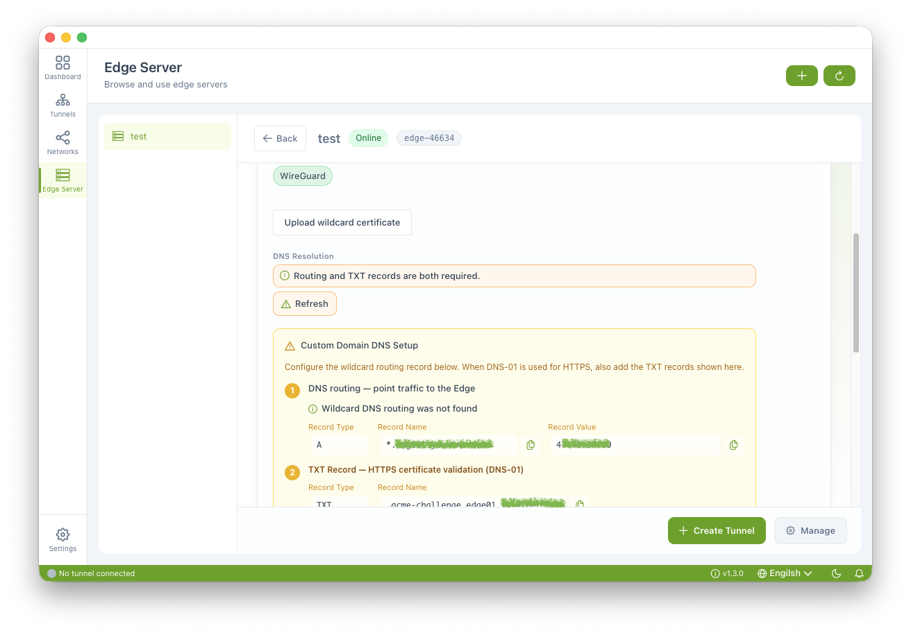

# 🌐 DNS 故障排除指南

> 確保您的 DNS 設定正確，以便正常解析域名。如果遇到 DNS 解析問題，請檢查網路連線和 DNS 配置。

## 🔍 常見 DNS 問題診斷

### DNS 解析失敗
- **現象**: 域名無法訪問，瀏覽器顯示 "DNS_PROBE_FINISHED_NXDOMAIN" 或類似錯誤
- **可能原因**: 
  - DNS 記錄未正確配置
  - DNS 傳播尚未完成（通常需要 1-48 小時）
  - 本地 DNS 快取過期
  - DNS 伺服器不可用

### DNS 驗證失敗
- **現象**: YAT 控制台顯示 "DNS Verification Failed"
- **可能原因**:
  - CNAME 記錄指向錯誤的 Edge 地址
  - DNS 記錄 TTL 設定過長，導致更新延遲
  - DNS 提供商限制或防火牆攔截

## 🛠️ 排查步驟

### 步驟 1: 獲取 CNAME 記錄值

#### 在 Edge 控制台中獲取記錄值
1. 登入 YAT 控制台 → [Edge 管理](edge/management.md)
2. 在 Edge 列表中找到您的 Edge 伺服器
3. 點選 **管理** 按鈕或點選 Edge 卡片進入詳情頁
4. 在 **域名健康** 或 **DNS 配置** 區域找到 CNAME 記錄值
5. 複製顯示的 CNAME 記錄值（通常格式為 `xxx.edge.tunnel6.com`）

> 📸  Edge 控制台的 DNS 配置

#### 在 yat-fe 客戶端中獲取記錄值
1. 開啟 yat-fe 客戶端應用
2. 在左側導航欄選擇 **隧道管理**
3. 找到對應的隧道並點選進入詳情頁
4. 在 **遠端地址** 或 **域名配置** 區域找到 CNAME 記錄值
5. 點選複製按鈕獲取記錄值

> 📸  隧道詳情頁會顯示遠端地址、CNAME 記錄和複製按鈕

### 步驟 2: 檢查 DNS 記錄配置
1. 登入您的 DNS 提供商控制台
2. 確認 CNAME 記錄已正確新增
3. 驗證記錄值是否指向正確的 Edge 節點地址

### 步驟 2: 驗證 DNS 傳播狀態
使用以下命令檢查 DNS 是否已生效：
```bash
# 檢查 DNS 解析
nslookup your-domain.com

# 或使用 dig 命令
dig your-domain.com CNAME +short
```

### 步驟 3: 配置隧道 alias 域名

#### 在 yat-fe 客戶端中配置 alias 域名
1. 開啟 yat-fe 客戶端應用
2. 在左側導航欄選擇 **隧道管理**
3. 點選右上角 **+ 建立隧道** 按鈕
4. 在建立隧道嚮導中選擇應用型別（如 HTTP）
5. 在 **域名配置** 區域輸入您的自定義域名（如 `myapp.example.com`）
6. 儲存配置並啟動隧道

> 📸  建立隧道嚮導中的域名輸入與儲存設定

### 步驟 4: 清除本地 DNS 快取
```bash
# macOS
sudo dscacheutil -flushcache; sudo killall -HUP mDNSResponder

# Windows
ipconfig /flushdns

# Linux
sudo systemd-resolve --flush-caches
```

## 📚 相關資源
- [DNS 記錄配置指南](custom-domains.md#dns-record-setup)
- [自定義域名配置](custom-domains.md)
- [Edge 管理](edge/management.md)

## ❓ 常見問題

### Q: DNS 傳播需要多長時間？
A: 通常需要 1-48 小時，具體取決於 DNS 記錄的 TTL 設定。

### Q: 如何加快 DNS 傳播？
A: 在 DNS 配置前將 TTL 設定為較短時間（如 300 秒），配置完成後可恢復為較長 TTL。

### Q: YAT 支援哪些 DNS 提供商？
A: 支援所有主流 DNS 提供商，包括 Cloudflare、阿里雲 DNS、騰訊雲 DNS、GoDaddy、Namecheap 等。

---
*檔案最後更新: 2026-05-04*
