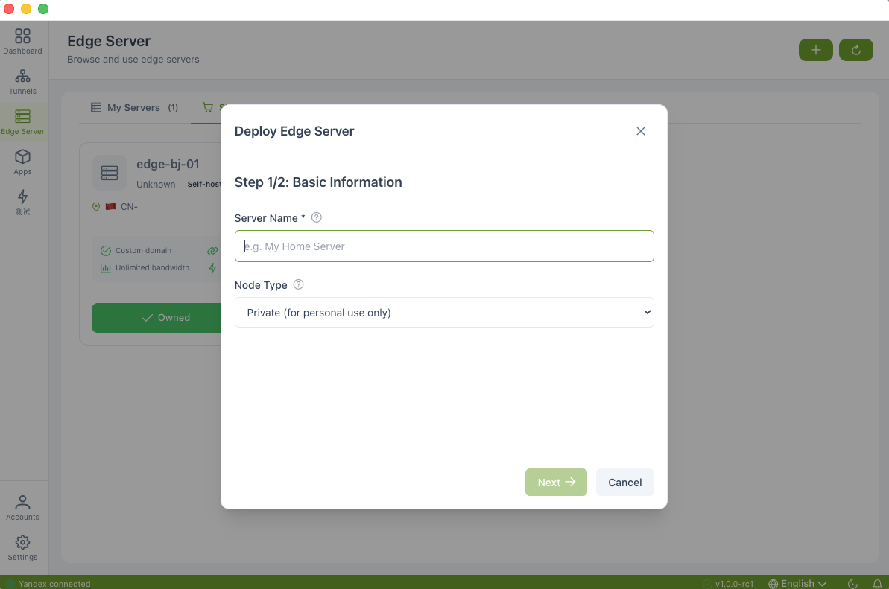
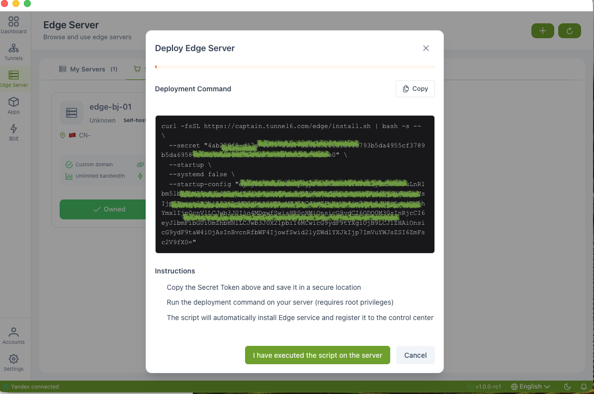
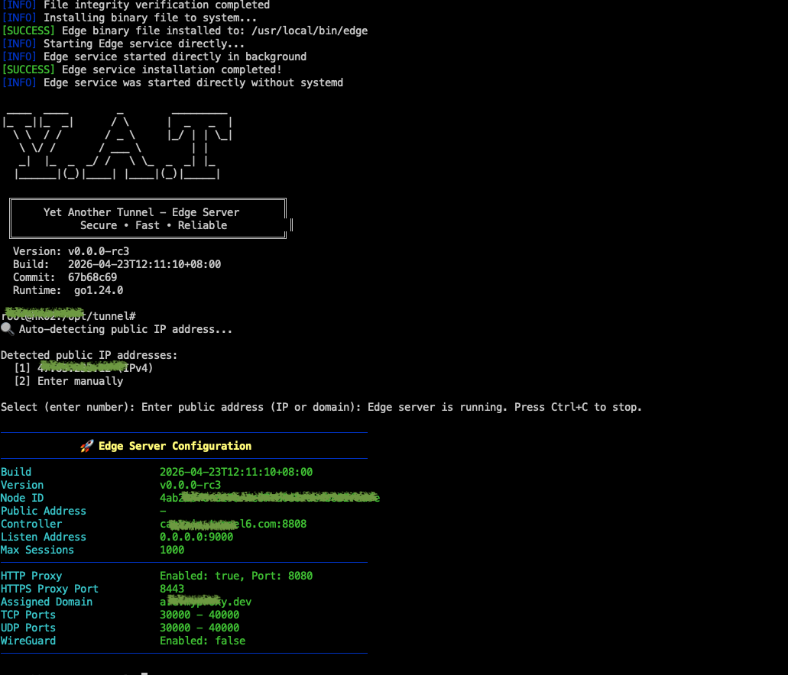

# 部署 Edge 伺服器

> 在公網伺服器上部署 YAT Edge 節點

---

## 📋 前置要求

- ✅ 公網 VPS（Ubuntu 18.04+ / CentOS 7+ Linux kernel 5.6+）
- ✅ 公網 IP 地址
- ✅ 域名（可選，用於自定義域名）

---

## 方式一：使用 YAT 客戶端部署（推薦）

### 步驟 1：開啟部署對話方塊

1. 點選 **Edges** > **建立**
2. 填寫 Edge 資訊：
   - **Edge 名稱** - 自定義名稱
   - **節點型別** - 私有還是共享

> 📸  Edge 部署對話方塊

> 📸  獲取部署指令碼

### 步驟 2：手動部署

1. 登入到公網伺服器
2. 執行部署指令碼

> 📸  執行部署指令碼

### 步驟 3：驗證部署

部署成功後：
- ✅ Edge 出現在"我的 Edge"列表
- ✅ 狀態顯示為 **線上**
- ✅ 顯示公網 IP 和域名

---

## 方式二：手動部署

### 步驟 1：下載 Edge

```bash
# 下載最新版本
curl https://download.tunnel6.com/download/edge/releases/v1.1.0-rc3/edge-linux-amd64 -o /usr/local/bin/edge

# 新增執行許可權
chmod +x /usr/local/bin/edge
```

### 步驟 2：獲取部署指令碼

在 YAT 客戶端中建立 Edge 後，獲取對應的部署指令碼（包含認證 token）。

### 步驟 3：啟動 Edge

```bash
# 前臺啟動（測試）
edge server start

# 後臺啟動（生產）
nohup edge server start --daemon > edge.log 2>&1 &
```

### 步驟 4：配置 systemd（可選）

```ini
# /etc/systemd/system/edge.service
[Unit]
Description=YAT Edge Server
After=network.target

[Service]
Type=simple
ExecStart=/usr/local/bin/edge server start
Restart=always
RestartSec=5

[Install]
WantedBy=multi-user.target
```

```bash
# 啟用並啟動服務
sudo systemctl daemon-reload
sudo systemctl enable edge
sudo systemctl start edge

# 檢視狀態
sudo systemctl status edge
```

---

## 下一步

- [管理 Edge 伺服器](management.md#管理-edge-伺服器) — 檢視狀態、配置域名
- [配置引數參考](config-reference.md) — 自定義 Edge 配置
- [CLI 命令參考](cli-reference.md) — 命令列工具使用
- [WireGuard 配置](wireguard.md) — 啟用 WireGuard 組網功能

---

*YAT Team - 讓內網穿透更簡單*
