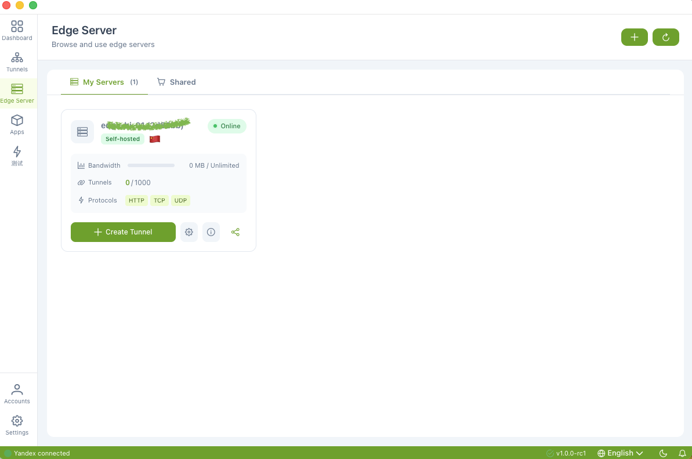

# Edge 伺服器管理

> 瞭解 Edge 伺服器的概念、架構和日常管理

---

## 什麼是 Edge 伺服器

Edge 伺服器是 YAT 網路的**核心節點**，負責：

- 🔄 **流量轉發** — 中轉客戶端與伺服器的流量
- 🔐 **mTLS 認證** — 雙向 TLS 驗證
- 📊 **狀態同步** — 即時同步隧道狀態
- 🌐 **域名管理** — 分配和管理隧道域名

### 為什麼需要 Edge？

```
傳統方案（需要公網 IP + 埠轉發）:
  外網使用者 → 路由器配置 → 內網服務

YAT 方案（無需配置）:
  外網使用者 → Edge 伺服器 → 內網服務
```

**優勢**：無需公網 IP、無需配置路由器、自動加密、全球部署

### Edge 型別

| 型別 | 說明 | 適用場景 |
|------|------|---------|
| **自建 Edge** | 您自己部署的 Edge | 生產環境、私有化部署 |
| **共享 Edge** | 其他人共享的 Edge | 測試、個人使用 |

---

## 架構與啟動流程

### 元件結構

```
Edge 伺服器
├── 配置檔案 (config.yaml)
├── 證書目錄 (certs/)
│   ├── root-ca.crt         # 根證書
│   ├── edge-sub-ca.crt     # Edge 子 CA
│   ├── edge-tls.crt        # TLS 證書
│   └── edge-tls.key        # TLS 私鑰
├── 資料庫
│   ├── channels.db         # 通道狀態
│   └── wireguard.db        # WireGuard 配置
└── 二進位制檔案 (edge)
```

### 啟動流程

```
1. Bootstrap - 初始化配置
2. RegisterNode - 向 Captain 註冊
3. Subscribe - 訂閱控制流
4. Heartbeat - 心跳保活
```

---

## 管理 Edge 伺服器

### 檢視 Edge 列表

點選 **Edges**，切換到 **我的** 標籤：

> 📸  Edge 列表頁面
> 
> 說明：顯示 Edge 卡片、狀態、操作按鈕

### Edge 卡片資訊

每個 Edge 卡片顯示：

- **名稱** - Edge 名稱
- **狀態** - 線上/離線（帶圖示）
- **公網 IP** - Edge 的公網地址
- **域名** - 系統分配的域名
- **隧道數量** - 該 Edge 上的隧道數
- **服務狀態** - 各項服務執行狀態

### Edge 操作

#### 檢視詳情

點選 **詳情** 按鈕，檢視：

- 基本資訊
- 網路資訊（IP、域名）
- 域名健康狀態
- 服務執行狀態
- 隧道列表

> 📸  Edge 詳情頁面

#### 管理配置

點選 **管理** 按鈕（僅自建 Edge）：

- 修改名稱
- 修改描述
- 重啟 Edge
- 檢視部署命令

#### 刪除 Edge

點選 **刪除** 按鈕：

> ⚠️ **警告**：
> - 刪除 Edge 會清理所有相關隧道
> - 證書會被撤銷
> - 域名會被釋放

### 監控 Edge 狀態

- 🟢 **線上** - Edge 正常執行
- 🔴 **離線** - Edge 無法連線
- 🟡 **異常** - 部分服務異常

---

## 域名與健康檢查

### 系統分配域名

每個 Edge 自動分配域名：

```
格式: {edge-id}.edge.myroxy.dev
示例: abc123.edge.myroxy.dev
```

### 自定義域名

您可以為 Edge 配置自定義域名：

1. 在 Edge 管理中新增自定義域名（如 `edge.example.com`）
2. 新增 CNAME 記錄指向系統分配域名
3. YAT 自動驗證 DNS 配置
4. 驗證通過後自動申請 Let's Encrypt 證書

### 健康檢查

YAT 每 5 分鐘定期檢查 Edge 域名健康：

| 狀態 | 說明 | 操作 |
|------|------|------|
| **正常** | DNS 和證書都正常 | 無需操作 |
| **DNS 異常** | DNS 記錄有問題 | 檢查 DNS 配置 |
| **證書異常** | 證書過期或無效 | 重新生成證書 |
| **未知** | 無法檢測 | 檢查 Edge 連線 |

---

## 📚 相關檔案

- [部署 Edge 伺服器](deploy.md) — 快速部署 Edge 節點
- [WireGuard 配置](wireguard.md) — 啟用 WireGuard 組網功能
- [配置引數參考](config-reference.md) — config.yaml 完整配置項
- [CLI 命令參考](cli-reference.md) — 命令列工具參考
- [常見問題](faq.md) — Edge 部署和執行常見問題
- [自定義域名](../custom-domains.md) — 域名配置詳解
- [WireGuard 組網](../wireguard-networking.md) — 構建虛擬區域網

---

*YAT Team - 讓內網穿透更簡單*
