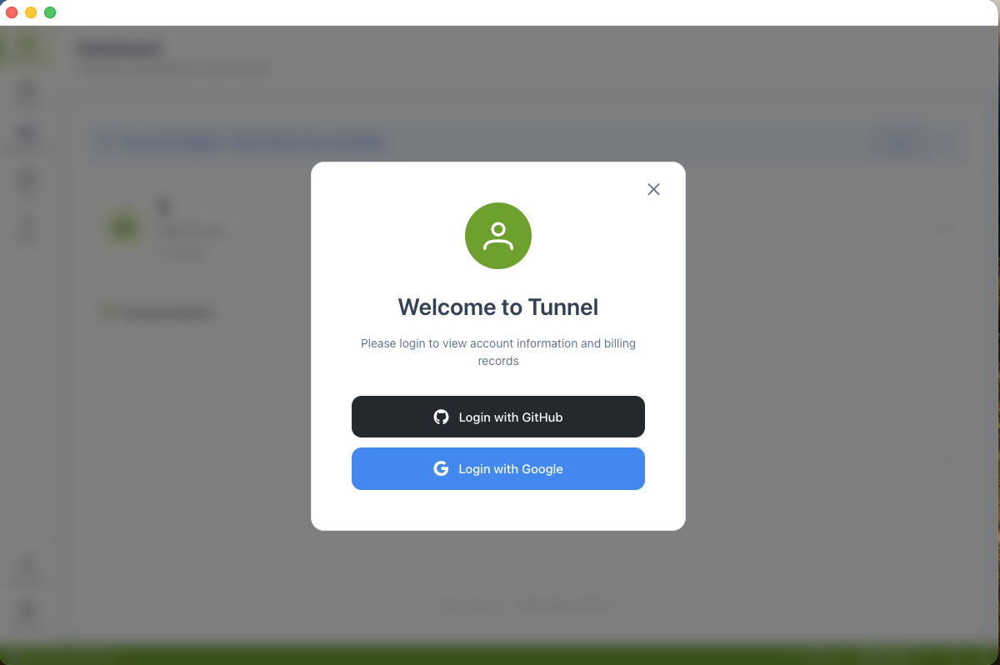
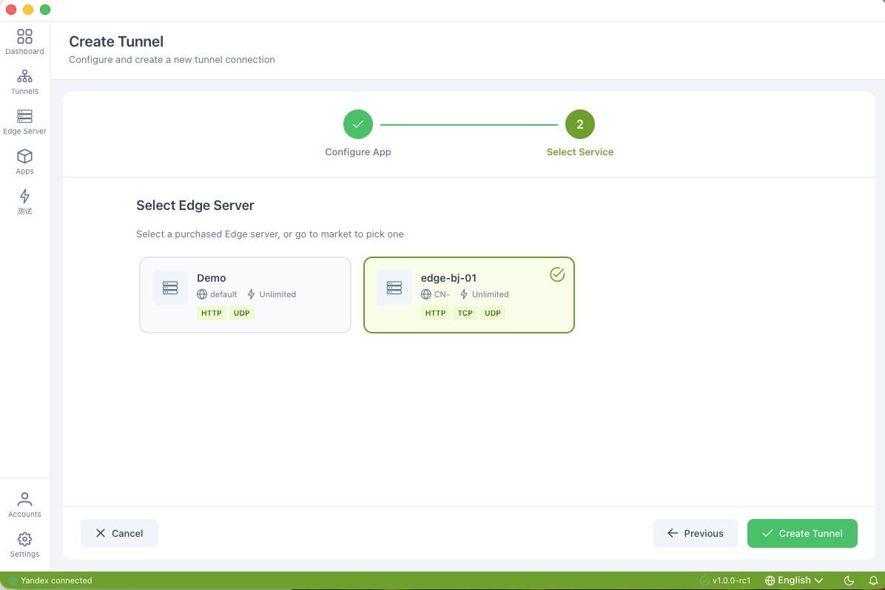
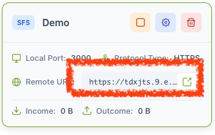

# 快速開始

> 5 分鐘上手 YAT，建立您的第一個隧道

---

## 📋 前置要求

- ✅ macOS 10.15+ / Windows 10+ / Linux (Ubuntu 18.04+)
- ✅ 網路連線
- ✅ YAT 賬戶（支援 GitHub/Google 登入）

---

## 步驟 1：安裝 YAT 客戶端

### macOS

1. 下載 `.dmg` 安裝包
2. 雙擊開啟，拖拽到 Applications 資料夾
3. 從 Launchpad 或 Applications 資料夾啟動

> ⚠️ **首次啟動提示**：如果提示"無法驗證開發者"，請前往 系統設定 > 隱私與安全性 > 仍要開啟

> 📖 更多方案（DMG 一鍵修復、Finder 放行、終端機命令、本機自簽名）見 [macOS 安裝指南（未簽名 / 自簽名版本）](./macos-unsigned-install.md)。

### Windows

1. 下載 `.exe` 安裝包
2. 雙擊執行安裝嚮導
3. 按提示完成安裝

### Linux

```bash
# 下載 AppImage
chmod +x yat-*.AppImage
./yat-*.AppImage
```

### 驗證安裝

啟動後，您應該看到 YAT 的主介面：

> 📸 YAT 主介面 - 首次啟動
> 
> 說明：顯示歡迎頁面、登入按鈕、功能介紹

---

## 步驟 2：登入

### 登入方式

YAT 支援以下登入方式：

1. **GitHub 登入**（推薦）
2. **Google 登入**
3. **郵箱註冊**（即將支援）

### 登入流程

1. 點選 **登入** 按鈕
2. 選擇登入方式
3. 授權 YAT 訪問您的賬戶
4. 完成登入

>  登入頁面
> 
> 說明：顯示 GitHub/Google 登入按鈕

### 登入後

登入成功後，您將進入主介面，可以看到：

- 📊 **Dashboard** - 概覽統計
- 🔌 **Tunnels** - 隧道管理
- 🖥️ **Edges** - Edge 伺服器管理
- 🧩 **Apps** - 應用與擴充套件
- ⚙️ **Settings** - 設定

---

## 步驟 3：訂閱 Edge 伺服器

Edge 伺服器是 YAT 網路的中轉節點。對於新使用者，我們建議先訂閱共享的 Edge 伺服器。

### 訂閱共享 Edge

1. 點選左側導航欄的 **Edges**
2. 切換到 **市場** 標籤
3. 選擇一個可用的 Edge 伺服器
4. 點選 **訂閱** 按鈕

> 📸  Edge 市場頁面
> 
> 說明：顯示可訂閱的 Edge 列表、訂閱按鈕

### 驗證訂閱

訂閱成功後，Edge 會出現在 **我的** 標籤中，狀態顯示為 **線上**。

---

## 步驟 4：建立第一個隧道

現在讓我們建立一個 HTTP 隧道，將本地服務暴露到公網。

### 準備本地服務

如果您還沒有本地服務，可以快速啟動一個：

```bash
# 使用 Python 啟動簡單 HTTP 伺服器
python3 -m http.server 8080

# 或使用 Node.js
npx http-server -p 8080
```

訪問 `http://localhost:8080` 確認服務正常執行。

### 建立隧道

1. 點選左側導航欄的 **Tunnels**
2. 點選 **建立隧道** 按鈕
3. 選擇 **HTTP 代理** 應用
4. 選擇已訂閱的 Edge 伺服器
5. 填寫配置：
   - **隧道名稱**: 我的測試服務
   - **本地埠**: 8080
   - **共享設定**: 獨佔（推薦）
6. 點選 **建立**

>  建立隧道對話方塊
> 
> 
> 說明：顯示應用選擇、Edge 選擇、配置表單

### 建立成功

建立成功後，隧道會出現在隧道列表中，狀態為 **未啟動**。

---

## 步驟 5：啟動隧道

1. 找到剛建立的隧道卡片
2. 點選 **啟動** 按鈕
3. 等待狀態變為 **執行中**

>  隧道啟動過程
> 
> 說明：顯示啟動按鈕、狀態變化、載入動畫

### 啟動成功

啟動成功後，隧道卡片會顯示：

- ✅ 狀態：**執行中**（綠色）
- 🌐 遠端地址：`https://xxx.myroxy.dev`
- 📊 流量統計

---

## 步驟 6：訪問遠端服務

### 獲取遠端地址

在隧道卡片上，找到 **遠端地址** 區域：

```
https://abc123-def456.myroxy.dev
```

### 測試訪問

1. 複製遠端地址
2. 在瀏覽器中開啟
3. 您應該看到與 `http://localhost:8080` 相同的內容

> 📸   瀏覽器訪問遠端地址
> 
> 說明：顯示通過 YAT 隧道訪問的網頁

### 🎉 恭喜！

您已成功建立並啟動了第一個 YAT 隧道！

---

## 🎯 5 分鐘體驗清單

- [x] 安裝 YAT 客戶端
- [x] 註冊與登入
- [x] 訂閱 Edge 伺服器
- [x] 建立 HTTP 隧道
- [x] 啟動隧道
- [x] 訪問遠端服務

---

## 🚀 下一步

現在您已經體驗了 YAT 的基本功能，可以探索更多高階功能：

### 推薦學習路徑

1. **[隧道管理](tunnel-management.md)** - 學習建立 TCP/UDP 隧道、隧道共享等
2. **[Edge 伺服器管理](edge/management.md)** - 部署自己的 Edge 伺服器
3. **[應用與擴充套件](apps-and-extensions.md)** - 使用 ARD 遠端桌面

### 常用操作速查

| 操作 | 位置 | 說明 |
|------|------|------|
| 建立隧道 | Tunnels > 建立隧道 | 選擇應用和 Edge |
| 啟動/停止 | 隧道卡片 > 按鈕 | 控制隧道狀態 |
| 檢視詳情 | 隧道卡片 > 檢視詳情 | 檢視通道、域名等 |
| 刪除隧道 | 隧道卡片 > 刪除 | 永久刪除隧道 |
| 訂閱 Edge | Edges > 市場 > 訂閱 | 訂閱共享 Edge |
| 部署 Edge | Edges > 建立 | 部署自己的 Edge |

---

## 💡 常見問題

### Q: 建立隧道時提示"沒有可用的 Edge"

**原因**: 您還沒有訂閱任何 Edge 伺服器。

**解決**: 前往 Edges > 市場，訂閱一個共享 Edge。

### Q: 隧道啟動失敗

**可能原因**:
1. Edge 伺服器離線
2. 本地埠被佔用
3. 網路連線問題

**解決**: 
1. 檢查 Edge 狀態（應為線上）
2. 確認本地埠可訪問
3. 檢視錯誤提示，或參考 [常見問題](faq.md)

### Q: 遠端地址無法訪問

**檢查清單**:
- [ ] 隧道狀態是否為"執行中"
- [ ] 本地服務是否正常執行
- [ ] 瀏覽器是否提示證書錯誤（忽略並繼續）
- [ ] Edge 伺服器是否線上

---

## 📚 相關檔案

- [YAT 是什麼](what-is-yat.md) - 瞭解 YAT 的核心功能
- [隧道管理](tunnel-management.md) - 深入學習隧道管理
- [Edge 伺服器管理](edge/management.md) - 部署和管理 Edge
- [常見問題](faq.md) - 解決常見問題

---

*YAT Team - 讓內網穿透更簡單*
