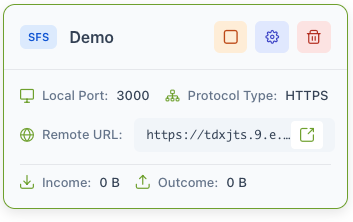
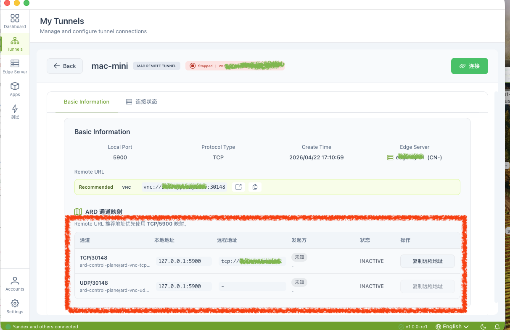
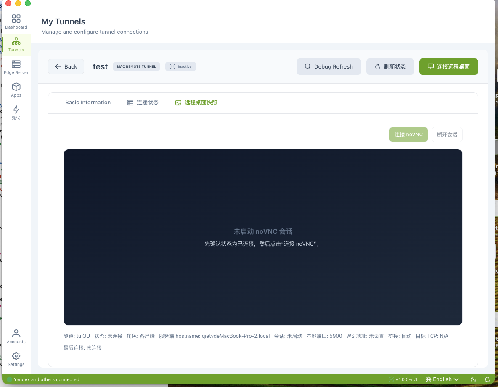
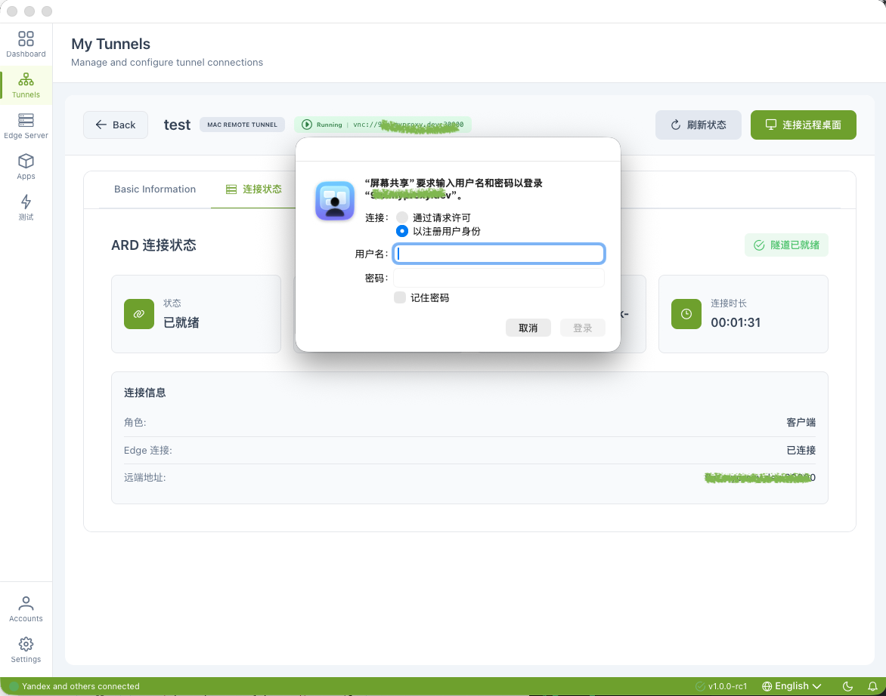

# 隧道管理

> 學習如何建立、管理和監控隧道

---

## 📋 目錄

- [隧道概述](#隧道概述)
- [建立隧道](#建立隧道)
- [啟動與停止](#啟動與停止)
- [檢視隧道詳情](#檢視隧道詳情)
- [隧道共享與協作](#隧道共享與協作)
- [刪除隧道](#刪除隧道)
- [隧道統計](#隧道統計)
- [常見問題](#常見問題)

---

## 隧道概述

### 什麼是隧道？

隧道（Tunnel）是 YAT 的核心工作單元，用於將內網服務暴露到公網。

**隧道的組成**：
- **Intent（意圖）** - 您想要做什麼（協議、配置）
- **Channels（通道）** - 具體的轉發規則
- **Participants（參與者）** - 裝置及其角色
- **Routes（路由）** - 執行鏈路

### 隧道狀態

| 狀態 | 說明 | 圖示 |
|------|------|------|
| **active** | 執行中 | 🟢 |
| **inactive** | 未啟動 | ⚪ |
| **stopped** | 已停止 | 🔴 |
| **failed** | 啟動失敗 | ❌ |
| **negotiating** | 協商中 | 🟡 |

### 支援的應用型別

| 應用 | 協議 | 說明 |
|------|------|------|
| **HTTP 代理** | HTTP/HTTPS | Web 服務、API |
| **TCP 轉發** | TCP | 資料庫、SSH |
| **UDP 轉發** | UDP | 遊戲伺服器、DNS |
| **ARD 遠端桌面** | TCP+UDP | macOS 遠端桌面 |

---

## 建立隧道

### 方式一：從 Tunnels 頁面建立

1. 點選左側導航欄 **Tunnels**
2. 點選 **建立隧道** 按鈕
3. 選擇應用型別

> 📸   應用選擇對話方塊
> 
> 說明：顯示可用的應用列表、應用圖示和描述

### 方式二：從 Edge 頁面建立

1. 點選左側導航欄 **Edges**
2. 選擇一個 Edge 伺服器
3. 點選 **建立隧道** 按鈕

### 配置隧道

#### HTTP 代理

**配置項**：
- **隧道名稱** - 自定義名稱（必填）
- **本地埠** - 本地服務埠（必填）
- **本地主機** - 本地監聽地址（預設 127.0.0.1）
- **傳輸模式** - Relay / P2P / WireGuard
- **共享設定** - 共享 / 獨佔

> 📸  HTTP 代理配置表單
> 
> 說明：顯示名稱、埠、傳輸模式等配置項

#### TCP/UDP 轉發

**配置項**：
- **隧道名稱** - 自定義名稱
- **本地埠** - 本地監聽埠
- **遠端埠** - 遠端暴露埠（可選）
- **本地主機** - 本地監聽地址

#### ARD 遠端桌面

**配置項**：
- **隧道名稱** - 自定義名稱
- **目標主機** - 目標 Mac 的主機名或 IP
- **傳輸模式** - Relay / P2P / WireGuard
- **角色** - 伺服器 / 客戶端

### 配置初始化

某些應用會在建立時自動初始化配置：

```typescript
// ARD 示例
{
  localHost: '127.0.0.1',
  sharedState: 'shared',
  tunnelRole: 'publisher',
  transport: 'relay',
  creatorDeviceId: 'device-xxx'
}
```

### 建立成功

建立成功後：
- ✅ 隧道出現在隧道列表中
- ✅ 狀態為 **未啟動**
- ✅ 可以點選檢視詳情

---

## 啟動與停止

### 啟動隧道

**方式一：從列表啟動**

1. 找到隧道卡片
2. 點選 **啟動** 按鈕
3. 等待狀態變為 **執行中**

**方式二：從詳情啟動**

1. 點選 **檢視詳情**
2. 點選 **啟動** 按鈕

> 📸   隧道啟動過程
> 
> 說明：顯示啟動按鈕、載入狀態、成功提示

### 啟動流程

```
使用者點選啟動
  ↓
檢查 Edge 連線
  ↓
檢查本地埠
  ↓
呼叫 Host API (startChannels)
  ↓
Edge 建立通道
  ↓
狀態同步到客戶端
  ↓
顯示執行中
```

### 停止隧道

**方式一：從列表停止**

1. 找到執行中的隧道
2. 點選 **停止** 按鈕
3. 確認停止

**方式二：從詳情停止**

1. 進入隧道詳情
2. 點選 **停止** 按鈕

### 重啟隧道

隧道執行異常時，可以點選 **重新連線** 按鈕重啟。

---

## 檢視隧道詳情

### 進入詳情

點選隧道卡片上的 **檢視詳情** 按鈕。

### 詳情頁面結構

#### 1. 基本資訊

- **隧道名稱**
- **應用型別**
- **Edge 伺服器**
- **建立時間**
- **更新時間**

> 📸  隧道詳情 - 基本資訊
> 
> 說明：顯示名稱、應用、Edge、時間等資訊

#### 2. 遠端地址

顯示可用的遠端訪問地址：

- **系統分配域名** - `xxx.myroxy.dev`
- **自定義域名** - 如果已配置
- **CNAME 狀態** - DNS 驗證狀態

> 📸  隧道詳情 - 遠端地址
> 
> 說明：顯示多個地址、複製按鈕、CNAME 狀態

#### 3. 通道列表

顯示隧道下的所有通道：

| 通道名稱 | 協議 | 本地埠 | 遠端埠 | 狀態 |
|---------|------|---------|---------|------|
| VNC 通道 | TCP | 5900 | 12345 | 執行中 |
| VNC 通道 | UDP | 5900 | 12345 | 執行中 |

> 📸  隧道詳情 - 通道列表
> 
> 說明：顯示通道 key、協議、埠繫結、狀態

#### 4. 參與者資訊

顯示參與裝置的角色：

- **裝置 ID**
- **角色** - Publisher / Consumer / Controller
- **狀態** - Online / Offline
- **最後線上時間**

#### 5. 應用自定義標籤頁

某些應用會提供額外的標籤頁：

**ARD 示例**：
- **連線狀態** - 顯示 VNC 服務狀態
- **遠端桌面快照** - 顯示遠端桌面預覽

> 📸  隧道詳情 - ARD 自定義標籤
> 
> 說明：顯示連線狀態、桌面快照

---

## 隧道共享與協作

### 共享模式

YAT 支援兩種共享模式：

#### Exclusive（獨佔）

- 🔒 僅建立裝置可以使用
- 🚫 其他裝置無法加入
- ✅ 適合個人使用

#### Shared（共享）

- 👥 同一賬號的其他裝置可以加入
- 🔄 自動同步通道狀態
- ✅ 適合多裝置協作

### 設定共享模式

**建立時設定**：
在建立隧道的配置表單中選擇共享或獨佔。

**建立後修改**：
目前不支援修改共享模式，需要重新建立隧道。

### 多裝置協作

#### 場景示例

**場景**: 在公司訪問家裡的 NAS

**設定步驟**：

1. **家裡裝置（Publisher）**
   - 建立隧道，設定為 **共享**
   - 角色：**Publisher**（釋出端）
   - 啟動隧道

2. **公司裝置（Consumer）**
   - 看到共享隧道
   - 角色：**Consumer**（消費端）
   - 檢視遠端地址，訪問服務

> 📸   多裝置協作示意圖
> 
> 說明：顯示 Publisher 和 Consumer 裝置、隧道共享關係

### 角色說明

| 角色 | 許可權 | 說明 |
|------|------|------|
| **Publisher** | 啟動/停止/控制 | 服務提供者 |
| **Consumer** | 檢視/訪問 | 服務使用者 |
| **Controller** | 管理配置 | 管理員（預留） |

---

## 刪除隧道

### 刪除流程

1. 找到隧道卡片
2. 點選 **刪除** 按鈕
3. 確認刪除

> ⚠️ **警告**：刪除操作不可逆！

### 刪除前檢查

刪除前，應用可以定義檢查邏輯：

```typescript
hooks: {
  onBeforeDelete(context) {
    // 檢查是否有執行中的服務
    if (context.tunnel.status === 'active') {
      alert('請先停止隧道')
      return false
    }
    return true
  }
}
```

### 刪除後

- ❌ 隧道從列表中移除
- ❌ Edge 上的通道被清理
- ❌ 分配的域名被釋放
- ❌ 無法恢復

---

## 隧道統計

### 統計卡片

Tunnels 頁面頂部顯示統計資訊：

- **執行中** - 當前執行的隧道數量
- **已停止** - 已停止的隧道數量
- **入站流量** - 接收的資料量
- **出站流量** - 傳送的資料量

> 📸  統計卡片
> 
> 說明：顯示 4 個統計指標

### 檢視單個隧道流量

在隧道詳情中可以看到該隧道的流量統計。

---

## 常見問題

### Q: 建立隧道時提示"埠被佔用"

**原因**: 本地埠已被其他服務佔用。

**解決**: 
1. 更換本地埠
2. 或關閉佔用該埠的服務

```bash
# macOS/Linux 檢視端口占用
lsof -i :8080

# Windows 檢視端口占用
netstat -ano | findstr :8080
```

### Q: 隧道啟動後立即停止

**可能原因**:
1. Edge 伺服器離線
2. 本地服務未啟動
3. 網路不穩定

**解決**:
1. 檢查 Edge 狀態
2. 確認本地服務執行正常
3. 檢視錯誤日誌

### Q: 如何檢視隧道日誌？

目前日誌功能開發中，您可以通過以下方式排查問題：

1. 檢視隧道狀態提示
2. 檢視 Edge 伺服器日誌
3. 提交 Issue 附帶截圖

### Q: 一個 Edge 可以建立多少個隧道？

理論上沒有限制，但建議：
- 單個 Edge 不超過 20 個隧道
- 總頻寬不超過 Edge 伺服器容量

### Q: 隧道可以跨 Edge 遷移嗎？

目前不支援。如需更換 Edge，需要：
1. 刪除原隧道
2. 在新 Edge 上重新建立

---

## 💡 最佳實踐

### 1. 命名規範

使用有意義的名稱：

```
✅ 我的 NAS - HTTP
✅ 開發伺服器 - TCP 3000
✅ 家庭監控 - UDP
❌ 隧道 1
❌ test
```

### 2. 埠選擇

- 使用非特權埠（>1024）
- 避免常見埠衝突
- 記錄埠用途

### 3. 安全建議

- 個人使用選擇 **獨佔** 模式
- 團隊協作選擇 **共享** 模式
- 定期清理不用的隧道

### 4. 效能最佳化

- 優先選擇 **P2P 模式**（延遲更低）
- 大檔案傳輸使用 **WireGuard 模式**
- Web 服務使用 **HTTP/HTTPS**

---

## 📚 相關檔案

- [快速開始](quick-start.md) - 建立第一個隧道
- [Edge 伺服器管理](edge/management.md) - 管理 Edge 伺服器
- [應用與擴充套件](apps-and-extensions.md) - 使用擴充套件功能
- [傳輸模式](transport-modes.md) - 瞭解傳輸模式

---

*YAT Team - 讓內網穿透更簡單*
