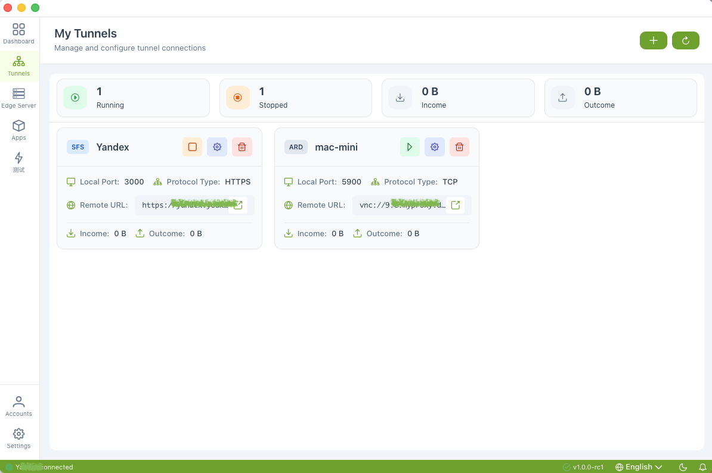
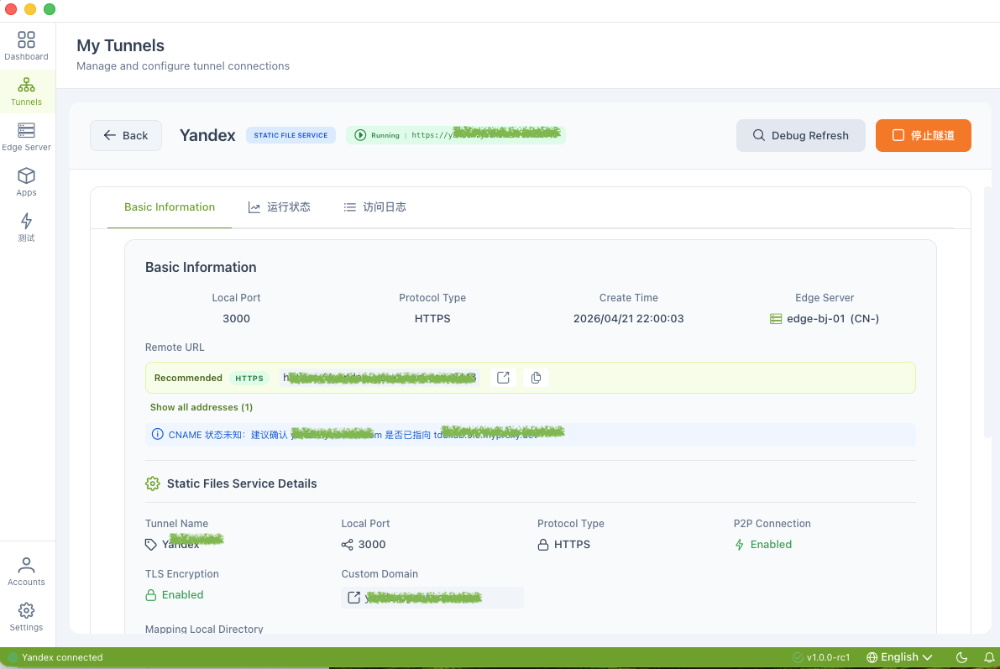
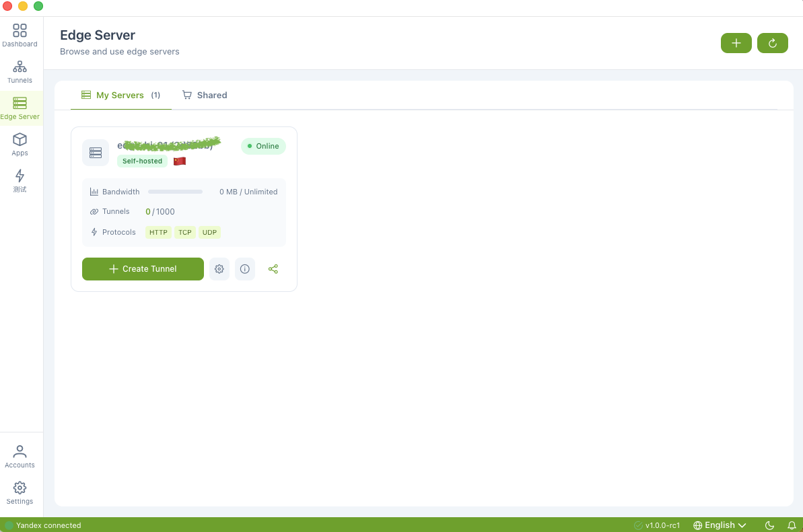

# YAT（打洞黍） 是什麼

> 瞭解 YAT 的核心功能、應用場景和系統架構

---

## 📌 一句話介紹

**YAT (Yet Another Tunnel)|打洞黍** 是一個功能強大的**內網穿透與應用擴充套件平臺**，讓您能夠安全、快速地從任何地方訪問內網服務。

---
## 🔥 特色
- **私有化部署：** 允許使用者搭建專屬邊緣節點，掌控資料主權與網路效能
- **全鏈路零信任：** 摒棄傳統邊界防禦，構建端到端加密與動態驗證的安全防線
- **全棧網路擴充套件：** 基於 YAT 框架提供四層/七層網路能力，滿足高效能轉發與複雜業務路由需求

## 🎯 核心功能

### 1. 內網穿透（隧道服務）

將內網服務暴露到公網，無需配置路由器埠轉發。

**支援的協議**：
- ✅ **HTTP/HTTPS** - Web 服務、API 介面
- ✅ **TCP** - 資料庫、SSH、自定義服務
- ✅ **UDP** - 遊戲伺服器、DNS 服務
- ✅ **WireGuard** - VPN 組網（即將支援）

**典型場景**：
```
家庭 NAS → 公網訪問
本地開發伺服器 → 客戶演示
內網資料庫 → 遠端辦公
IoT 裝置 → 雲端管理
```

### 2. Edge 伺服器網路

YAT 使用 **Edge 伺服器** 作為中轉節點，提供穩定的連線服務。

**特點**：
- **🌍 網路覆蓋廣：** 官方提供多地域節點，支援使用者就近接入，並允許自行搭建專屬 Edge 節點
- **🔄 智慧高可用：** 節點間支援自動故障轉移與負載均衡，保障服務持續線上
- **🔐 雙向認證安全：** 基於 mTLS 進行雙向認證與加密傳輸，確保通訊全程可信
- **📡 狀態可觀測：** 提供即時節點健康監控與流量統計，支援運維視覺化
- **🤝 共享與自治兼顧：** 既可使用官方或社群共享節點，也可部署私有節點並自主管控
### 3. 應用擴充套件系統

通過擴充套件（Extension）機制，YAT 可以支援各種遠端訪問場景。

**內建擴充套件**：
- 🖥️ **HTTP Proxy** - HTTP Proxy 服務
- 🔧 **TCP Forword** - TCP 轉發能力
- ☁️ **UDP Forword** - UDP 協議轉發能力
- 📁 **File Server** - 檔案伺服器

**第三方擴充套件**：
開發者可以開發自己的擴充套件，釋出到應用市場。

### 4. 多裝置協作

支援多個裝置協同工作，每個裝置可以扮演不同角色：

- **Publisher（釋出端）** - 提供服務的裝置
- **Consumer（消費端）** - 使用服務的裝置
- **Controller（控制端）** - 管理配置的裝置

---

## 🏗️ 系統架構

### 元件概覽

```
┌─────────────────────────────────────────────────────┐
│                   YAT 生態系統                        │
│                                                      │
│  ┌──────────────┐      ┌──────────────┐             │
│  │  yat-fe      │      │   Edge       │             │
│  │  桌面客戶端   │◄────►│   邊緣伺服器   |              │
│  │              │ mTLS │              │             │
│  └──────────────┘      └──────┬───────┘             │
│         │                     │                     │
│         │                     │                     │
│         ▼                     ▼                     │
│  ┌──────────────────────────────────────┐           │
│  │        控制面                         │           │
│  │  - 使用者認證                           │           │
│  │  - Edge 註冊管理                      │           │
│  │  - 證書籤發與撤銷                      │           │
│  │  - DNS 管理                          │           │ 
│  └──────────────────────────────────────┘           │
└─────────────────────────────────────────────────────┘
```

### 元件說明

#### 1. YAT（桌面客戶端）

- **功能**:
  - 管理隧道（建立、啟動、停止）
  - 管理 Edge 伺服器（部署、訂閱）
  - 載入和執行擴充套件
  - 顯示隧道狀態和統計資訊

#### 2. Edge（邊緣伺服器）

- **功能**:
  - 隧道執行時協調
  - mTLS 連線管理
  - 通道狀態維護
  - 與客戶端即時同步

**部署位置**：
- 公網 VPS（推薦）
- 家庭路由器（需公網 IP）
- 雲伺服器（AWS、GCP、阿里雲等）

---

## 🔑 核心概念

### Tunnel（隧道）

隧道是 YAT 的核心工作單元，表示一個遠端訪問連線。

**屬性**：
- **名稱**: 使用者自定義
- **協議**: HTTP/HTTPS/TCP/UDP
- **狀態**: active（執行中）/ inactive（未啟動）/ stopped（已停止）
- **共享狀態**: shared（共享）/ exclusive（獨佔）

**示例**：
```
隧道名稱: 我的 NAS
協議: HTTP
本地埠: 5000
遠端地址: https://nas-abc123.myroxy.dev
狀態: 執行中
```

### Channel（通道）

通道是隧道下的具體轉發規則，一個隧道可以有多個通道。

**示例**：
```
通道: VNC 通道
規則 1: TCP 5900 → 遠端 5900
規則 2: UDP 5900 → 遠端 5900
```

### Edge Server（邊緣伺服器）

Edge 伺服器是 YAT 網路的節點，負責轉發流量，服務協調等。

**屬性**：
- **ID**: 唯一標識
- **名稱**: 使用者自定義
- **狀態**: online（線上）/ offline（離線）
- **公網 IP**: Edge 的公網地址
- **域名**: 系統分配的域名
- **所有者**: 建立者或共享者

---

## 🆚 與其他工具對比

| 特性 | YAT | frp | ngrok | Cloudflare Tunnel |
|------|-----|-----|-------|-------------------|
| **GUI 客戶端** | ✅ Electron 桌面應用 | ❌ 命令列 | ✅ Web | ✅ Web |
| **擴充套件系統** | ✅ 外掛化架構 | ❌ | ❌ | ❌ |
| **多裝置協作** | ✅ Actor 模型 | ❌ | ❌ | ❌ |
| **mTLS 加密** | ✅ 雙向認證 | ⚠️ 單向 | ✅ | ✅ |
| **自定義 Edge** | ✅ 自行部署 | ✅ | ❌ | ❌ |
| **Edge 市場** | ✅ 共享訂閱 | ❌ | ❌ | ❌ |
| **WireGuard** | ✅ 支援中 | ❌ | ❌ | ❌ |
| **開源** | ✅ | ✅ | ❌ | ❌ |

---

## 🎨 介面預覽

### 主介面

> 📸 **** 主介面截圖
> 
> 說明：顯示隧道列表、統計卡片、建立按鈕

### 隧道詳情

> 📸  **隧道詳情頁面**
> 
> 說明：顯示隧道狀態、遠端地址、通道列表、操作按鈕

### Edge 管理

> 📸  Edge 管理頁面
> 
> 說明：顯示 Edge 列表、部署對話方塊、訂閱市場

---

## 💡 適用場景

### 個人使用者

- 🏠 **家庭 NAS 遠端訪問** - 隨時隨地訪問家中檔案
- 💻 **開發環境共享** - 將本地開發伺服器暴露給團隊成員
- 🎮 **遊戲伺服器** - 搭建私人遊戲伺服器
- 📹 **監控攝像頭** - 遠端檢視家中監控

### 團隊使用者

- 🏢 **內網服務暴露** - 將內部 API 暴露給外部合作伙伴
- 🔧 **遠端運維** - SSH 遠端管理伺服器
- 🖥️ **遠端桌面** - ARD/VNC 遠端協助
- 📊 **資料同步** - 跨辦公室資料同步

### 開發者

- 🚀 **應用演示** - 向客戶展示本地開發的應用
- 🔌 **Webhook 測試** - 接收外部服務的 Webhook 回撥
- 🧪 **API 除錯** - 除錯需要公網訪問的 API

---

## 🔐 安全特性

### 1. mTLS 雙向認證

所有連線都使用 mTLS（Mutual TLS），確保：
- ✅ 客戶端驗證 Edge 伺服器身份
- ✅ Edge 伺服器驗證客戶端身份
- ✅ 防止中間人攻擊

### 2. 證書管理

- 📜 自動證書籤發
- 🔄 證書自動續期
- ❌ 證書撤銷（CRL）
- 🔒 Edge 子 CA 機制

### 3. 訪問控制

- 👤 使用者認證（OAuth）
- 🔑 裝置 ID 管理
- 👥 共享許可權控制
- 🚫 訂閱撤銷機制

---

## 🚀 下一步

現在您已經瞭解了 YAT 是什麼，讓我們開始使用吧！

👉 **閱讀 [快速開始指南](quick-start.md)**

---

## 📚 相關檔案

- [快速開始](quick-start.md) - 5 分鐘上手 YAT
- [隧道管理](tunnel-management.md) - 學習核心功能
- [Edge 伺服器管理](edge/management.md) - 部署和管理 Edge
- [開發者檔案](https://github.com/tunnel6/yat/blob/main/docs/DEVELOPER_GUIDE.md) - 瞭解技術架構

---

*YAT Team - 讓內網穿透更簡單*
