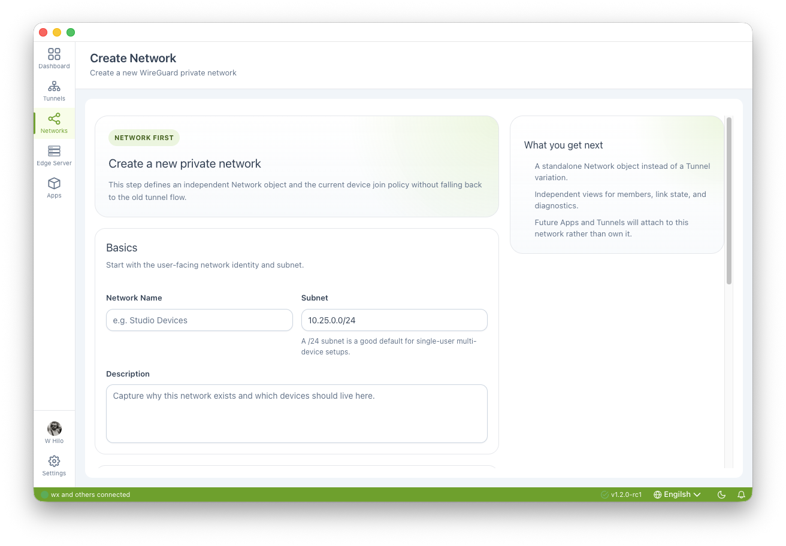
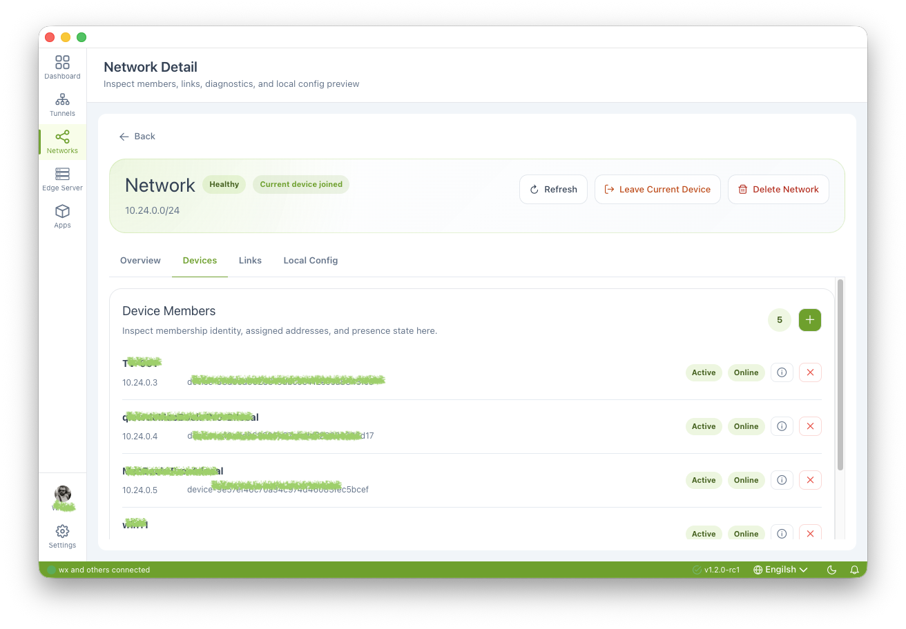
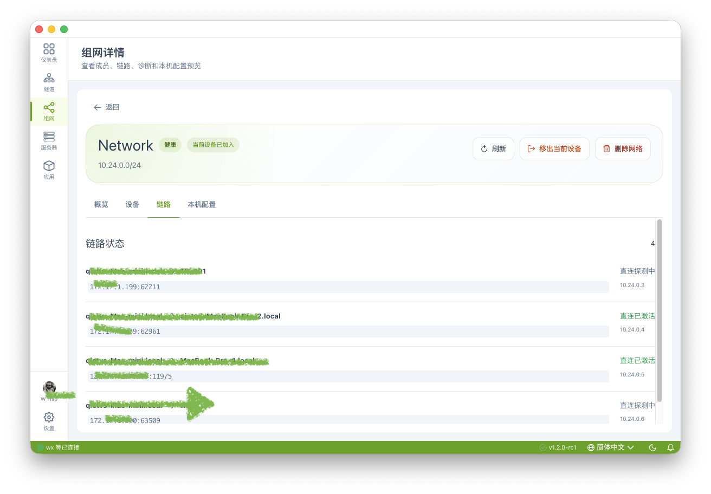
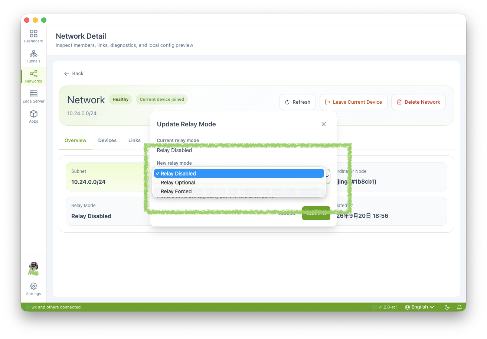
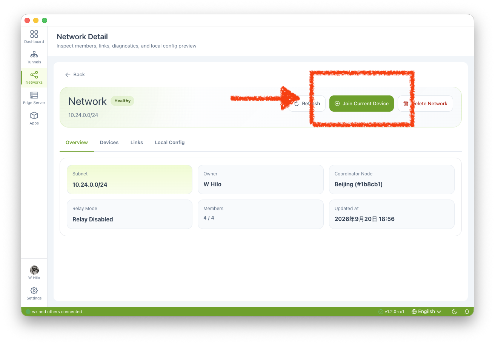

# WireGuard 組網指南

> 使用 WireGuard 構建虛擬區域網，實現裝置間安全互聯

---

## 📋 目錄

- [什麼是 WireGuard 組網](#什麼是-wireguard-組網)
- [快速開始](#快速開始)
- [進階最佳化](#進階最佳化)
- [自維護 Edge 配置](#自維護-edge-配置)
- [常見問題排查](#常見問題排查)
- [平臺特定指南](#平臺特定指南)

---

## 什麼是 WireGuard 組網

### 核心概念

WireGuard 組網是 YAT 的高階網路功能，使用 WireGuard 協議在多臺裝置間建立虛擬區域網（VPN）。與傳統的隧道模式不同，WireGuard 組網提供：

- 🌐 **虛擬區域網** - 所有成員共享同一 IP 網段
- 🔐 **端到端加密** - WireGuard 核心級加密
- 🚀 **高效能** - 接近原生的網路效能
- 🔄 **智慧路由** - 自動選擇直連或中繼路徑

### 工作原理

```
┌─────────────────────────────────────────────────────┐
│                  WireGuard 網路                      │
│                                                     │
│  ┌──────────┐         ┌──────────┐                 │
│  │ 裝置 A   │◄───────►│ 裝置 B   │                 │
│  │ 10.0.0.2 │  直連   │ 10.0.0.3 │                 │
│  └──────────┘  或中繼  └──────────┘                 │
│       │                        │                    │
│       │                        │                    │
│       ▼                        ▼                    │
│  ┌──────────┐         ┌──────────┐                 │
│  │ 裝置 C   │◄───────►│ 裝置 D   │                 │
│  │ 10.0.0.4 │         │ 10.0.0.5 │                 │
│  └──────────┘         └──────────┘                 │
│                                                     │
│  Edge 伺服器：協調 + 中繼（可選）                    │
└─────────────────────────────────────────────────────┘
```

### 與隧道模式的區別

| 特性 | 隧道模式 | WireGuard 組網 |
|------|---------|---------------|
| **連線方式** | 點對點隧道 | 虛擬區域網 |
| **IP 分配** | 無 | 自動分配網段 IP |
| **多裝置互聯** | 需要多個隧道 | 原生支援 |
| **效能** | 中等 | 接近原生 |
| **適用場景** | 單服務暴露 | 多裝置互聯、遠端管理 |

---

## 快速開始

### 前置要求

- ✅ YAT 客戶端已安裝並登入
- ✅ 已訂閱支援 WireGuard 的 Edge 伺服器
- ✅ Edge 伺服器已啟用 WireGuard 功能（參見 [Edge WireGuard 配置指南](edge/wireguard.md)）

### 步驟 1：建立 WireGuard 網路

1. 開啟 YAT 客戶端，進入 **Networks** 頁面
2. 點選 **建立網路** 按鈕
3. 填寫網路配置：
   - **網路名稱**：自定義名稱（如 "我的辦公室網路"）
   - **CIDR 網段**：建議使用 `10.0.0.0/24`（支援 254 個裝置）
   - **中繼模式**：選擇 `optional`（推薦）或 `force`

>  建立 WireGuard 網路對話方塊
> 
> 說明：顯示網路名稱、CIDR 輸入框、中繼模式選擇

4. 點選 **建立** 完成

### 步驟 2：加入本地裝置

建立網路後，需要將當前裝置加入網路：

1. 在網路卡片上點選 **加入本地裝置** 按鈕
2. 等待系統分配 IP 地址
3. 裝置狀態變為 **線上**

>   網路詳情頁面 - 加入本地裝置按鈕
> 
> 說明：顯示網路卡片、加入按鈕、成員列表

::: tip 提示
每臺裝置都需要單獨點選"加入本地裝置"才能參與組網。這是安全設計，確保只有明確授權的裝置才能加入網路。
:::

### 步驟 3：邀請其他裝置

其他裝置加入網路的步驟：

1. 在其他裝置上開啟 YAT 客戶端
2. 進入 **Networks** 頁面
3. 找到目標網路（同一 Edge 下的網路會自動同步）
4. 點選 **加入網路**
5. 等待 IP 分配完成

### 步驟 4：驗證連線

加入網路後，驗證裝置間是否可以互通：

```bash
# 在裝置 A 上 ping 裝置 B 的內網 IP
ping 10.0.0.3

# 應該看到正常的 ICMP 響應
64 bytes from 10.0.0.3: icmp_seq=1 ttl=64 time=2.5ms
```

> 網路成員列表 - 顯示線上狀態和 IP
> 
> 說明：顯示成員列表、IP 地址、線上狀態、連線質量

### 步驟 5：檢視連線詳情

點選成員可以檢視連線詳情：

- **連線路徑**：直連（direct）或中繼（relay）
- **延遲**：當前連線延遲
- **Endpoint**：對端的實際 UDP 地址
- **握手時間**：最後一次 WireGuard 握手時間

> 成員詳情對話方塊 - 顯示連線資訊
> 
> 說明：顯示成員詳情、連線路徑、延遲、endpoint

---

## 進階最佳化

### 中繼模式選擇

YAT 支援三種中繼模式，影響裝置間的連線策略：

#### 1. `optional` 模式（推薦）

```
裝置 A ──嘗試直連──► 裝置 B
          │
          ├─ 成功 → 使用直連（低延遲）
          │
          └─ 失敗 → 自動切換到 Edge 中繼
```

**特點**：
- ✅ 優先嚐試直連，效能最佳
- ✅ 直連失敗自動回退到中繼
- ✅ 適合大多數場景

**適用場景**：
- 混合網路環境（部分裝置在同一區域網）
- 跨地域但有直連可能的裝置
- 需要最佳效能的場景

#### 2. `force` 模式

```
裝置 A ──強制中繼──► Edge 伺服器 ──中繼──► 裝置 B
```

**特點**：
- ✅ 連線穩定，不受 NAT 型別影響
- ⚠️ 延遲較高（經過 Edge 中轉）
- ⚠️ 頻寬受 Edge 限制

**適用場景**：
- 對稱 NAT 環境（直連幾乎不可能）
- 需要穩定連線，不關心延遲
- 除錯和測試

#### 3. `disabled` 模式

```
裝置 A ──僅直連──► 裝置 B
          │
          └─ 失敗 → 無法連線
```

**特點**：
- ✅ 最高效能（純直連）
- ❌ 直連失敗則無法通訊
- ❌ 對 NAT 型別要求高

**適用場景**：
- 所有裝置在同一區域網
- 所有裝置都有公網 IP
- 極致效能要求

### 切換中繼模式

1. 進入網路詳情頁
2. 點選 **設定** 或 **編輯** 按鈕
3. 修改 **中繼模式**
4. 儲存後，所有成員會自動同步新配置

> 網路設定對話方塊 - 中繼模式選擇
> 
> 說明：顯示三種中繼模式選項

### 理解連線路徑

YAT 會智慧選擇最優路徑：

#### Endpoint 選擇流程圖

下圖展示了 YAT 如何為每個 peer 確定使用哪個 endpoint：

```
                    ┌──────────────────────────────────┐
                    │  Edge 從 WireGuard 握手中觀察到    │
                    │  peer 的 UDP 源地址               │
                    │  → "observed endpoint"            │
                    │    (如 1.2.3.4:57681)    │
                    └──────────────┬───────────────────┘
                                   │
                    ┌──────────────▼───────────────────┐
                    │  兩個 peer 是否共享相同的          │
                    │  observed 公網 IP？               │
                    │  (same-NAT / 同區域網檢測)        │
                    └──────┬───────────────┬───────────┘
                           │               │
                     ┌─YES─┘               └──NO──┐
                     ▼                             ▼
          ┌─────────────────────┐    ┌────────────────────────┐
          │  Edge 向兩個 peer    │    │  使用 observed endpoint │
          │  推送 gather 請求    │    │  作為 peer endpoint     │
          └──────────┬──────────┘    │  (公網直連路徑)          │
                     │               └────────────────────────┘
          ┌──────────▼──────────┐
          │  客戶端上報其         │
          │  LAN IP + WG 埠    │
          │  (如 192.168.1.5:   │
          │   51820)             │
          └──────────┬──────────┘
                     │
          ┌──────────▼──────────┐
          │  LAN endpoint 有效？  │
          │  (非 WG TUN IP,     │
          │   非過期)            │
          └──────┬─────────┬───┘
                 │         │
           ┌─YES─┘         └──NO──┐
           ▼                      ▼
  ┌──────────────────┐  ┌────────────────────────┐
  │ 使用 LAN endpoint │  │ 回退到 observed endpoint│
  │ (區域網直連路徑)   │  │ (公網直連路徑)          │
  └────────┬─────────┘  └──────────┬─────────────┘
           │                       │
           └───────────┬───────────┘
                       │
          ┌────────────▼────────────┐
          │  WireGuard 核心傳送      │
          │  PersistentKeepalive    │
          │  (每 25 秒)              │
          └────────────┬────────────┘
                       │
          ┌────────────▼────────────┐
          │  通訊正常？              │
          └──────┬────────────┬─────┘
                 │            │
           ┌─YES─┘            └──NO──┐
           ▼                         ▼
  ┌──────────────────┐    ┌──────────────────────────┐
  │ ✅ 連線成功！      │    │  WG 核心自動修正 endpoint │
  │  低延遲 LAN 路徑   │    │  為 observed IP           │
  │  或公網路徑        │    │  (自愈，≤25秒)            │
  └──────────────────┘    └────────────┬─────────────┘
                                       │
                          ┌────────────▼────────────┐
                          │  仍然不通？              │
                          │  Relay 模式回退：         │
                          │  optional → relay peer   │
                          │  force → 始終走 relay    │
                          │  disabled → 無回退        │
                          └─────────────────────────┘
```

#### Endpoint 型別

| 型別 | 來源 | 可靠性 | 示例 |
|------|------|--------|------|
| **Observed** | Edge 從 WG 握手中觀察到的 peer UDP 源地址 | ✅ 已驗證可用 | `1.2.3.4:57681` |
| **LAN** | 客戶端通過 same-NAT gather 自報 | ⚠️ 未驗證 | `192.168.1.100:51820` |
| **Relay** | Edge relay 伺服器配置 | ✅ 始終可用 | `edge.example.com:58021` |

#### 自愈機制

當 LAN endpoint 不通時，WireGuard 內建機制會自動恢復：

1. Peer 從 **observed** 公網 IP 傳送 `PersistentKeepalive`（每 25 秒）
2. 本地 WG 核心收到 keepalive → 自動更新 peer endpoint
3. 通訊恢復到 observed（公網）路徑

**恢復時間**：最長 25 秒（一個 keepalive 週期）+ 網路延遲

#### 直連路徑（Direct）

```
裝置 A (192.168.1.100:51820) ──UDP──► 裝置 B (192.168.1.101:51820)
```

**判斷標準**：
- WireGuard 握手成功
- 收到認證 payload（不僅是握手）
- 75 秒內有新資料

**優勢**：
- 延遲最低
- 頻寬最高
- 不經過 Edge

#### 中繼路徑（Relay）

```
裝置 A ──UDP──► Edge (公網IP:WG埠) ──Kernel Forward──► 裝置 B
```

**觸發條件**：
- 直連握手超時（30 秒）
- 直連無資料（75 秒）
- 強制中繼模式

**Edge 中繼機制**：
- 所有 peer 連線至同一 WG 介面埠
- Edge 通過 kernel forwarder（nftables + ip_forward）在同介面內轉發加密報文
- 無需額外 per-peer relay 埠

### P2P 會話狀態與健康指示器

網路詳情頁頂部的健康狀態 pill 反映了所有 P2P 會話的聚合狀態。理解這些狀態有助於排查連線問題。

#### 會話生命週期

兩臺裝置之間的直連協商經歷以下階段：

```
建立 → 資訊收集(gathering) → 打洞(punching) → 建立中(establishing) → 已連線(connected)
                                                          ↘ 失敗(failed)
```

| 階段 | 超時 | 說明 |
|------|------|------|
| **資訊收集** | 30 秒 | 雙方交換 endpoint 資訊（公網 IP、LAN 地址、NAT 型別） |
| **打洞** | 60 秒 | 向對端 endpoint 傳送 WireGuard 握手嘗試 |
| **建立中** | 30 秒 | 等待對端確認打洞結果 |
| **已連線** | - | 協商成功，直連路徑可用 |
| **失敗** | - | 協商超時或打洞失敗 |

#### 健康狀態含義

| 狀態 | 顏色 | 含義 |
|------|------|------|
| **Healthy** | 🟢 綠色 | 所有會話已連線 |
| **Partial** | 🟠 橙色 | 部分會話失敗，但有中繼回退或其餘連通 |
| **Error** | 🔴 紅色 | 所有會話失敗且無中繼回退 |
| **Offline** | ⚪ 灰色 | 無線上成員 |

#### 會話失敗但實際連通

在某些場景下，UI 顯示會話 "失敗" 但實際網路是連通的：

- **原因**：P2P 信令協商（endpoint 發現與打洞）和 WireGuard 實際加密握手是兩個獨立的過程。信令超時不代表隧道不通。
- **自動恢復**：Edge 的觀測迴圈（每 5 秒）會檢測 WireGuard 實際握手狀態。當檢測到隧道已連通時，會自動將 "失敗" 的會話恢復為 "已連線"。
- **恢復延遲**：最多 5-10 秒。

::: tip 提示
如果你看到 "失敗" 狀態但 `ping` 測試正常，說明 WireGuard 隧道實際已建立。等待幾秒後 UI 會自動更新。如果持續不恢復，嘗試點選 **重新整理** 按鈕。
:::

#### 排查 Health Banner

展開健康 Banner 可以檢視每個失敗/待連線會話的詳情：

- **會話端點**：`{發起方} → {目標方}`，顯示裝置名稱
- **狀態標籤**：顯示當前協商階段
- **錯誤資訊**：顯示失敗原因（如 `timeout`、`direct punch failed`）

常見錯誤資訊：

| 錯誤 | 含義 | 建議 |
|------|------|------|
| `timeout` | 協商階段超時 | 檢查 NAT 型別，考慮切換到 `force` 模式 |
| `direct punch failed, relay disabled` | 打洞失敗且無中繼 | 切換到 `optional` 模式啟用中繼回退 |
| `direct punch failed, relay fallback remains active` | 打洞失敗但中繼可用 | 正常，流量正通過中繼轉發 |

### 最佳化建議

#### 1. 同一區域網裝置

如果多臺裝置在同一區域網：

- ✅ 使用 `optional` 或 `disabled` 模式
- ✅ Edge 會自動檢測 Same-NAT 裝置
- ✅ 裝置間會優先使用 LAN 地址直連

>  Same-NAT 檢測提示
> 
> 說明：顯示檢測到同一 NAT 後的裝置對

#### 2. 跨地域裝置

如果裝置分佈在不同地域：

- ✅ 使用 `optional` 模式
- ✅ 允許自動回退到中繼
- ✅ 考慮部署地理位置居中的 Edge

#### 3. 對稱 NAT 環境

如果裝置在對稱 NAT 後：

- ✅ 使用 `force` 模式
- ✅ 所有流量通過 Edge 中繼
- ✅ 連線穩定但延遲較高

#### 4. 效能敏感場景

如果需要最佳效能：

- ✅ 確保裝置間可以直連
- ✅ 使用 `optional` 或 `disabled` 模式
- ✅ 檢查防火牆是否放行 UDP 流量

---

## 自維護 Edge 配置

### Edge WireGuard 功能要求

自維護 Edge 需要啟用 WireGuard 功能：

```yaml
# Edge 配置檔案 (config.yaml)
proxy:
  wireguard:
    enabled: true              # 啟用 WireGuard 功能
    relay:
      enabled: true            # 啟用業務 relay
      interface_prefix: "wg-yat0"
      listen_port_base: 58021  # WG 介面埠起始
      key_dir: "/var/lib/yat/wg-keys"
      public_endpoint: "edge.example.com"  # Edge 公網地址
```

### 關鍵配置說明

#### 1. `enabled: true`

啟用 WireGuard 功能。Edge 啟動後會：
- 建立 WireGuard observation interface
- 初始化 relay manager
- 開始 endpoint 觀測迴圈

#### 2. `relay.enabled`

控制業務 relay 是否啟用：

- `true`：啟用 kernel forwarder 中繼轉發（nftables + ip_forward）
- `false`：僅保留 observation interface，不支援 relay

::: tip 提示
即使 `relay.enabled=false`，Edge 仍然可以觀測 endpoint。只是客戶端無法使用中繼路徑。
:::

#### 3. `listen_port_base: 58021`

WireGuard 介面埠起始值。每個網路佔用一個埠：
- 網路 1: 58021
- 網路 2: 58022
- ...

**防火牆要求**：
```bash
# 放行 WG 介面埠
sudo ufw allow 58021:58100/udp
```

#### 4. `public_endpoint`

Edge 的公網地址。客戶端使用此地址連線 relay：

```
客戶端 A ──UDP──► edge.example.com:58021 ──Kernel Forward──► 客戶端 B
```

**格式要求**：
- ✅ `edge.example.com`
- ✅ `1.2.3.4`
- ✅ `1.2.3.4:8000`（如果 Edge 在非標準埠）
- ❌ `http://edge.example.com`（不要帶協議）

### 部署驗證

部署 Edge 後，驗證 WireGuard 功能：

```bash
# 1. 檢查 Edge 日誌
journalctl -u yat-edge -f | grep -i wireguard

# 應該看到：
# "WireGuard functionality enabled"
# "Relay manager initialized"
# "Observation loop started"

# 2. 檢查 WireGuard 介面
sudo ip link show | grep wg-yat

# 應該看到類似：
# wg-yat0-abc123: <POINTOPOINT,NOARP,UP,LOWER_UP> mtu 1420

# 3. 檢查監聽埠
sudo ss -ulnp | grep yat-edge

# 應該看到：
# udp  0  0  0.0.0.0:58021  0.0.0.0:*  users:(("yat-edge",pid=1234))
```

::: tip 說明
Edge relay 使用 kernel forwarder 在同 WG 介面內轉發 peer 間流量，
無需額外的 per-peer relay 埠。只需放行 WG 介面埠即可。
:::

### 常見配置問題

#### Q: Edge 啟動失敗，提示 "WireGuard initialization failed"

**原因**：
- 核心不支援 WireGuard（需要 Linux 5.6+）
- 缺少許可權建立網路介面

**解決**：
```bash
# 檢查核心版本
uname -r

# 如果 < 5.6，升級核心
sudo apt install linux-image-generic

# 確保以 root 執行 Edge
sudo systemctl start yat-edge
```

#### Q: 客戶端無法連線 relay

**原因**：
- 防火牆未放行埠
- `public_endpoint` 配置錯誤
- Edge 未啟用 relay

**解決**：
```bash
# 1. 檢查防火牆
sudo ufw status
sudo ufw allow 58021:60999/udp

# 2. 驗證 public_endpoint
curl -I http://edge.example.com

# 3. 檢查 Edge 配置
grep -A 10 "wireguard:" /etc/yat/config.yaml
```

#### Q: 中繼模式切換後不生效

**原因**：
- 配置未同步到所有成員
- 客戶端未重新整理執行態

**解決**：
1. 在 Edge 上修改中繼模式
2. 所有客戶端點選 **同步本地 Adapter** 按鈕
3. 等待 5-10 秒讓配置生效

---

## 常見問題排查

### 問題 1：需要手動點選"加入本地裝置"才能參與組網

**現象**：
建立網路後，當前裝置沒有自動加入網路，需要手動點選"加入本地裝置"。

**原因**：
這是安全設計。YAT 不會自動將裝置加入網路，需要使用者明確授權。

**解決**：
1. 在網路卡片上找到 **加入本地裝置** 按鈕
2. 點選並等待 IP 分配完成
3. 裝置狀態變為 **線上** 即表示加入成功

> > 加入本地裝置按鈕
> 
> 說明：顯示網路卡片上的加入按鈕

### 問題 2：組網不成功，嘗試"同步本地 Adapter"

**現象**：
裝置已加入網路，但無法 ping 通其他成員。

**原因**：
- 本地 WireGuard 配置未同步
- Helper daemon 未正確 apply 配置
- 執行態與配置不一致

**解決**：
1. 進入網路詳情頁
2. 找到 **同步本地 Adapter** 按鈕（通常在配置面板或操作選單中）
3. 點選並等待同步完成
4. 檢查是否出現 WireGuard 介面

**macOS**：
```bash
# 檢查 WireGuard 介面
ifconfig | grep -A 5 utun

# 應該看到類似：
# utun3: flags=8051<UP,POINTOPOINT,RUNNING,MULTICAST> mtu 1420
#     inet 10.0.0.2 --> 10.0.0.1 netmask 0xffffffff
```

**Windows**：
```powershell
# 檢查網路介面卡
Get-NetAdapter | Where-Object {$_.InterfaceDescription -like "*WireGuard*"}

# 應該看到類似：
# Name  InterfaceDescription                  Status
# ----  --------------------                  ------
# YAT   WireGuard Tunnel: yat-network1        Up
```

### 問題 3：macOS WireGuard 除錯

**現象**：
macOS 上 WireGuard 介面未建立或無法通訊。

**除錯步驟**：

#### 1. 檢查 Helper Daemon

```bash
# 檢查 yat-wg-helperd 是否執行
ps aux | grep yat-wg-helper

# 應該看到：
# root  1234  0.0  0.1  /var/run/yat-wg-helperd

# 如果未執行，手動啟動
sudo /Library/Application\ Support/yat/yat-wg-helperd
```

#### 2. 檢查 Unix Socket

```bash
# 檢查 socket 檔案
ls -l /var/run/yat-wg-helper.sock

# 應該看到：
# srw-r--r--  1 root  wheel  0  9 18 10:00 /var/run/yat-wg-helper.sock
```

#### 3. 檢視 Helper 日誌

```bash
# 檢視 helper daemon 日誌
log show --predicate 'process == "yat-wg-helperd"' --last 5m

# 或在 YAT 客戶端中檢視：
# 設定 > 系統 > WireGuard Helper > 檢視日誌
```

#### 4. 檢視 Helper 日誌確認啟動成功

```bash
# macOS：通過 unified log 檢視
log show --predicate 'process == "yat-wg-helperd"' --last 5m

# macOS：直接檢視日誌檔案
tail -f /Library/Logs/YAT/yat-wg-helperd.log

# Windows：檢視日誌檔案
type %ProgramData%\YAT\helper\wireguard\yat-wg-helperd.log

# 或在 YAT 客戶端中檢視：
# 設定 > 系統 > WireGuard Helper > 檢視日誌
```

::: tip 提示
`yat-wg-helperd` 內嵌了 boringtun 引擎，不存在獨立的 boringtun 程式。
確認日誌中出現 `started` 或 `apply` 成功資訊即表示 helper daemon 正常執行。
:::

#### 6. 強制重新 Apply

```bash
# 刪除所有 WireGuard 介面
sudo ifconfig utun3 down
sudo ifconfig utun3 destroy

# 在 YAT 客戶端中點選"同步本地 Adapter"
# 或重啟 YAT 客戶端
```

### 問題 4：Windows 檢查網路介面卡是否組建

**現象**：
Windows 上 WireGuard 網路未正常工作。

**檢查步驟**：

#### 1. 檢查網路介面卡

```powershell
# 方法 1：PowerShell
Get-NetAdapter | Where-Object {$_.InterfaceDescription -like "*WireGuard*"}

# 方法 2：命令列
netsh interface show interface

# 方法 3：裝置管理器
# 開啟裝置管理器 > 網路介面卡 > 查詢 "WireGuard" 相關裝置
```

**期望結果**：
```
Name       InterfaceDescription         Status
----       --------------------         ------
YAT-NET1   WireGuard Tunnel: yat-net1   Up
```

#### 2. 檢查 IP 配置

```powershell
# 檢視 WireGuard 介面卡的 IP 配置
Get-NetIPAddress -InterfaceAlias "YAT-NET1"

# 應該看到分配的內網 IP
# IPAddress      : 10.0.0.2
# PrefixLength   : 24
# AddressFamily  : IPv4
```

#### 3. 檢查路由表

```powershell
# 檢視路由表
Get-NetRoute -InterfaceAlias "YAT-NET1"

# 應該看到網路網段的路由
# DestinationPrefix  NextHop  RouteMetric
# 10.0.0.0/24        0.0.0.0  256
```

#### 4. 測試連通性

```powershell
# Ping 其他成員
Test-Connection -ComputerName 10.0.0.3 -Count 4

# 如果失敗，檢查防火牆
# Windows Defender 防火牆可能阻止 ICMP
New-NetFirewallRule -DisplayName "Allow ICMP" -Direction Inbound -Protocol ICMPv4 -Action Allow
```

#### 5. 檢查 Wintun 驅動

```powershell
# 檢查 Wintun 驅動（安裝程式已自動包含，無需手動安裝）
Get-WindowsDriver -Online | Where-Object {$_.ProviderName -like "*Wintun*"}

# 正常情況下安裝 YAT 客戶端後驅動已就緒
# 如確實缺失，可重新執行 YAT 安裝程式修復
```

#### 6. 重啟 WireGuard 服務

```powershell
# 停止 YAT 客戶端
Stop-Process -Name "YAT"

# 刪除 WireGuard 介面卡
Remove-NetAdapter -Name "YAT-NET1" -Confirm:$false

# 重新啟動 YAT 客戶端
Start-Process "C:\Program Files\YAT\YAT.exe"

# 等待 10 秒，檢查介面卡是否重新建立
Get-NetAdapter | Where-Object {$_.InterfaceDescription -like "*WireGuard*"}
```

### 問題 5：Same-NAT LAN 是否組網成功觀察

**現象**：
兩臺裝置在同一區域網（Same-NAT），但不確定是否成功使用 LAN 地址直連。

**觀察方法**：

#### 1. 檢視成員詳情

在 YAT 客戶端中：
1. 進入網路詳情頁
2. 點選目標成員
3. 檢視 **連線資訊**

**期望看到**：
```
連線路徑：direct
Endpoint：192.168.1.101:51820  （LAN 地址）
延遲：< 5ms
```

如果 Endpoint 是公網 IP，說明未使用 LAN 地址。

> 成員詳情 - 顯示 LAN endpoint
> 
> 說明：顯示連線路徑為 direct，endpoint 為 LAN 地址

#### 2. 檢查 Edge 日誌

```bash
# 在 Edge 上檢視日誌
journalctl -u yat-edge -f | grep -i "same-nat"

# 應該看到：
# "Detected same-NAT peers: peerA=1.2.3.4, peerB=1.2.3.4"
# "Triggering LAN endpoint gathering"
```

#### 3. 驗證 LAN 連通性

```bash
# 在裝置 A 上
ping 192.168.1.101  # 裝置 B 的 LAN 地址

# 應該成功
64 bytes from 192.168.1.101: icmp_seq=1 ttl=64 time=0.5ms
```

#### 4. 檢查 WireGuard 介面

**macOS**：
```bash
# 檢視 WireGuard peer 的 endpoint
sudo wg show all

# 應該看到：
# interface: wg-yat0-abc123
# peer: <peer-B-public-key>
#   endpoint: 192.168.1.101:51820  （LAN 地址）
```

**Windows**：
```powershell
# 使用 WireGuard CLI（如果安裝）
& "C:\Program Files\WireGuard\wireguard.exe" /showall

# 或在 YAT 配置面板中檢視
```

#### 5. 強制 LAN 發現

如果未檢測到 Same-NAT：

1. 確保兩臺裝置都已加入網路
2. 等待 30 秒讓 Edge 完成 endpoint 觀測
3. 在兩臺裝置上分別點選 **同步本地 Adapter**
4. 檢查 Edge 日誌是否觸發 LAN gathering

### 問題 6：Endpoint 未被觀測到

**現象**：
成員的 endpoint 顯示為空或 "未觀測到"。

**原因**：
- 客戶端未傳送 WireGuard 握手
- Edge observation interface 未正常工作
- 防火牆阻止 UDP 流量

**解決**：

#### 1. 檢查客戶端 WireGuard 狀態

```bash
# macOS
sudo wg show all

# 應該看到 peer 和 endpoint
# peer: <public-key>
#   endpoint: 1.2.3.4:51820

# Windows
# 檢視 YAT 配置面板中的 WireGuard 狀態
```

#### 2. 檢查 Edge 觀測介面

```bash
# 在 Edge 上
sudo wg show wg-yat0-abc123

# 應該看到所有 peer
# peer: <peer-A-key>
#   endpoint: 1.2.3.4:51820
# peer: <peer-B-key>
#   endpoint: 5.6.7.8:51820
```

#### 3. 檢查防火牆

```bash
# Edge 防火牆
sudo ufw status
sudo ufw allow 58021:60999/udp

# 客戶端防火牆
# macOS: 系統設定 > 網路 > 防火牆 > 允許傳入連線
# Windows: Windows Defender 防火牆 > 允許應用通過防火牆
```

#### 4. 強制重新整理

1. 在客戶端點選 **同步本地 Adapter**
2. 等待 5-10 秒
3. 在 Edge 上檢查日誌：`journalctl -u yat-edge -f | grep observation`
4. 應該看到 endpoint 更新

### 問題 7：中繼轉發失敗

**現象**：
使用 `force` 模式，但無法通過 Edge 中繼通訊。

**原因**：
- Edge relay listener 未啟動
- 目標 endpoint 未被觀測到
- 嚴格 NAT 阻止 relay 流量

**解決**：

#### 1. 檢查 Edge relay 狀態

```bash
# 檢查 relay listener 是否監聽
sudo ss -ulnp | grep yat-edge

# 應該看到：
# udp  0  0  0.0.0.0:58021  0.0.0.0:*  users:(("yat-edge",pid=1234))
```

::: tip 說明
Edge relay 使用 kernel forwarder 在同 WG 介面內轉發，所有 peer 共享同一 WG 埠。
無需檢查額外的 per-peer relay 埠。
:::

#### 2. 檢查目標 endpoint

```bash
# 在 Edge 上檢視目標 peer 的 endpoint
sudo wg show wg-yat0-abc123 | grep -A 2 "peer: <target-key>"

# 應該看到：
# endpoint: 1.2.3.4:51820
```

如果 endpoint 為空，relay 無法轉發。

#### 3. 檢查 relay 日誌

```bash
# 檢視 relay 轉發日誌
journalctl -u yat-edge -f | grep -i relay

# 應該看到 nft counter 增長：
# yat_relay  chain forward  accept
```

::: tip 說明
Edge relay 使用 kernel forwarder 在同 WG 介面內轉發，所有 peer 共享同一 WG 埠。
無需檢查額外的 per-peer relay 埠。
:::

#### 4. 理解當前限制

::: warning 重要提示
Kernel forwarder 依賴 `ip_forward` 在同 WG 介面內轉發流量，
源 IP 保持不變。但在嚴格 endpoint-dependent NAT 環境下，
peer 直連可能仍然受限。建議優先使用 `optional` 模式。
:::

**臨時解決方案**：
- 使用 `optional` 模式，優先嚐試直連
- 部署地理位置居中的 Edge，減少 NAT 層級
- 確保目標裝置的 endpoint 已被觀測到

---

## 平臺特定指南

### macOS

#### 前提條件

- 已加入至少一個 WireGuard 網路
- Helper daemon 需要管理員許可權（首次加入網路時 YAT 會自動請求提權）

#### 除錯資訊

| 專案 | 路徑 |
|------|------|
| Helper 日誌 | `/Library/Logs/YAT/yat-wg-helperd.log` |
| WG 配置檔案 | `~/Library/Application Support/yat/wireguard/networks/<networkId>/wg.conf` |

#### 檢視 WireGuard 狀態

```bash
# 安裝 WireGuard 官方 macOS 客戶端後可用
# https://apps.apple.com/app/wireguard/id1451685025
sudo wg show all
```

### Windows

#### 前提條件

- 已加入至少一個 WireGuard 網路
- Helper daemon 需要管理員許可權（YAT 安裝程式已自動配置）

#### 除錯資訊

| 專案 | 路徑 |
|------|------|
| Helper 日誌 | `%ProgramData%\YAT\helper\wireguard\yat-wg-helperd.log` |
| WG 配置檔案 | `%APPDATA%\yat\wireguard\networks\<networkId>\wg.conf` |

#### 檢視 WireGuard 狀態

```powershell
# 通過 Wintun 虛擬網路介面卡檢視發包情況
Get-NetAdapter | Where-Object {$_.InterfaceDescription -like "*WireGuard*"}

# 在 Windows 裝置管理器 > 網路介面卡 中也可看到 Wintun 介面卡
```

### Linux

#### 前提條件

- Linux 5.6+（核心原生支援 WireGuard）
- Edge 程式需要 root 許可權

```bash
# 檢視 WireGuard 介面狀態
sudo wg show all

# 檢視介面詳情
sudo ip link show type wireguard
```

---

## 💡 最佳實踐

### 1. 網路規劃

- ✅ 使用 `/24` 網段（支援 254 個裝置）
- ✅ 避免與現有網段衝突（如 `192.168.1.0/24`）
- ✅ 為不同用途建立不同網路（辦公、測試、生產）

### 2. 安全建議

- ✅ 定期審查網路成員
- ✅ 及時移除不活躍裝置
- ✅ 使用強密碼保護 YAT 賬戶
- ✅ 啟用兩步驗證（如果支援）

### 3. 效能最佳化

- ✅ 優先使用直連路徑
- ✅ 選擇地理位置居中的 Edge
- ✅ 避免在對稱 NAT 環境下使用直連
- ✅ 定期監控連線質量

### 4. 故障預防

- ✅ 保持 YAT 客戶端更新
- ✅ 定期檢查 Edge 健康狀態
- ✅ 備份重要配置
- ✅ 記錄網路拓撲和 IP 分配

---

## 📚 相關檔案

- [傳輸模式](transport-modes.md) - 瞭解 Relay/P2P/WireGuard 的區別
- [Edge 管理](edge/management.md) - 部署和管理 Edge 伺服器
- [多裝置與角色](multi-device-roles.md) - 多裝置協作和許可權管理
- [常見問題](faq.md) - 解決其他常見問題

---

*最後更新：2026-09-18*
*YAT Team - 讓內網穿透更簡單*
